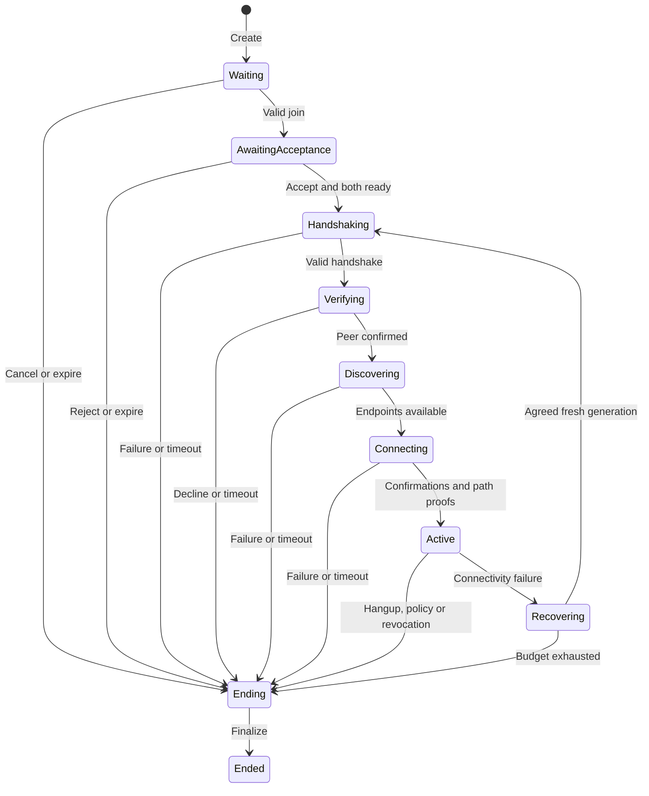

# Proposed call and peer connection lifecycle

> Superseded on 2026-10-17 by [Call implementation proposed V2](call_implementation_proposed_v2.md). This initial proposal is retained for reference, not as a second current specification. V2 replaces its code-only scope, short-code assumptions, one-attempt recovery, unspecified leases, and earlier wire/audio details. Follow V2 where they differ; neither document verifies implementation.

**Status: proposed design, 2026-10-16; not a verified implementation.** [Session management](session-management.md) owns enrollment, account/guest access, tokens and revocation. This document starts with an authenticated device and ends with a released call. [system.md](system.md) remains the canonical architecture overview.

Newer working-tree Android native Noise/direct-IPv6 code is a partial implementation: readiness, verification ordering, replay admission, recovery and cleanup require completion. Guest support is proposed here but deferred in that backend. The [September baseline](current-implementation.md) describes older WebRTC code and must not be treated as this design's verification.

## 1. Scope and separate verification gates

First scope: two-party, code-based, direct IPv6 UDP voice between registered or guest devices. Both require eligible public IPv6 connectivity. Relay/IP-hidden mode, arbitrary file transfer, contacts/ringing, closed-app incoming calls, video, groups and web are future work. Direct failure ends this version's call; no fallback is implied.

| Gate | Evidence | Does not prove |
| --- | --- | --- |
| Device enrolled | Private-key possession proof and active device record | Real-world identity of a guest |
| API authorized | Valid session/device and permission | Intended remote peer identity |
| Participant accepted | Membership and creator consent | Encryption or reachability |
| Peer authenticated | Context-bound handshake and trusted/verified device key | Reachability of an advertised address |
| Path validated | Fresh protected challenges/responses in both directions | Permanent ownership of an IP |

A locator, public key alone, IP address or call ID grants no trust. Explain before setup that direct mode exposes IP/port information to the peer. Microphone capture and voice transmission require all gates plus microphone permission.

## 2. Ownership and identifiers

Backend owns call ID, participant/device/authorizing-session bindings, invitation, consent, policy, lifecycle and leases. Endpoints own private keys, temporary handshake secrets, directional media keys, counters/replay state and audio. Rendezvous observes/forwards authorized endpoints; it never receives audio or media keys.

Separate invitation locator, call ID, participant ID, purpose-bound ticket, connection generation/key epoch, and path challenge. Bind asynchronous work to identity and call generations; reject delayed responses or packets from older calls/generations.

## 3. Create, join and consent

1. A requests a call with current credentials, supported media/routing profile and an idempotency key.
2. Backend checks session/device, policy, rate limits and conflicting calls. Atomically create call, creator membership, expiring active-call reservation and invitation.
3. Return code and server expiry. Proposed invitation lifetime: 10 minutes. Display/share in a dedicated waiting screen.
4. B authenticates and enters the code. Check validity/expiry/state, device/policy, self-join and conflicting calls. Atomically admit at most one joiner and consume the invitation.
5. Show A the join request with an honest registered/guest label. Expose only consent-required metadata before acceptance; withhold peer keys/endpoints until permitted.
6. A accepts/rejects. Acceptance fixes participant device bindings and starts secure setup. B's join expresses a request to connect, not automatic microphone permission or peer trust.
7. Rejection, cancellation or expiry releases both reservations idempotently. First version creates a new invitation after rejection; do not silently recycle participants.

Every action checks membership, device/session, role, prior state and idempotency. Account names are not independent proof of device keys. Guest calls use the same cryptographic verification.

## 4. Signaling readiness and peer authentication

1. Each accepted participant obtains a short-lived single-use signaling ticket through its API session. Bind to purpose, call, participant, device, session, generation and expiry; consume atomically.
2. Connect over protected WebSocket transport. Reconnect obtains a fresh ticket; unauthorized frames are never forwarded.
3. Prepare native handshake state on both devices. Exchange generation-bound readiness before starting; socket presence is insufficient.
4. Run proposed `Noise_XX_25519_ChaChaPoly_SHA256` through a reviewed library, with fresh ephemeral material and fixed roles.
5. Bind canonical application/version, call ID, participant/device identities and keys, roles, routing policy, media profile and generation through the handshake's supported context mechanisms.
6. Check remote static key against membership and trust state. Establish separate A-to-B and B-to-A traffic keys; no media keys go to signaling.
7. First contact: compare a transcript-derived verification code through an independently trusted channel; both users confirm. Decline/mismatch aborts. Comparing values only through potentially compromised signaling is not independent verification.
8. Matching previously verified device keys may use remembered trust. Changed keys require warning and fresh verification; persist trust only after successful confirmation for the intended binding.

The proposed Noise choice is not a completed reviewed application protocol. Before implementation/release, specify exact context encoding, verification-code derivation/strength, handshake limits, key usage limits and test vectors in [protocol.md](protocol.md). No weaker fallback is permitted. Device enrollment proof is a separate unresolved protocol in session management.

## 5. IPv6 discovery and path verification

After intended-peer verification, obtain a purpose-bound short-lived rendezvous ticket/secret. Atomically consume with a defined retry/idempotency policy.

1. Select network and bind UDP socket; reject unsuitable local addresses and ensure public IPv6 availability.
2. Send authenticated registration from that socket to the configured IPv6 rendezvous. Bind requests/responses to nonce, ticket, call, generation and expiry.
3. Rendezvous records observed source IPv6/port, not an address claimed in request data. Return authenticated acknowledgement and forward authorized endpoints.
4. Configure peer destination before sending protected confirmation/controls. Hold local verification confirmation until a destination exists.
5. Both send fresh unpredictable encrypted challenges with bounded retries. Responses must match outstanding challenge, generation and endpoint; an arbitrary authenticated ACK is insufficient.
6. Require bidirectional reachability and both peers' verification confirmation before audio begins.

This binds usable reachability to a cryptographic session, not permanent IP ownership. Reject unsolicited endpoint updates; never redirect media based on a connection ID or new address alone. Public IPv6 does not bypass firewalls. Failed bounded validation ends the direct call clearly.

## 6. Successful combined flow

```mermaid
sequenceDiagram
    participant A as Device A
    participant S as Backend / rendezvous
    participant B as Device B
    Note over A,B: Enrolled devices; valid registered/guest sessions
    A->>S: Create call
    S-->>A: Code and expiry
    Note over A,B: Share locator externally
    B->>S: Authenticated join
    S-->>A: Join request
    A->>S: Accept B
    A->>S: Ticketed signaling; prepared and ready
    B->>S: Ticketed signaling; prepared and ready
    Note over A,B: Noise handshake via S; check keys and context
    Note over A,B: Compare code or match verified device trust
    A->>S: Authenticated UDP registration
    B->>S: Authenticated UDP registration
    S-->>A: B's observed endpoint
    S-->>B: A's observed endpoint
    A->>B: Protected challenge and confirmation
    B->>A: Response, reverse challenge and confirmation
    A->>B: Reverse response
    Note over A,B: All gates pass; microphone permission granted
    A->>B: Encrypted Opus audio
    B->>A: Encrypted Opus audio
    A->>B: Protected termination, best effort
    A->>S: Idempotent end
    Note over A,B: Stop media; release resources and temporary keys
```

## 7. Audio and packet processing

Send: capture permitted audio, encode bounded Opus frame, allocate unique directional packet number, authenticate canonical header, encrypt and send on validated path. Mute suppresses voice while permitted liveness/control continues.

Receive: bound size/parsing; select generation/key; authenticate; atomically apply replay admission; validate type/schema/state; buffer audio within limits; decode/play. Failed authentication cannot advance trusted replay state, reach the decoder or occupy unbounded queues. Authenticated malicious peers still receive codec/resource limits.

Explicit permitted types cover audio, probes, verification, keepalive, acknowledgements and termination. Never encrypt different plaintext with the same key/nonce. Identical ciphertext retransmission is deduplicated; control reliability must not rely on duplicate packets being dispatched again. Specify recovery from lost control responses.

Candidate starting audio settings are mono Opus, 48 kHz, 20 ms frames, 24 kbit/s. Datagram bounds, jitter buffering, pacing/congestion response, loss behavior, sequence exhaustion and key renewal require exact profile/tests. Audio transfer does not authorize generic files or remote commands.

## 8. Lifecycle, deadlines and leases



Every setup stage has bounded server/client deadlines: invitation, acceptance, readiness/handshake, human verification, discovery and connectivity. Only the proposed 10-minute invitation baseline is selected here; remaining values need review/testing. End/cancel is permitted from every nonterminal stage. Delayed success cannot resurrect an ended call.

Backend reservations/calls use renewable leases checked against participant ownership and active authorizing sessions. Workers or transactional expiry-on-access free stale active-call slots after crashes. Track each participant's readiness/activation; a creator report alone is not proof both have audio.

Finalize lease interval, renewal cadence, outage grace, liveness thresholds and quotas before implementation. Compliant clients stop at the permitted deadline without renewal. Infrastructure cannot instantly prevent two uncooperative direct endpoints from communicating.

## 9. Exceptions and recovery

| Event | Required behavior |
| --- | --- |
| Invalid code/foreign call/conflicting call | Reject before sensitive metadata; release only authorized resources |
| Concurrent join/accept/end | Atomic transition, deterministic winner, idempotent terminal result |
| Lost create/join response | Idempotent retry without duplicate reservations |
| Microphone denial/user cancellation | Stop setup, no capture, release slots |
| Key/context/code mismatch | Abort, destroy temporary secrets, no weaker fallback |
| Signaling loss during setup | Bounded reconnect, fresh ticket, mutually agreed generation |
| Registration response lost | Bounded authenticated retry with explicit consumed-ticket recovery |
| IPv6 unavailable/UDP blocked | Clear failure after validation budget |
| Loss/duplicates/reordering/forged numbers | Bounded handling; authentication before replay mutation |
| Peer vanishes | Authenticated liveness detection, bounded recovery then end |
| Network/IP changes | Pause media; fresh coordinated handshake/keys and path validation |
| Access refresh succeeds | Preserve media keys; use replacement credentials for API calls |
| Session/device revoked | Stop on notification/check; lease bounds continued compliant use |
| Backend outage | Continue only within agreed lease grace, then stop |
| Old packet/callback | Reject old call/identity generation |
| Notification hangup/audio interruption | Unified finalizer; explicit interruption policy |
| Crash/restart | Lease releases server slots; first version starts a new call |

Proposed first version allows one coordinated recovery attempt with a finite overall deadline. Both peers agree generation/roles through authorized signaling; local epoch increments alone are insufficient. Fresh keys permit new counters; unchanged keys never permit counter reset. Multi-instance operation needs shared participant readiness/generation, not process-local socket counts.

## 10. Teardown

Immediately stop capture/outgoing audio. Best-effort authenticated peer termination and backend end must not delay local shutdown. Stop playback, release audio focus/background service, close sockets/signaling, cancel timers/retries, discard buffered media/temporary keys and clear call state. Do not disable all sending before scheduling the only termination packet.

Backend end is idempotent: check membership, store minimal reason/timestamps, invalidate invitations/tickets, release both active-call slots. In-app hangup, notification hangup, logout, peer end, failure, timeout and revocation use one finalizer. Lost messages are handled by liveness/lease expiry. Retain separately managed device identity and peer trust according to session policy.

## 11. Execution and acceptance

Implement: session/device prerequisites; atomic invitation/consent; ready-gated handshake/trust; rendezvous/path proof; protected audio; leases/recovery/finalizer. Specify exact protocol/security/deployment contracts before release.

Test registered/registered, guest/guest and mixed calls; first/remembered/changed keys; substitution/context tampering; ticket replay; join races; permission denial; malformed/replayed/reordered packets; lost responses; firewall failure; network change; refresh/revocation; outage; crash; simultaneous end; notification hangup; stale callbacks; and shared readiness if multiple backend instances are supported.

Physical two-device validation and an explicitly authorized test backend/database follow mocked/unit checks. Preparing this document does not apply migrations or verify working calls. Remaining profile, timing, lease, retention and trust decisions are tracked in [decisions.md](decisions.md).
