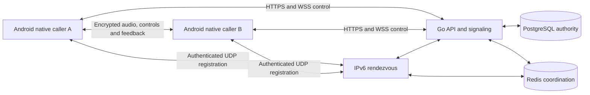
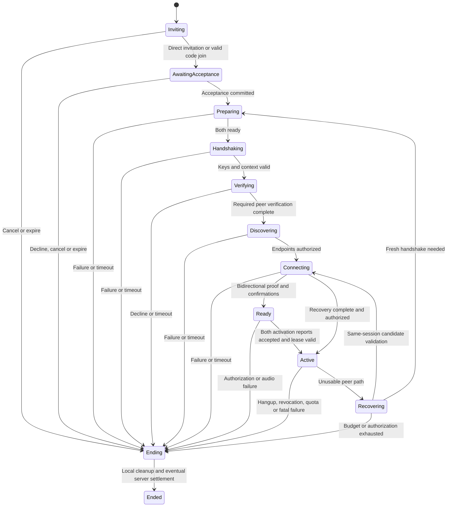

# Call implementation proposed V2

> User-flow decisions consolidated 2026-10-31: [user-management plan](user-management-implementation-plan.md) resolves registered recovery/account lifecycle and caller-permission UX: adding a contact explicitly grants directional future ringing, removing it revokes that grant, and blocking overrides admission. Unknown requests remain non-ringing and show Accept/Block when opened; acceptance alone does not grant future ringing or trust. Username changes preserve UUID-based relationships. Registered direct-IPv6 duration is unlimited under all existing security limits; guest accounting persists through conversion. Visible registered history rolls off after 90 days. Account changes/recovery/deletion must propagate through call bindings/finalization; media, lease and protocol requirements below remain unchanged and need real integration evidence.

> Session integration (2026-10-20): [session V2](session-management-proposed-v2.md) is the accepted user/device/session counterpart. It supplies weekly guest policy, recovery/persistence, recognition buckets, one-profile binding, reminders/gating and per-API limits. This update preserves calling V2 peer/media/security defaults; earlier user-flow policy deferrals are settled only as explicitly specified there.

**Status: accepted design direction with provisional test defaults, 2026-10-17. This is an implementation plan, not evidence that these flows are implemented, secure, or deployed.**

This document consolidates the calling decisions reviewed with the user. It supersedes the initial [call/peer proposal](call-peer-connection.md) for the current calling scope. [system.md](system.md) remains the canonical whole-system overview. [Session V2](session-management-proposed-v2.md) owns the separate account/device lifecycle; this plan specifies the contract calling needs from it. The [September source baseline](current-implementation.md) is historical, and the newer native working-tree code is only a partial implementation.

## Contents

1. [Scope and architecture](#1-scope-and-architecture)
2. [Prerequisites, ownership, and identifiers](#2-prerequisites-ownership-and-identifiers)
3. [Safety gates and state machine](#3-safety-gates-and-state-machine)
4. [Invitations and caller permissions](#4-invitations-and-caller-permissions)
5. [Signaling and ticket recovery](#5-signaling-and-ticket-recovery)
6. [Handshake and canonical context](#6-handshake-and-canonical-context)
7. [Verification links, QR, and remembered trust](#7-verification-links-qr-and-remembered-trust)
8. [IPv6 endpoint discovery and path proof](#8-ipv6-endpoint-discovery-and-path-proof)
9. [Packet format, nonces, and replay](#9-packet-format-nonces-and-replay)
10. [Native audio and quality adaptation](#10-native-audio-and-quality-adaptation)
11. [Control acknowledgements and retries](#11-control-acknowledgements-and-retries)
12. [Network changes and migration](#12-network-changes-and-migration)
13. [Liveness and bounded recovery](#13-liveness-and-bounded-recovery)
14. [Key renewal](#14-key-renewal)
15. [Authorization leases and one-phone enforcement](#15-authorization-leases-and-one-phone-enforcement)
16. [Tiers, duration, and usage accounting](#16-tiers-duration-and-usage-accounting)
17. [Guest interruptions and process loss](#17-guest-interruptions-and-process-loss)
18. [Termination and safety intervention](#18-termination-and-safety-intervention)
19. [Persistence and backend failure](#19-persistence-and-backend-failure)
20. [Defaults and deadline precedence](#20-defaults-and-deadline-precedence)
21. [Implementation phases and source map](#21-implementation-phases-and-source-map)
22. [Acceptance and security validation](#22-acceptance-and-security-validation)
23. [Specification completion and deferred work](#23-specification-completion-and-deferred-work)

## 1. Scope and architecture

### First delivery

- Expo/React Native UI with a custom Android native voice module; Go control backend.
- PostgreSQL for authoritative records; Redis for temporary tickets, coordination, notifications, presence, and rate limits.
- Two-party, direct IPv6 UDP voice for registered users and authenticated guests.
- Native Android capture/playback with proposed bundled libopus; no WebRTC media dependency in this design.
- Direct invitations for registered users while apps are connected; code/link invitations for guests and registered users.
- Endpoint-only media keys and audio. Protected peer feedback, FEC, and liveness use the direct path.

### Outside first delivery

IPv4 blind relay, IP-hidden routing, background/closed-app incoming ringing, arbitrary file transfer, video, groups, recording, iOS native implementation, and the deferred web application. IPv6/UDP failure ends the current direct-only flow clearly; do not silently downgrade. A future blind relay forwards ciphertext without media keys and needs its own route authorization and policy design.



The service is independent of the media forwarding path, not fully serverless: invitations, discovery, short authorization leases, revocation, and one-phone policy depend on infrastructure. A backend cannot instantly stop two uncooperative endpoints that already hold direct-call keys. An outsider may capture encrypted packets and observe IPs, sizes and timing; the goal is to prevent intelligible audio disclosure and acceptance of forged/replayed operations, assuming uncompromised endpoints and correct peer verification.

## 2. Prerequisites, ownership, and identifiers

### User/session contract

Calling receives a validated principal, account type/tier, enrolled device/public key, auth-session reference, permissions, and identity authorization generation. It never receives raw passwords or refresh tokens from other modules. The private device key stays in the native identity component.

Device enrollment uses the accepted candidate Noise IK exchange over HTTPS: authorized enrollment attempt, single-use challenge, possession proof, explicit finish, and atomic activation. The exact enrollment/library profile is a user/session implementation prerequisite, not a second calling handshake. A public key or installation ID alone is not possession proof.

Account recovery and offline recovery codes are provisionally accepted user-flow work and are not specified here. Calling only requires their effects: revoked old sessions/keys, no silent trust inheritance, and explicit replacement-device verification. Guests have a principal and authenticated device session despite lacking email or username.

### Ownership

| Owner | Data/responsibility |
| --- | --- |
| PostgreSQL/Go | Active-phone authorization, accepted call membership, policy, reservations, lifecycle, accounting, revocation, minimal audit |
| Redis/Go | Short-lived tickets/results, bounded presence/readiness coordination, caches, notifications and rate limits |
| Native endpoint | Identity private key, handshake state, traffic keys, packet counters/replay, sockets, codec, audio and timers |
| Local trust store | Verified remote device-key binding scoped to the local account/guest |

### Distinct identifiers

Use separate principal/device/session IDs, invitation locator, logical call ID, identity authorization generation, cryptographic key generation, connection identifier, migration operation ID, control operation ID, security sequence, and media sequence/timestamp. Do not conflate them.

An address change is a new path, not necessarily a new key generation. A fresh handshake creates a new connection identifier/key generation. The call ID and media timeline persist during permitted in-call renewal/recovery. All asynchronous callbacks carry enough identity/call/generation ownership to reject stale results. Generations must not wrap or be reused within their owning lifecycle.

## 3. Safety gates and state machine

Before audio, require all gates:

1. Enrolled device possession and active device/account or guest.
2. Valid API token and live, non-revoked session bound to that device.
3. Eligible tier/route, rate limits and no conflicting active call.
4. Valid invitation, accepted membership and explicit user consent.
5. Call/device/session-bound signaling authorization and mutual readiness.
6. Successful context-bound Noise handshake and expected remote key checks.
7. First-contact verification or matching previously verified keys, plus protected confirmations from both sides.
8. Authenticated observed endpoint registration and bidirectional path proof.
9. Valid call authorization and server acceptance of both participants' activation reports.
10. Microphone permission and usable native audio resources; no capture before all media gates pass.



Cancel/end is legal from every nonterminal state even where not separately drawn. Key renewal is a coordinated sub-operation of an active call; it does not reset admission, allowance or media timeline. Local state and backend state need explicit mappings; one participant's report cannot prove the other is active. An ended call cannot be revived.

## 4. Invitations and caller permissions

### Registered direct invitation

1. A requests a voice/direct-IPv6 invitation to B using an idempotency key.
2. Go derives A from validated credentials, checks both relevant policy/permission boundaries and caller blocking, and reserves the pending operation atomically.
3. Approved callers may ring B's currently authorized connected phone. Unknown registered callers create a non-ringing request. A verified key alone is not caller approval.
4. B sees identity labels and Accept/Decline/Block. Fetch current server state before accepting a delivered event; delivery is not consent.
5. Accept checks current session/device, invitation expiry, membership/capacity and active-call availability. Commit both participant-device/session bindings and consent atomically.
6. Start secure setup. Do not disclose direct endpoints or unnecessary peer key metadata before the appropriate acceptance gate.

Caller approval is a separate communication-permission record/interface. Do not assume historical contacts already implement it. Unknown/blocked callers receive generic unavailable outcomes where detailed online/busy status would disclose unnecessary information. The non-ringing-request expiry and approval-management UX remain product parameters to specify before that entry point ships.

### Code/link invitation

1. A creates a call with a short-lived locator and holds an expiring reservation. Registered and guest creators may use this entry point if policy permits.
2. Display/share the locator on a waiting screen, including the active waiting overlay; no hidden code/share action.
3. B submits it with B's own valid session. Check expiry/state, self-join, policy, device and conflicts. Atomically admit at most one joiner and consume the invitation.
4. A sees B's registered/guest join label and approves or rejects. B's submission expresses a request, not microphone permission or verified peer trust.
5. On approval, bind participants as above. Rejection requires a new invitation initially; do not silently recycle membership.

An invitation code/link is not a media secret or identity proof. Hash lookup secrets server-side. Define request idempotency so lost create/join responses return the accepted operation rather than duplicate calls/reservations. Invitation-token encoding and entropy are protocol/security prerequisites, not authorization to reuse the verification URL payload.

### Races and unavailable users

- Thirty-second ringing and code-join approval deadlines; repeats do not reset them.
- A cancel committed before B's accept makes accept fail; expiry/end cannot be reversed by delayed delivery.
- Crossed A-to-B/B-to-A invitations resolve transactionally to one deterministic surviving invitation; still require explicit acceptance.
- Busy users receive no call waiting/automatic replacement initially. Explicitly end the current call before accepting another.
- Bound pending invitations and rate-limit unwanted requests.
- New-phone activation invalidates invitations bound to the old phone; caller retries rather than silently transferring a device-key binding.
- Offline/closed-app ringing is deferred; do not promise immediate delivery to a force-stopped app.

## 5. Signaling and ticket recovery

Each accepted participant obtains a purpose-bound ticket through current API authorization. Bind it to call, participant, device, authorizing session, generation and expiry. Authorize before upgrade/forwarding. Fetch a fresh ticket on reconnect, and fence superseded sockets. Do not log credential-bearing URLs.

Readiness records are participant/generation-specific and shared across instances. Two sockets do not imply two distinct ready devices. Duplicate readiness is idempotent. No handshake starts until both native states are prepared.

### Signaling establishment loss

On failed upgrade/uncertain establishment, reauthenticate and obtain a replacement ticket. Invalidate superseded pending tickets; replace the participant's connection slot and reject old-socket callbacks. Reconcile the existing handshake generation before deciding to resume or restart. Rate-limit and deduplicate ticket issuance.

### Rendezvous response loss

Retain a bounded completion result for an authenticated registration. A retry with the same ticket/request identity, nonce, contents, call/generation and observed endpoint receives the same authenticated result without a second registration side effect. Re-authenticate the retry.

A changed source address/port is not an identical retry: obtain fresh authorization and register a new candidate. Missing/expired result after Redis loss requires reissue after current membership checks, not blind ticket reuse.

Ticket processing has atomic Issued/Processing/Completed/Expired transitions, with validation before consumption, bounded processing recovery and idempotent completion. Separate read/delete is insufficient. An invalid request cannot consume another participant's ticket. Processing/result retention and issuance TTL values must be fixed with retry/deadline tests; current source's 30-second ticket TTL is not automatically the V2 profile.

## 6. Handshake and canonical context

Use the candidate `Noise_XX_25519_ChaChaPoly_SHA256` through reviewed Android/Go-compatible implementations. Original caller is initiator; peer is responder. Enrollment Noise IK is separate. Peer private keys and derived media keys never go to the server.

After mutual readiness, the initiator sends XX message 1; responder processes and sends message 2; initiator processes and sends message 3. Verify the expected static device keys and agreed context; complete handshake before installing transport state. Follow library state transitions rather than implementing raw cryptography.

### Deterministic context

Encode a fixed-order deterministic-CBOR structure containing:

1. Application/protocol identifier and version.
2. Logical call ID, proposed 128-bit connection ID and key generation.
3. Initiator principal UUID, device UUID and 32-byte X25519 public key.
4. Responder principal UUID, device UUID and public key.
5. Agreed media profile and direct-IPv6 routing policy.

Use UUIDs as 16-byte values, unsigned integers within defined ranges, and fixed initiator/responder ordering. Bind through the Noise prologue. No usernames, tokens, IPs or wall-clock-dependent values belong in this identity context. Both endpoints must agree on the connection reference before readiness; different context bytes fail authentication. Specify exact CBOR field/type codes and test vectors before coding interoperability.

REST may remain JSON; it is not the canonical cryptographic encoding. Deterministic CBOR uses fixed schemas, definite lengths and a restricted type set; reject noncanonical encodings, unknown fields/tags, unsupported versions, ambiguous numbers and excessive nesting. No arbitrary data graphs or executable payloads.

### Failure/duplication

Wrong expected key, conflicting generation/context, unexpected handshake step or failed authentication aborts the setup attempt. Duplicate delivered frames must not advance Noise twice; reconcile by step and bounded stored message identity. Conflicting duplicates fail the attempt. Bound frame sizes and total processing. An outsider's invalid post-setup datagram is discarded, not an instruction to terminate a healthy call or trigger expensive handshakes.

No fallback to an unauthenticated/weaker profile. Ordered WSS delivery does not eliminate application deadlines or reconnect state. Any direct-UDP carriage of renewal/recovery handshake frames needs an explicit bounded encapsulation/retry contract; a generic encrypted control channel alone is not that complete specification.

## 7. Verification links, QR, and remembered trust

### First contact

1. Finish the handshake and locally obtain its full 256-bit fingerprint/hash under the finalized profile.
2. Offer Share verification link, Show/Scan QR, and a full readable fallback. Both link and QR encode the same versioned call/generation/fingerprint binding.
3. Compare through an independently authenticated external channel, or scan directly in person. Our own signaling service distributing matching values is not independent verification.
4. Recipient parses locally and matches against its active handshake. Opening a URL must not join, replace trust, fetch arbitrary destinations, authorize operations or start capture.
5. Each side explicitly confirms its own comparison. Mismatch, decline, stale generation or timeout ends setup; no unverified-audio bypass initially.
6. Exchange protected, handshake/generation-bound confirmations after a destination/transport is available. Remember successful device trust only under the intended binding; retain enough provisional local confirmation state without sending prematurely.

Verification URLs contain no private/media keys, auth/refresh tokens or join credentials. Use app/HTTPS links; a fragment is a candidate payload location but does not eliminate history/share/log leakage. App-link association, exact encoding, local validation and expiry handling require specification. Do not shorten the fingerprint to a few digits without a reviewed short-authentication-string protocol.

### Returning peers

Store local principal scope, remote principal/device/public-key binding, verification method/time and record version. No arbitrary time expiry initially. Fresh handshakes check this binding automatically; manual comparison is unnecessary for unchanged verified device identities even after IP changes or media-key renewal.

Require fresh verification for a new phone/key, forgotten/lost/reset trust or incompatible security policy. A revoked key is blocked until authorized replacement, not merely accepted by another QR confirmation. Ordinary logout may retain protected account-scoped trust; a different local account cannot inherit it. Reinstall/new phone does not automatically migrate trust. Guest conversion transfers trust only through an ownership-preserving user/session operation. Backend metadata cannot silently overwrite verified keys. Labels say Verified device/Previously verified device/Device key changed, not Safe person.

## 8. IPv6 endpoint discovery and path proof

1. Select an eligible Android network using native callbacks/link properties; bind a UDP socket to it. Reject unsuitable local/candidate addresses.
2. Request a short-lived, purpose-bound rendezvous ticket/secret under current call authorization.
3. Register from that socket using an authenticated request binding ticket, nonce, call/generation and expiry.
4. Rendezvous observes source IPv6/port, returns an authenticated response, and forwards only authorized endpoint metadata. Client-supplied address text is not proof.
5. Configure the peer destination before sending protected confirmations. Local user confirmation may be retained pending endpoint availability.
6. Each peer sends a fresh 256-bit random path challenge; accept only a protected matching response for the outstanding operation, generation, endpoint and expiry.
7. Require both directions and both protected verification confirmations. Report ready to backend; activate only with both accepted reports and valid authorization.

Rendezvous authenticates registration, not peer identity or final reachability. Public IPv6 does not imply firewall/UDP access. Initial validation failure ends clearly within setup deadlines.

```mermaid
sequenceDiagram
    participant A as Caller A
    participant S as Go and rendezvous
    participant B as Peer B
    A->>S: Authorized invitation
    S-->>B: Direct request, or B submits shared locator
    Note over A,B: Correct entry-path recipient explicitly accepts
    A->>S: Fresh ticket, prepared readiness
    B->>S: Fresh ticket, prepared readiness
    A->>S: Noise XX message 1
    S->>B: Forward
    B->>S: Noise XX message 2
    S->>A: Forward
    A->>S: Noise XX message 3
    S->>B: Forward
    Note over A,B: Expected-key checks and independent QR/link verification or remembered trust
    A->>S: Authenticated UDP registration
    B->>S: Authenticated UDP registration
    S-->>A: Authorized B endpoint
    S-->>B: Authorized A endpoint
    A->>B: Protected confirmation and challenge
    B->>A: Protected confirmation, response and reverse challenge
    A->>B: Reverse response
    A->>S: Ready/activation report
    B->>S: Ready/activation report
    S-->>A: Active authorization
    S-->>B: Active authorization
    Note over A,B: Permission/resources ready; capture and playback start
    A->>B: Encrypted Opus
    B->>A: Encrypted Opus
```

## 9. Packet format, nonces, and replay

### Protected UDP header

| Field | Bytes | Rule |
| --- | ---: | --- |
| Protocol version | 1 | Supported version only |
| Packet type | 1 | Explicit allowed type; untrusted until authentication |
| Reserved flags | 2 | Zero in initial version |
| Connection identifier | 16 | Random reference agreed in handshake context |
| Key generation | 8 | Match installed receive state |
| Security packet sequence | 8 | Directional nonce input and replay identity |
| Ciphertext length | 2 | Includes 16-byte tag; exact framing match |
| **Header** | **38** | Authenticate exact bytes as AAD |

Integer header fields use network byte order. Keep 64-bit counters/generations exact in native code and serialization; never round them through a JavaScript Number or an incompatible signed-integer conversion. Noise nonce encoding follows its library/profile, not an arbitrary byte reinterpretation. The header is readable and authenticated; exclude account IDs, tokens and keys. Whole UDP payload cap is 1,200 bytes, excluding IP/UDP headers. Thus encrypted plaintext capacity is 1,146 bytes after header/tag.

Audio plaintext is an 8-byte media sequence, 8-byte timestamp in the negotiated 48 kHz sample timeline, and one 20 ms Opus frame. Media sequencing continues across routine renewal; controls do not create false media-loss gaps. Specify mute, discarded-before-send frames, wrap limits and timestamp origin explicitly in the wire appendix. FEC stays within the Opus frame; it is not a separate original audio sequence. No application fragmentation; bound encoder output and decoder samples, reject oversize input safely.

### Send

One 64-bit counter per directional key generation, starting at zero for fresh keys. Audio and controls share the allocator. Serialize allocation/encryption safely across threads. Never reclaim numbers for failed/unsent packets, wrap counters or encrypt different plaintext under the same key/nonce. Retries receive fresh packet numbers while retaining the logical operation ID.

### Receive

1. Bound size and fixed parsing; locate known connection/generation without unbounded allocation.
2. Authenticate header/payload using the expected directional key and nonce.
3. Atomically recheck/admit the sequence and update a proposed 1,024-number sliding replay window.
4. Validate packet type/schema/state; only then dispatch media or permitted controls.
5. Apply jitter-buffer/playback deadlines separately from replay eligibility.

Unseen authenticated numbers within the window permit reordering; duplicates/too-old packets are dropped. A valid new highest number advances the bounded window without allocating the intervening range. Failed authentication never advances trusted state or reserves a sequence. No unauthenticated buffering may poison valid sequence positions. A captured genuine packet accepted first still contains the original sender's bytes; later copies are discarded. Separate directional keys reject reflection. Source-IP filtering complements, never replaces, these checks.

## 10. Native audio and quality adaptation

### Pipeline and negotiation

Android AudioRecord -> libopus -> protected paced UDP -> authentication/replay/schema -> adaptive jitter buffer -> libopus FEC/PLC/decode -> AudioTrack. Keep codec/encryption/network work outside JS/UI threads. Use maintained native dependencies with explicit integration approval, compatible pinned versions, license/security review and no toolchain upgrades hidden in implementation.

Negotiate mono speech-oriented Opus, 48 kHz codec timeline, fixed 20 ms frames, 24 kbit/s start and provisional 12-32 kbit/s adaptation range. Adapt hardware sample rates where needed. Authenticate the common profile through handshake context. No common profile fails clearly; changes outside negotiated capabilities require protected negotiation. DTX is initially disabled; mute still stops voice while liveness continues.

The bundled-libopus direction provides explicit bitrate, loss/FEC and decoder controls; verify Android integration/ABI support. Do not assume MediaCodec exposes equivalent controls consistently. Basic permission/audio focus/interruption/route safety and cleanup are first delivery requirements; advanced echo/noise/gain/Bluetooth tuning and broad device optimization follow core lifecycle validation.

### Adaptive buffering and drift

- Playback buffer starts at 40 ms, targets 20-120 ms. These are target values, not unlimited queue capacity.
- Schedule against media timestamps and a monotonic local clock. Increase buffering for sustained late arrivals; reduce gradually after stability.
- Bound packet/sample storage independently of potentially hostile timestamps. Drop past-deadline frames rather than postpone the entire stream.
- Send queue holds at most two waiting frames (40 ms); discard oldest stale unsent media and preserve timeline gaps. Do not reclaim crypto sequences.
- Pace frame delivery; never burst a growing backlog. Bound priority of essential controls.
- Estimate long-term capture/playback clock drift separately from short-term jitter; use bounded gradual resampling/time adjustment. Never reset security state to fix audio timing.

### Feedback and FEC

Send an authenticated aggregate report after 25 received audio packets or 500 ms, whichever comes first. The timer still fires under severe loss. Intentional mute is not media loss; use media coverage/sender status and peer probes. Optional bounded scheduling variation must not extend deadlines or be advertised as traffic-analysis security.

Reports bind report ID/generation and measurement interval; include audio sequence coverage, received/missing/late/reordered counts, arrival variation, buffer target, FEC/PLC counts and RTT timing. Validate/clamp counters and adaptation inputs even for authenticated peers. Do not subtract unsynchronized wall clocks to claim exact one-way latency. Duplicate/old feedback cannot reverse newer settings.

Use a five-second loss window. FEC is normally off below 1%; enable at >=3% only with negotiated support, headroom and playback budget; between thresholds retain state; disable after loss remains below 1% for 10 seconds. Severe congestion response need not wait for that window. Opus mode/settings determine whether recovery data is actually present. Decode suitable recovery data before deadline; otherwise PLC; late originals are discarded. PLC synthesizes sound and cannot restore original long missing segments.

FEC data travels peer-to-peer, not through the server. Include redundancy, headers and controls within the offered-load budget; do not automatically add redundancy under growing congestion.

### Experimental congestion controller

Each direction independently uses receiver feedback plus local queue age and RTT variation. Repeated queue pressure or sustained RTT growth with late/lost audio proposes a 20% bitrate reduction; severe sustained loss reduces load promptly. After 10 seconds of stability, propose a 10% increase, then observe. Clamp to negotiated limits, smooth observations and avoid double reactions to overlapping intervals. Loss alone is not proof of congestion. At minimum bitrate, persistent degradation is shown honestly; handshakes cannot fix a congested but responsive path. New path gets a new measurement baseline without resetting security state.

These are experimental control rules, not a validated complete congestion algorithm. Test fairness, stability, overhead at low bitrates, burst handling and recovery; revise or replace the controller before production if evidence requires it.

### Performance interpretation

Twenty Mbit/s is ample bandwidth relative to expected voice traffic but guarantees neither latency nor stability. Distance creates propagation delay; stable long-distance audio may be clear but delayed. Target mouth-to-ear delay below 150 ms where feasible, not as an intercontinental guarantee. Measure final-format bandwidth, latency, jitter, loss, underruns, CPU and battery; earlier 28-byte-header bandwidth estimates do not apply unchanged to this 38-byte header plus encrypted media metadata.

## 11. Control acknowledgements and retries

| Class | Behavior |
| --- | --- |
| Audio | Send continuously; no routine retransmission of stale frames |
| Periodic quality/status observations | Newer observations supersede older ones |
| Essential operations | Explicit responses, bounded retry and idempotent application |

Use 128-bit random control operation IDs distinct from packet sequences. Retrying operation R7 sends a newly encrypted packet with a fresh sequence but the same operation identity/content. Receiver authenticates/replay-checks, then applies a valid new operation once. Identical valid retries return the cached result; conflicting contents under one ID are rejected. Packet replay protection does not substitute for operation deduplication.

Responses distinguish received, ready/completed and rejected. Bind to operation/call/generation; receipt is not proof keys were installed or audio activated. No ACK-of-ACK loop. Bound request/result storage and keep deduplication valid for the entire retry lifetime; never evict protection early then execute a duplicate. Invalid requests do not allocate unlimited state.

Initial timeout 500 ms without RTT history; adaptive range 250 ms-2 seconds, based on RTT/variation and backoff. At most five transmissions including original; every stage deadline overrides retries. Cancel on completion, supersession, ending, revocation or expiry. Exact estimator, jitter/backoff formula, cache lifetimes/capacity and per-type payload codes require implementation-level specification and tests.

## 12. Network changes and migration

### Network scenarios

| Scenario | Response |
| --- | --- |
| Stable Wi-Fi/Ethernet | Preserve socket/path while valid; newly added temporary address alone does not force a switch |
| Deprecated but still valid IPv6 | Prepare replacement as appropriate; do not abruptly kill working audio |
| Router/ISP prefix change or old address removed | Validate replacement or enter recovery |
| Stationary mobile | Monitor actual route/liveness; location/tower sameness is no guarantee |
| Moving between towers | Preserve working path if endpoint continuity remains; conceal short loss; migrate for real path change |
| Hotspot | Validate the calling device's own usable endpoint, not just the hotspot host's IPv6; handle upstream/client changes |
| No usable direct IPv6/UDP | Bounded failure; no implicit IPv4/relay fallback |

Use native network availability/loss/capability/link-property callbacks, not just transport-type changes or a storage-polling script. Network objects/sockets can become unusable while the label remains Wi-Fi or cellular. Coalesce event bursts and rate-limit registrations. Active endpoints are in-memory connection state; persisted addresses are stale hints. Registration updates belong to a device/call generation, not a global user IP.

### Same-session migration

1. Keep old path carrying media if it still works. Bind one pending candidate socket to the replacement network.
2. A sends a protected candidate-path control from the new socket to B's known reachable endpoint, or uses fresh authorized rendezvous registration.
3. B authenticates but treats the source as a candidate. Before validation, only bounded path controls are processed; no candidate audio dispatch or main-stream redirection.
4. Bind fresh challenges to migration operation, endpoint, call/connection/generation and expiry. Prove both directions; a connection ID, one authenticated packet or arbitrary ACK is insufficient.
5. Confirm promotion under an explicit idempotent transition. Switch media only after proof and readiness. Preserve keys/counters/replay and media timeline.
6. Retire the old validated path after at most two seconds of transition overlap. Both paths share the same replay state; keep unique send counters across sockets.

Before validation, proposed outbound amplification cap is 3x authenticated, non-replayed bytes received on that candidate, plus bounded challenge/candidate rates. A replay from a spoofed source cannot redirect media or replenish candidate sending credit. Exact budget accounting, probing bootstrap and rate caps must be specified and tested; do not interpret this ratio as complete DoS protection.

A migration attempt has 10 seconds, constrained by the 20-second recovery episode when applicable. If both addresses change with neither endpoint known, rendezvous is needed again. Unchanged usable keys may migrate; uncertain crypto continuity requires fresh-handshake recovery. Serialize migration and renewal through one coordinator; explicit end/revocation always wins.

## 13. Liveness and bounded recovery

Track inbound authenticated traffic and matching round-trip responses separately. Approximately every two seconds send a protected challenge; mute does not disable it. Invalid/replayed traffic or an unvalidated candidate does not reset trusted liveness. Inbound audio alone cannot prove reverse reachability.

Proposed thresholds: around three seconds of no valid peer traffic marks suspicion and prompts a bounded probe; around six seconds or sustained failed RTT-aware checks enters recovery. Android declaring the bound network unusable triggers recovery immediately. Do not terminate after one lost response; account for scheduling and measured RTT.

### Recovery episode

1. Show Reconnecting, pause audio transmission on broken paths and discard stale queued audio.
2. Use short concealment, then silence/local reconnect indication; do not synthesize speech for the entire outage.
3. Preserve logical call/membership and attempt validated migration or a coordinated fresh handshake.
4. At most three attempts share one 20-second overall window. Substage deadlines and current lease/key deadlines further constrain it.
5. Repeated callbacks do not restart timers. Ten seconds of stable bidirectional operation is required before a later disruption receives a fresh episode budget; otherwise retain the existing deadline/attempt count.
6. On success resume authorized current-generation media. On exhaustion terminate; no indefinite loops.

Coordination fixes initiator/responder and next generation; independent local epoch increments are insufficient. Backend outage with healthy direct audio is not peer-path failure. Call authorization expiry overrides any remaining recovery time. Broader recovery-rate limits must protect against storms without restoring the old one-attempt-for-the-entire-call restriction.

## 14. Key renewal

Device identity persists separately from temporary traffic keys. Proposed operational defaults: begin fresh-handshake renewal at 45 minutes; stop old-key use at 60 minutes or 2^20 allocated packets in either direction, whichever is first. Start early enough before packet limits to finish renewal; never wait until exhaustion. These are conservative application test defaults, not universal cipher security limits.

Original initiator coordinates; the other peer may request renewal. Negotiate one pending next generation. Use fresh ephemeral handshake material, expected verified identities, canonical context and new connection reference. Routine renewal retains device trust and media timeline, not media keys. A changed identity key requires fresh human verification.

Prepare new receive state before switching sends; old/new keys and replay windows remain separate. At most two seconds of old receive overlap, further bounded by hard key/authorization deadlines. Drop stale audio regardless of overlap. An explicit promotion/loss-recovery contract must prevent one-sided key switches; do not claim that generic ACKs alone solve this.

Old audio may continue during renewal while authorized and within limits. If renewal fails, retry within budget; at hard expiry pause/stop old-key media and recover or end. Never extend key use indefinitely or fall back to old keys after retirement. Rate-limit/coalesce requests; a malicious peer cannot force unlimited parallel handshakes. Direct renewal requires a specified reliable handshake-control encapsulation; WSS forwarding is an alternative control route, not media forwarding.

## 15. Authorization leases and one-phone enforcement

Each participant renews a proposed 30-second call authorization every 10 seconds via Go; no extra grace after expiry. Validate current session/device, active-phone authorization generation, both accepted participant bindings, call/generation state, restrictions and allowance before extending. Revoking A prevents continuation renewal for the affected call, including B's authorization. Do not grant stale cached permission after a durable revocation.

Lease binding includes call/participant/device/session ownership, authorization and connection generations, expiry and operation identity as needed. Exact response schema remains to specify. Use authenticated server responses and conservative monotonic local deadlines; delayed responses, wall-clock rollback, suspension or retry cannot extend authorization. Recheck before resuming capture after wake.

Healthy peer audio may continue during backend outage only until current lease expiry. Retry boundedly; success before expiry continues the call, otherwise stop. Redis failure allows only an explicitly safe authoritative fallback; otherwise renewal fails closed. Access-token refresh alone does not rekey audio.

Successful new-phone login/enrollment atomically replaces active-phone ownership and revokes old sessions. Failed attempts do not disturb the old call. Notify both old call participants; refuse renewal; stop via client finalizer. New phone does not inherit the active call or old trust; start a new call and verify its device key. Account recovery is specified elsewhere. Immediate remote termination cannot be guaranteed offline; a compliant client is bounded by the remaining lease. Compromised endpoints may ignore policy.

## 16. Tiers, duration, and usage accounting

Policies are versioned by account tier, media, actual authorized route and period. [Session V2](session-management-proposed-v2.md#8-guest-allowance-and-gating) now selects guest calendar weeks starting Monday 00:00 UTC: seven IPv6 hours and one IPv4 hour, the latter inactive until supported. It owns per-service denial, the all-enabled-service registration gate, recognition bucket continuity and effective policy changes. Registered allowances/per-call settings remain separately configurable; daily or weekly policy must use its selected boundary, not a hardcoded UTC-day assumption. Unlimited calling removes duration quota, not session/lease checks.

At create/join/reservation/renewal, evaluate both participants. Remaining period allowance subtracts recorded usage and outstanding reservations. Allowed duration is bounded by each participant's per-call/period availability; the smaller governs the shared call. Reserve transactionally, in bounded renewable chunks, and release unused time. Future switching to IPv4 relay needs eligibility/allowance re-evaluation and user consent before consuming a new route bucket.

Start accounting when both ready reports and active authorization are accepted. No charging for invitation, ringing, readiness, handshake or human verification. Distinguish elapsed time, accounted authorized-active time and recovery time. Short concealed loss stays active; server-accepted recovery pauses accounting. Use server timestamps and idempotent nonoverlapping intervals; do not let arbitrary client timestamps erase usage. This is bounded client/server evidence, not exact proof of audible delivery.

Example: 300 seconds active, 12 recovering, 288 active equals 600 elapsed and 588 accounted-active seconds per participant. Do not double-charge each by summing both participants' durations. Store precise duration, not a minute rounded up per renewal. Split at the applicable policy period boundary (Monday UTC for initial guest weeks; UTC midnight for a configured daily bucket); do not reset per-call usage. Reconcile policy-version changes explicitly rather than rewriting historical ledger interpretation.

If no end arrives, cap the abandoned authorized interval at applicable lease expiry or an earlier accepted end/recovery event. Crashes can produce bounded overcount; never an indefinite active duration. Finalization settles ledger/reservations and frees call slots once. Period limits warn/stop under the granted deadline; warnings and exact reservation cadence remain product parameters.

## 17. Guest interruptions and process loss

Guests own authenticated principal/device/session and policy records. They do not need email/username to perform call authorization or peer verification. Show honest Guest labels; no verified-human claims. Network change does not create a new guest or reset allowance.

Crash, force-stop, uninstall and lost connectivity may send no end request. Remaining peer performs liveness/recovery; backend lease expiry/reconciliation releases stale state and reconciles usage. Never require a goodbye for correctness.

Valid surviving identity/tokens restore the same guest via session management, but process restart does not restore the lost media session. Reconcile the old call before admitting a new one. Without original credentials/private key, device ID/IP alone cannot restore ownership. Reinstall/new keys may create a new apparent guest; permanent physical-device identification and reinstall-proof quotas are not promised. Guest enrollment/lifetime/anti-abuse policy belongs to the user-flow plan. Shared IP blocks can affect unrelated users and must not substitute for identity.

## 18. Termination and safety intervention

### Unified finalizer

Local/notification hangup, peer end, block, admin termination, session replacement/revocation, quota/lease expiry, timeout and fatal failure use one idempotent native-aware finalizer:

1. Atomically mark Ending; reject media and stale callbacks, cancel setup/migration/renewal.
2. Stop microphone/outgoing audio and playback immediately; discard queued media.
3. Best-effort protected CALL_END with operation ID and bounded reason. Proposed at most three transmissions within one second, fresh packet sequence each. Media never waits for ACK.
4. Retain only minimal shutdown-control key/socket state during that interval; then close and destroy transient keys regardless of response. Do not disable sends before scheduling the sole termination message.
5. Release codecs, buffers, audio focus/routes, sockets, signaling ownership, timers, background service and notification. Work when JS/UI is interrupted.
6. Independently issue authenticated idempotent backend end. Server closes accounting, invalidates tickets/pending work, frees both slots and unused reservations, records minimal reasons and notifies peer. Network failure cannot delay local stop; leases/outbox/reconciliation finish later.

Simultaneous ends settle once. Preserve useful participant/admin reasons without allowing duplicate requests to overwrite evidence arbitrarily. Old CALL_END cannot end a different call. Retain separately protected identity and account-scoped peer trust.

### Local/admin intervention and evidence

Provide End, End and block, and Report call. Local block stops acceptance immediately without server permission. Reports may be submitted afterward. Admin per-call termination commits terminal state, invalidates authorization/tickets and notifies peers; current lease expiry is fallback. Do not expose an unauthenticated remote kill operation.

Record restricted call/participant/device references, key fingerprints, lifecycle/generation/path events, relevant observed endpoints under retention policy, bounded aggregate security/quality counters, reports and audited termination outcomes. No default audio, packet payloads, private keys, enrollment secrets or media keys in logs.

Invalid-tag traffic does not prove the claimed peer sent it. Authenticated malformed content identifies a key holder, not necessarily the human operator. Client reports require assessment. High loss/migration alone is not abuse. Do not automatically permanently ban someone from a forged source IP or single bad packet. Broader admin roles, retention and suspensions are outside this call plan; their call effects are termination and refusal of future server operations.

An accepted call never grants arbitrary filesystem/OS access. Authenticate before decoding, bound even authenticated codec input, maintain native libraries, use least privilege, and evaluate restricted-process media isolation where feasible. A kill switch cannot undo a completed exploit or guarantee cooperation by a compromised app. Server firewall bans do not prevent direct packets reaching a phone; the legitimate app rejects the session and closes its socket. IP/key bans cannot guarantee recognition after address change/reinstall.

## 19. Persistence and backend failure

### Authoritative transitions

Use PostgreSQL transactions/constraints/consistent locking for active-phone ownership, call slots, two-party admission, allowance and lifecycle. Redis locks alone are insufficient for durable outcomes. Endpoint registration/signaling tickets are atomic transient operations with current authorization checks and explicitly bounded recovery.

Commit terminal/security/lifecycle changes plus an outbox event in one database transaction. A Go publisher retries Redis delivery/invalidation; consumers deduplicate and compare current versions. Pub/Sub is not durable delivery. Reconcile state after reconnect and lease renewal even if notifications were missed.

### Failure matrix

| Failure | Required result |
| --- | --- |
| PostgreSQL unavailable | No new authorization/admission/quota mutation or lease renewal; existing media limited to its lease |
| Redis unavailable | Safe durable reads may use PostgreSQL where designed; required ticket/coordination operations fail closed, no process-local security fallback |
| Redis state lost | Rebuild caches from authority; missing/consumed tickets cannot become permissions |
| Go instance crash | Fresh ticketed reconnect and durable generation reconciliation; no reliance on process-local room count |
| Lost notification | Durable state and lease checks still enforce restrictions |
| Stale event/socket | Reject outdated identity/call generations; cannot restore revoked ownership |
| Delayed finalization | Local media already stopped; expiry/outbox/reconciler settles durable state |

Readiness/presence is shared by participant/generation across instances. Presence expiry is suspicion, not direct audio proof. Reconciliation workers repeat safely: expire authorizations/reservations, finalize abandoned calls, release slots, retry outbox and clean bounded operation state. Check versions before modifying anything.

Admin/UI outcomes distinguish committed state, notification pending, peer acknowledgement and expiry enforcement deadline. Published is not equivalent to disconnected. Durable restrictions must be consulted consistently; stale replica/cache reads cannot extend authorization beyond the intended bound.

## 20. Defaults and deadline precedence

All numerical values below are **accepted provisional test defaults**, not measurements, formal security bounds or permanent product promises.

| Parameter | Starting default |
| --- | --- |
| Protected UDP header / tag | 38 / 16 bytes |
| Maximum UDP payload | 1,200 bytes including header/tag |
| Security sequence / replay window | 64-bit per direction/key / 1,024 numbers |
| Control operation / path challenge | 128-bit random ID / 256-bit random challenge |
| Verification | Full 256-bit completed-handshake fingerprint; link/QR |
| Codec | Mono speech Opus; 48 kHz codec timeline; 20 ms frames |
| Bitrate | Start 24; negotiated test range 12-32 kbit/s |
| Playback buffer | Start 40 ms; adaptive target 20-120 ms |
| Waiting send queue | Two frames, nominal 40 ms |
| Feedback | 25 received audio packets or 500 ms, whichever first |
| FEC observations | Five seconds; enable candidate >=3% with headroom; retain between 1-3%; disable after <1% for 10 seconds |
| Experimental bitrate changes | Down 20%; up 10% after 10 seconds stability, then observe |
| Unused code/link invitation | 10 minutes |
| Direct ringing / code-join approval | 30 seconds each |
| Mutual preparation/readiness | 10 seconds after acceptance |
| Noise handshake | 15 seconds after mutual readiness |
| Human verification | Two minutes after verification is available |
| Rendezvous registration | 10 seconds |
| Bidirectional validation / migration attempt | 10 seconds |
| Initial setup overall | Three minutes after participation accepted |
| Peer challenge / suspicion / recovery entry | About 2 / 3 / 6 seconds, accounting for measured RTT and network loss |
| Recovery episode | 20 seconds total; at most three coordinated attempts |
| Stability before fresh recovery budget | 10 seconds bidirectional stability |
| Authorization / renewal / extra grace | 30 / 10 / 0 seconds |
| Scheduled key renewal / hard key age | Begin 45 minutes / stop old key at 60 minutes |
| Allocated packet hard limit | 2^20 per direction/key; renew early enough |
| Essential-control timeout | Start 500 ms; adaptive 250 ms-2 seconds, backoff |
| Essential transmissions | At most five including original, within stage budget |
| Old/new path or receive-key overlap | At most two seconds, further constrained by hard limits |
| Termination | Up to three transmissions within one second; media stops immediately |
| Candidate path amplification | At most 3x authenticated bytes received before validation; additional bounded rates |

Precedence: explicit end/revocation/denial wins; authorization and hard crypto limits are never extended by retry/recovery; stage deadlines fit inside initial/recovery episode deadlines; overlap never extends key lifetime; late callbacks cannot reset deadlines. Use monotonic local elapsed timing and server-authoritative invitation/authorization state, not synchronized phone wall clocks. Settings are versioned; a call uses negotiated/issued rules, not arbitrary mid-call server config changes.

## 21. Implementation phases and source map

This task prepares documentation only. It does not authorize migrations, native dependency installation, live API writes, deployment, or toolchain changes. Preserve existing user changes and versions. New schemas, when needed, require new ordered reviewed migrations; do not modify history or execute the destructive prepared migration 014 as validation.

| Phase | Work | Exit evidence |
| --- | --- | --- |
| 0. Freeze contracts | Exact schemas/type IDs/context, state mapping, timer precedence, security review/test vectors; identify user/session prerequisites | Cross-platform vectors and reviewed contracts; no unresolved unsafe defaults hidden in code |
| 1. Backend call ownership | Atomic direct/code invitations, caller approval interface, policy reservations, participant/session bindings, ticket state, outbox | Mocked race/idempotency/foreign-access tests; migration review if required |
| 2. Native coordinator and trust | Readiness, Noise integration, QR/link local comparison, remembered key rules, bounded state and unified finalizer | Key-substitution/context/duplicate/timeout tests; no media before gates |
| 3. Direct protected transport | Rendezvous retry, path proof, fixed header, nonce/replay, schema dispatch, bounded parsing | Datagram vectors/fuzzing, forged high-counter/duplicate/reflection tests |
| 4. Audio quality | Approved libopus integration, bounded I/O, jitter/PLC/FEC, feedback/pacing/drift, experimental controller | Codec/device and impaired-network results; no backlog/resource leak |
| 5. Long-call lifecycle | Leases, accounting, per-episode recovery, migration, renewal promotion and hard limits | Simulated clock/network/packet loss/race tests, quota/lease and old-state rejection |
| 6. Integration and release | Physical two-device tests, multi-instance/outage tests, call-specific intervention, independent review | Acceptance matrix below; measured limits and accurately scoped guarantees |

Candidate entry points, not instructions to rewrite unrelated code:

| Area | Existing repository paths |
| --- | --- |
| Native engine | `frontend/modules/voice-engine/android/src/main/java/expo/modules/ipv6voice/` |
| Coordinator / API / store | `frontend/src/modules/call/nativeVoice.ts`, `api.ts`, `store.ts`, `types.ts` |
| Calling UI | `frontend/src/pages/CallsPage.tsx`, `NativeCallPage.tsx`, navigation |
| Network / signaling | `frontend/src/services/networkService.ts`, `frontend/src/realtime/websocket.ts` |
| Call business/persistence | `backend/internal/service/call_service_v2.go`, `backend/internal/repository/call_repo_v2.go` |
| HTTP contracts | `backend/internal/transport/http/router.go`, `handlers/call_handler_v2.go` |
| Coordination | `backend/internal/realtime/call_signal.go`, `rendezvous.go`, repository cache |
| Session integration | Auth APIs/interceptors plus backend identity/session validation; owned by separate session work |

Existing native code has known readiness, verification-send ordering, replay-window, cleanup and recovery gaps. The receiver now authenticates packets before queueing or advancing the receive sequence, but the change and the full replay design still need native and adversarial validation. Track each against these phase exits. Historical WebRTC code is not the new transport's fallback.

## 22. Acceptance and security validation

| Test family | Required scenarios and outcome |
| --- | --- |
| Entry and consent | Registered direct, unknown request, guest/guest and mixed code/link; approved recipient only, no automatic microphone or endpoint disclosure |
| Invitation races | Concurrent joins, crossed invites, cancel/accept/expiry, busy and device replacement; one valid result, no leaked slots or revived calls |
| Trust | First QR/link, remembered key, new phone, changed/revoked key, no independent channel, stale URL; correct trust gate, no silent replacement |
| Handshake | Wrong key/context/roles/version, duplicates, ordering, timeout, oversized input; no weaker fallback or double advancement |
| Packet boundary | Tampering, replay, reordering, reflection, forged high numbers, malformed authenticated codec/control payloads, concurrent arrival; bounded safe rejection and authentication before replay mutation |
| Ticket retry | Lost API/upgrade/UDP responses, concurrent consumption, changed endpoint, Redis loss; no duplicate effects or replay authorization |
| Audio | Mute, variable arrivals, random/burst loss, FEC absent/present, late originals, drift and congestion; no stale audio backlog or unlimited processing |
| Network | Wi-Fi/Ethernet, stationary/moving cellular, hotspot, one-/two-sided address change, one-way loss, IPv6 firewall failure; validated switch or bounded end |
| Long call | Renewal hard/soft limits, old/new overlap, lost promotion controls, repeated disruptions, midnight split; nonce safety and correct state/accounting |
| Authorization | Refresh, logout, old/new phone, suspension, allowance and backend outage; notification or lease-bounded stop, no recovery bypass |
| Crash/cleanup | Force-stop/uninstall, native failure, JS interruption, notification end, simultaneous ends; no capture/playback/socket/timer/service or durable-slot leak |
| Infrastructure | Cross-instance readiness, stale cache, PostgreSQL/Redis failure, lost outbox/PubSub delivery, reconnect races; authority/version checks preserved |
| Intervention | User end/block/report and per-call admin termination; authenticated scope, honest outcomes, no automatic blame from spoofed IP |

Use side-effect-free unit/mocked checks first. Real database/device integration requires an explicitly authorized test target. Test domestic and intercontinental routes plus controlled delay, loss, reordering, bandwidth reduction and handovers. Measure mouth-to-ear delay, actual traffic, underruns/late frames, recovery interruptions, CPU/memory/battery and resource limits. Investigate poor results rather than asserting smooth calling from bandwidth alone.

Security review includes maintained library selection, precise application profile and negative vectors, fuzzing/resource tests, and independent review before release claims. Strong primitives or one successful demo do not prove a secure application. No implementation or deployment verification is claimed by this plan.

## 23. Specification completion and deferred work

Accepted behavior above should not be reopened merely because byte-level work remains. Complete these before the affected phase ships:

- Exact CBOR arrays/types, numeric packet/control assignments, profile versions, canonical context, nonce encoding and unsigned-integer interoperability vectors.
- Explicit renewal/migration promotion, duplicate response, overlapping generation and UDP handshake retry state tables; preserve rollback/retirement and hard-limit safety under loss.
- Bounded operation-result storage, ticket TTL/processing/result retention, per-type message sizes, rate caps, invitation entropy and anti-amplification accounting.
- Approved libopus/Noise implementations, protected key storage and ABI/build compatibility without silently changing project versions.
- Measured/refined congestion control, FEC/PLC/drift behavior and provisional defaults.
- Unanswered non-ringing-request expiry, caller-approval management and allowance-warning presentation.
- [Session V2](session-management-proposed-v2.md) now owns accepted guest durations/reset assignments, recovery, recognition and session policies. Registered tier settings and exact accounting/configuration schemas remain separately configurable or prerequisite work.
- Admin roles, evidence/endpoint retention, broader abuse policy, platform-wide recovery and background push delivery remain separate work.

### Reference basis

These explain primitives and design principles; they do not certify this application or imply adoption of another complete transport:

- [Noise Protocol Framework](https://noiseprotocol.org/noise.html): patterns, context, channel binding, explicit transport nonces and application responsibilities.
- [ChaCha20-Poly1305, RFC 8439](https://www.rfc-editor.org/rfc/rfc8439.html): AEAD and nonce requirements.
- [Deterministic CBOR, RFC 8949](https://www.rfc-editor.org/rfc/rfc8949.html#section-4.2): canonical structured encoding.
- [Replay window reference, RFC 6479](https://www.rfc-editor.org/rfc/rfc6479.html): bounded anti-replay principles.
- [Opus encoder controls](https://opus-codec.org/docs/opus_api-1.5/group__opus__encoderctls.html) and [decoder](https://opus-codec.org/docs/opus_api-1.5/group__opus__decoder.html): adaptation, FEC and PLC interfaces, not an approved version pin.
- [Opus transport guidance, RFC 7587](https://www.rfc-editor.org/rfc/rfc7587.html), [real-time congestion requirements, RFC 8836](https://www.rfc-editor.org/rfc/rfc8836.html), [UDP guidelines, RFC 8085](https://www.rfc-editor.org/rfc/rfc8085.html).
- [Android network state](https://developer.android.com/develop/connectivity/network-ops/reading-network-state), [IPv6 temporary addresses, RFC 8981](https://www.rfc-editor.org/rfc/rfc8981.html).
- [QUIC path validation, RFC 9000](https://www.rfc-editor.org/rfc/rfc9000.html#section-9): migration/anti-amplification reference only, not a QUIC implementation claim.
- [Redis Pub/Sub semantics](https://redis.io/docs/latest/develop/pubsub/#delivery-semantics): missed-notification limits.
