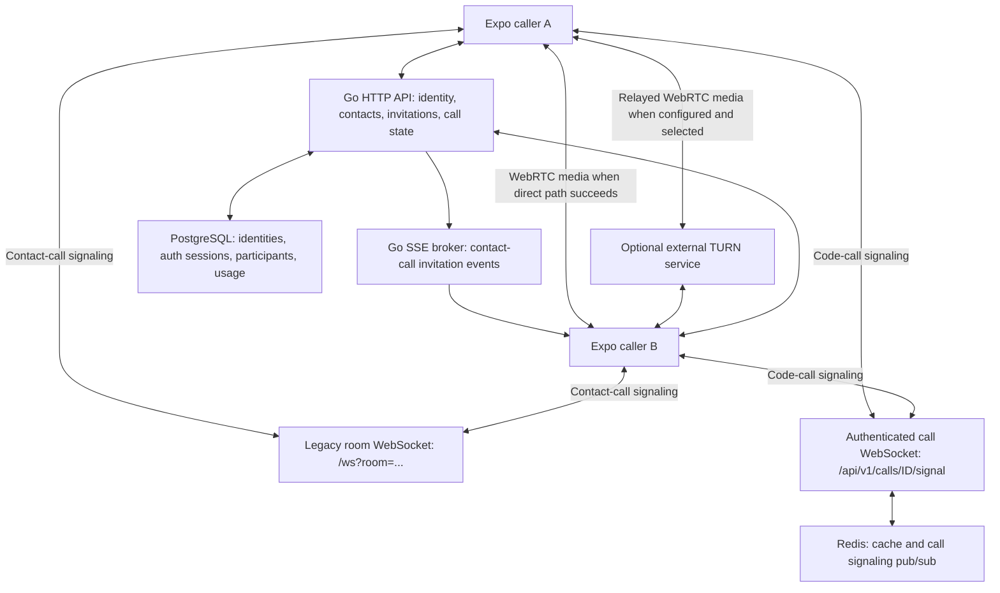
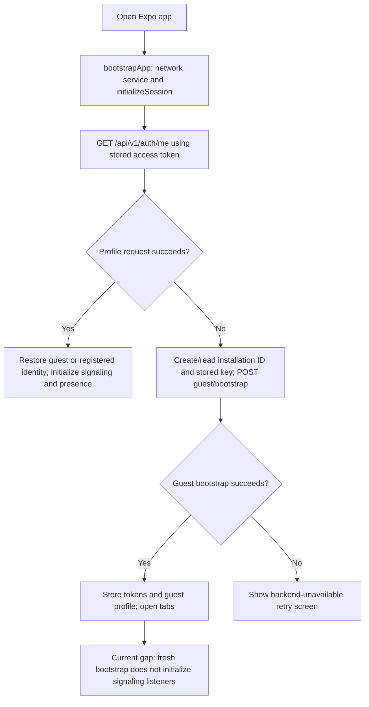

# Current implementation: registered users, guests, and connections

> Historical baseline: this September review predates the newer partial native IPv6 working-tree code. For the proposed lifecycle read [session management](session-management.md) and [call/peer connection](call-peer-connection.md). This file is retained as historical source evidence, not an up-to-date implementation inventory.

**Source inspection: 2026-09-19. Scope: Expo app and Go backend.** This describes code paths present in the repository, including incomplete wiring. It is not a successful two-device call test or confirmation that SQL migrations are applied to a running database. No database was accessed for this review.

Read this before extending session management. [system.md](system.md), [flows.md](flows.md), and [protocol.md](protocol.md) describe the target architecture; the custom authenticated Noise/media-packet design is not the current voice transport. [session-management.md](session-management.md) records the implementation gaps and proposed next work.

## 1. What runs where

Mobile versions below are resolved from `frontend/package-lock.json`, not guessed from version ranges. Backend versions come from `backend/go.mod`.

| Responsibility | Current package/system | Location |
| --- | --- | --- |
| Mobile application | Expo `54.0.35`, React Native `0.81.5` | `frontend/`; native Android/iOS configuration |
| Voice capture and peer connection | `react-native-webrtc` `124.0.7` | Mobile `modules/call/webrtc.ts`; `RTCPeerConnection`, `getUserMedia`, audio tracks |
| Native WebRTC build configuration | `@config-plugins/react-native-webrtc` `13.0.0` | `frontend/app.json` plugin |
| REST calls and refresh/retry | Axios `1.16.1` | Mobile `core/api/client.ts`, `interceptors.ts` |
| Contact invitation events | `react-native-sse` `1.2.1` | Mobile SSE client; Go SSE broker |
| Offer/answer/ICE exchange | React Native global `WebSocket`; Go `github.com/gorilla/websocket` `v1.5.3` | Two separate Go signaling endpoints |
| Token/device-key storage | `expo-secure-store` `15.0.8` | Mobile storage helper; in-memory fallback when native module is unavailable |
| App/auth/call state | Zustand `5.0.14` | Mobile stores |
| API query cache | `@tanstack/react-query` `5.100.14` | Mobile providers and module hooks |
| Network-change observation | `@react-native-community/netinfo` `11.4.1` | Mobile network service |
| Persisted Curve25519 key helper | TweetNaCl `1.0.3` | `frontend/src/crypto/ecdh.ts`; public key registration, unused shared-secret helper |
| HTTP API and coordination | Go standard `net/http`; module declares Go `1.25.0` | `backend/cmd/api` and `backend/internal` |
| Access-token signing/parsing | `github.com/golang-jwt/jwt/v5` `v5.3.1` | Go security package |
| Production password hashing | `golang.org/x/crypto` `v0.50.0`, Argon2id; bcrypt compatibility | Go auth service |
| Durable identities/auth/call state | PostgreSQL via `github.com/jackc/pgx/v5` `v5.9.1` | SQL functions and repository layer |
| Cache and call-signal pub/sub | `github.com/redis/go-redis/v9` `v9.19.0` | Redis required by production bootstrap; development can use memory fallback |

The WebRTC native module needs a native build containing it; stock Expo Go is not sufficient for calling. The app catches missing-module errors and disables that path. This matches the [package's native/Expo support guidance](https://github.com/react-native-webrtc/react-native-webrtc).

The Go service coordinates identity, signaling, permissions, and call metadata. It does not encode/decode voice. Media is handled by the native WebRTC stack between peers, optionally through a configured TURN relay. Actual deployed backend/database/relay versions and runtime network routes were not inspected.

## 2. Current connection topology



The two signaling paths are both in active mobile code. They do not yet share one authoritative call-session lifecycle.

## 3. App launch and identity



`App.tsx` invokes `bootstrapApp()`, which starts network observation and calls `initializeSession()`. The shared HTTP interceptor tries refresh on eligible 401 responses. If `/me` succeeds, the profile and tokens restore identity; signaling starts, then the app attempts a phonebook public-key upload and heartbeat.

If `/me` fails, `getMe()` clears the in-memory auth store and returns `null`, including for ordinary network/server failures. `initializeSession()` then attempts guest bootstrap. This does not distinguish an expired/revoked identity from a temporarily unreachable server.

Guest bootstrap sends an installation payload containing a persistent random installation identifier, the stored device public key, and platform. The field named `identifier_hash` currently receives the generated installation ID itself; the client does not hash it. PostgreSQL's guest function creates or reuses an installation-linked guest principal; a device currently attached to a registered principal is moved to a newly created guest on this path.

Both guest and registered identities receive API tokens. In the UI store, a guest has `hasIdentity=true` but `isAuthenticated=false`; that flag means a registered account, not the absence of server authentication.

**Fresh guest gap:** `bootstrapGuest()` only stores tokens and the profile. It does not call `initializeSignaling()`. A restored guest follows the `/me` branch and gets the listeners, but also attempts the registered SSE stream, for which the guest role lacks `events:read` in the latest ACL migration.

## 4. Registered-user journey

1. Open the app and restore an identity or enter as a guest.
2. Choose sign-in/sign-up from Settings or a guest benefits prompt.
3. Sign-in first checks the username. An existing username shows the password step; a new one navigates to Register.
4. The login/register request includes installation details and the current guest principal ID when present.
5. Production login verifies the password, optionally merges guest state into the account, and attaches the device. Registration converts an active guest principal in place when supplied, or creates a new account.
6. The backend creates an auth-session row and returns access/refresh tokens. The app stores them, initializes signaling/presence, updates the profile, and opens the main tabs.
7. The user searches usernames in Add Users, adds a contact, and calls from Contacts or Contact Details. Registered users can also use the Calls tab's invitation-code path.

Search uses `/api/users/search`; contact list/add use `/api/contacts`; contact deletion uses `/api/contacts/{id}`. Guests see locked Contacts/Add pages, and server permissions independently restrict those API capabilities.

### Contact-call sequence: current legacy room path

```mermaid
sequenceDiagram
    participant A as Registered caller
    participant G as Go API / room hub
    participant B as Registered recipient
    A->>G: POST /api/rooms/create with API token
    G-->>A: room_id
    A->>G: Connect /ws?room=room_id
    A->>G: POST /api/rooms/invite with contact_id and room_id
    G-->>B: SSE call-invite
    B->>G: Connect same room socket; show incoming call
    G-->>A: peer-joined
    A->>A: Capture microphone, create WebRTC offer
    A->>G: offer and ICE candidates
    G->>B: Forward offer and candidates
    B->>B: User taps Accept; capture audio and create answer
    B->>G: answer and ICE candidates
    G->>A: Forward answer and candidates
    Note over A,B: WebRTC negotiates the media path
    A->>B: Encrypted media over selected direct/relay route
    B->>A: Encrypted return media
```

The optional phonebook lookup currently logs whether an IPv6 address exists; it does not select the media destination. ICE does that. The recipient joins the room on the invite event, before accepting media. The caller therefore gets `peer-joined` before user acceptance.

**Boundary gap:** room creation/invitation REST APIs require permissions, but `/ws?room=...` itself checks only the room string before upgrading. This path creates no `call_session_id`, does not use participant authorization from the new call API, and skips that API's start/end usage accounting.

## 5. Guest journey and code-based calls

Guests can reach Calls and Settings; Contacts/Add are locked behind account prompts. They need an installation-linked guest API session, not a username/password. Registered users can use this same code-call path.

### Backend/code-call path present in source

1. Creator taps **Create Code**. The app posts `{media_type: "voice", network_family: "ipv6"}` to `/api/v1/calls/invitations`.
2. Go generates a link token and a formatted code. The SQL function checks the caller's plan, remaining allowance, and guest IPv6 eligibility, then creates call/participant/invitation records and any quota reservation.
3. The response includes `call_session_id`, `participant_id`, code, optional share URL, policy, allowance, and expiry. Token/code hashes are stored; the full formatted fallback code is also stored as `fallback_code_hint`.
4. Creator connects to `/api/v1/calls/{id}/signal?access_token=...` and waits for `peer-joined`.
5. Joiner enters the shared code. `/api/v1/calls/join` checks the invitation, participant capacity, account policy, and guest eligibility; it inserts the participant and marks the invitation accepted.
6. Joiner connects to the same authenticated signal endpoint. The endpoint validates the auth session and call participation before upgrading.
7. Creator sends the WebRTC offer. With signaling listeners initialized, joiner receives an incoming-call prompt and taps Accept; answer/ICE exchange follows.
8. WebRTC connected events call `/start`; cleanup calls `/end`. SQL records connection times, ends participants, writes idempotent usage-ledger entries, and finalizes reservations.

The signal route currently inherits `calls:update_state` from the router and then verifies participation; it does not use the separately defined `calls:signal` permission.

### Visible UI gaps

- Fresh guests do not install offer/answer/ICE listeners after bootstrap, so the above code path is not a complete working fresh-guest call flow.
- `createInviteCall()` sets state to `calling` before `CallsPage` receives/displays the code. The root navigator displays a full-screen CallPage whenever state is not `idle`, covering the code and Share control behind it.
- CallPage cancels `calling` after 20 seconds, while the manager waits 30 seconds for a peer. SQL invitation expiry is 10 minutes and stores a 30-second acceptance deadline; these are not a coordinated lifecycle.
- `joinCallByToken()` exists, and optional join URLs can be shared, but no mobile deep-link handler/caller was found. The wired join UI accepts codes.

These are code-level observations, not failures reproduced on physical devices during this review.

## 6. Policy in migration files versus actual media

Assuming the supplied migrations through 013 have been applied in order:

| Account/plan | Declared call policy | Current mobile surface |
| --- | --- | --- |
| Guest / trial | IPv6 voice: 30 minutes per call, 60 minutes per UTC day; IPv4/video blocked | Code-based voice UI; fresh-start and sharing gaps above |
| Registered / free | IPv6 voice/video unlimited; IPv4 voice/video share 30 minutes per UTC day | Audio-only calls; both contact and code entry points |

The backend checks guests against the HTTP request's observed address using a SQL IPv6 predicate. This is not verification of the actual WebRTC candidate pair. Proxy/IP handling therefore affects eligibility independently of peer media connectivity.

The app always labels code calls `ipv6` when creating them. It does not send the selected ICE pair's actual address family back for policy reconciliation. Returned `allowed_seconds` is not used to stop mobile media, and no active-call cutoff worker was found in the inspected Go code. Policy tables and admission reservations are not proof of enforced media duration.

Guest trial timestamps still exist, but `useAuth()` returns `isExpiredGuest=false` and the latest invitation functions omit the older explicit trial-expiry guard. Trial-expiry behavior must be reconciled rather than described as reliably enforced.

## 7. Current media routing and encryption

`EXPO_PUBLIC_ICE_MODE` selects the code branch; the default is `stun`.

| Mode | Current peer-connection configuration | Limitation |
| --- | --- | --- |
| `ipv6-direct` | Empty `iceServers` | Does not filter IPv4 candidates; warns if no local IPv6 candidate was gathered |
| `stun` | Two configured Google STUN entries | Direct discovery; no TURN credentials requested in this branch |
| `turn` | Fetch ICE servers from backend, otherwise fall back to STUN | No relay-only policy; a direct path can still be selected |

The Settings TURN toggle is persisted, but `createPeerConnection()` uses `ICE_MODE`, not that toggle. The toggle is read for failure-message wording. There is no implemented IP-hidden relay-only guarantee in this manager.

Voice capture uses audio tracks with echo cancellation, noise suppression, and automatic gain control; video is disabled. The app does not explicitly set an Opus-only codec profile or implement the custom AEAD packet format from the target design. It delegates media negotiation/protection to WebRTC. WebRTC specifies DTLS-SRTP for protected RTP media; see [RFC 8827](https://www.rfc-editor.org/rfc/rfc8827.html). This is not evidence of the target's independent intended-peer identity authentication.

The persisted TweetNaCl key is registered with the backend, but `computeSharedSecret()` has no callers in `frontend/src`. No app-level Noise handshake or key binding to the call's WebRTC identity was found.

## 8. Existing auth-session lifecycle

| Stage | Current production path |
| --- | --- |
| Issue | Guest bootstrap, login, or registration creates `iam.auth_sessions`; refresh secret is random and stored as SHA-256 hash |
| Access token | HS256 JWT, 15-minute expiry; includes principal, session ID, device ID, auth version, account/plan metadata |
| Refresh token | Opaque token; newly created/rotated session expiry is set 30 days ahead |
| Protected REST request | Validate JWT, DB session/revocation/consumption/expiry, active principal/auth version, then permission |
| Refresh | Mobile serializes refresh attempts through an in-process queue; DB locks old row, consumes it, creates replacement in the same family, and returns a new session ID/token pair |
| Old/invalid refresh reuse | Known revoked/consumed/expired token causes family revocation and a reuse-event record; no new session returned |
| Logout | Revoke current server session when possible, terminate signaling, clear local tokens/profile, bootstrap a guest |
| Refresh failure | Clear local auth/tokens and attempt WebRTC/signaling cleanup |

Production bootstrap selects `NewProductionAuthService`. Older fallback methods using different token/session behavior remain in the service file and tests; they are not the production wiring described above.

Open sockets are authenticated at connection time but are not continuously revalidated in their message pumps. The WebSocket reconnect URL retains the original access token; after rotation/expiry, reconnect can use stale credentials. Logout does not explicitly call WebRTC cleanup or clear the shared query cache in its API function. These belong in the next session-management work.

## 9. Source map

Paths are repository-relative, kept as text so this documentation folder remains shareable on its own.

| Area | Source anchors |
| --- | --- |
| Launch and restore | `frontend/App.tsx`; `src/app/bootstrap.ts`; `src/services/authService.ts::initializeSession` |
| Guest/account lifecycle | `frontend/src/modules/auth/api.ts`; `store.ts`; `hooks.ts`; `core/api/interceptors.ts`; `core/storage/secure.ts` |
| Navigation and restrictions | `frontend/src/navigation/index.tsx`; `pages/LoginPage.tsx`; `pages/RegisterPage.tsx`; `components/PromptCoordinator.tsx` |
| Call UI and media | `frontend/src/pages/CallsPage.tsx`; `CallPage.tsx`; `modules/call/webrtc.ts`; `api.ts`; `store.ts` |
| Signaling | `frontend/src/services/signalingService.ts`; `realtime/websocket.ts`; `realtime/sse.ts` |
| Network/crypto | `frontend/src/config/env.ts`; `hooks/useTurnMode.ts`; `services/networkService.ts`; `crypto/ecdh.ts` |
| Production auth | `backend/internal/bootstrap/app.go`; `service/service.go`; `security/security.go`; `repository/identity_repo.go` |
| API boundaries | `backend/internal/transport/http/router.go`; `handlers/handlers.go`; `handlers/call_handler.go`; `middleware/middleware.go` |
| Call records and hubs | `backend/internal/service/call_service.go`; `repository/call_repo.go`; `realtime/realtime.go`; `realtime/call_signal.go` |
| SQL identity/rotation/merge | `backend/migrations/008_identity_functions_and_call_flows.sql`; guest override in `011_fix_guest_identity_ambiguous_columns.sql` |
| SQL validation/start/guest limits | `backend/migrations/009_secure_sessions_and_guest_calls.sql`; signaling authorization in `010_call_signal_authorization.sql` |
| Latest policy/join/end functions | `backend/migrations/012_registered_acl_quotas_prompts.sql`; create-invitation override in `013_fix_call_invitation_allowed_seconds.sql` |


