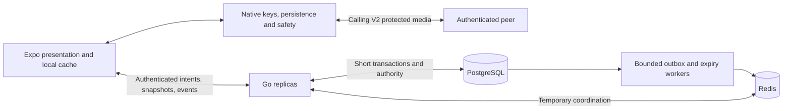

# Deployment and operations

## Currently Implemented in Code

The backend is Go with PostgreSQL. Redis supports transient coordination and is not the source of durable authorization. The active app is Expo with the local Android `frontend/modules/voice-engine` module. Native voice requires an Android development build or installed build containing that module. `frontend-web/` is deferred.

Account event delivery requires reviewed migrations 019 and 020 before the event-enabled backend. Bootstrap reads the 019 sequence table even for older clients; deploy the backend only after that table is present. The backend serves ticketed streams and runs bounded expiry cleanup, requiring the runtime privileges in the [migration review](../../sql/migrations/020_review.sql). Deploy the compatible backend before the Expo consumer. No migration has been executed as part of this change.

Apply the reviewed registered foundations migration before deploying the new backend. Establish the signer pin while the existing X25519 key remains current. Configure a canonical HTTPS origin, a base64 SEC1 P-256 signing key, and an integer epoch. When switching the advertised X25519 key, increment the epoch and retain the previous private key and ID across replicas until its outstanding challenges expire. See the [migration and cutover review](../../sql/migrations/018_review.sql).

## Target New Flow (To Be Implemented)

Deploy compatible PostgreSQL schema and Go services first, then the Expo client. Production signaling requires HTTPS/WSS and reachable IPv6 UDP rendezvous. The relay is deferred. Use the [SQL review files](../../sql/migrations/) for prerequisites, privileges, rollout, verification and recovery. Apply migrations only on the separately approved target.

## Calling V2

### 16. Tiers, duration, and usage accounting

Policies are versioned by account tier, media, actual authorized route and period. [Session V2](flows.md#8-guest-allowance-and-gating) now selects guest calendar weeks starting Monday 00:00 UTC: seven IPv6 hours and one IPv4 hour, the latter inactive until supported. It owns per-service denial, the all-enabled-service registration gate, recognition bucket continuity and effective policy changes. Registered allowances/per-call settings remain separately configurable; daily or weekly policy must use its selected boundary, not a hardcoded UTC-day assumption. Unlimited calling removes duration quota, not session/lease checks.

At create/join/reservation/renewal, evaluate both participants. Remaining period allowance subtracts recorded usage and outstanding reservations. Allowed duration is bounded by each participant's per-call/period availability; the smaller governs the shared call. Reserve transactionally, in bounded renewable chunks, and release unused time. Future switching to IPv4 relay needs eligibility/allowance re-evaluation and user consent before consuming a new route bucket.

Start accounting when both ready reports and active authorization are accepted. No charging for invitation, ringing, readiness, handshake or human verification. Distinguish elapsed time, accounted authorized-active time and recovery time. Short concealed loss stays active; server-accepted recovery pauses accounting. Use server timestamps and idempotent nonoverlapping intervals; do not let arbitrary client timestamps erase usage. This is bounded client/server evidence, not exact proof of audible delivery.

Example: 300 seconds active, 12 recovering, 288 active equals 600 elapsed and 588 accounted-active seconds per participant. Do not double-charge each by summing both participants' durations. Store precise duration, not a minute rounded up per renewal. Split at the applicable policy period boundary (Monday UTC for initial guest weeks; UTC midnight for a configured daily bucket); do not reset per-call usage. Reconcile policy-version changes explicitly rather than rewriting historical ledger interpretation.

If no end arrives, cap the abandoned authorized interval at applicable lease expiry or an earlier accepted end/recovery event. Crashes can produce bounded overcount; never an indefinite active duration. Finalization settles ledger/reservations and frees call slots once. Period limits warn/stop under the granted deadline; warnings and exact reservation cadence remain product parameters.

### 19. Persistence and backend failure

#### Authoritative transitions

Use PostgreSQL transactions/constraints/consistent locking for active-phone ownership, call slots, two-party admission, allowance and lifecycle. Redis locks alone are insufficient for durable outcomes. Endpoint registration/signaling tickets are atomic transient operations with current authorization checks and explicitly bounded recovery.

Commit terminal/security/lifecycle changes plus an outbox event in one database transaction. A Go publisher retries Redis delivery/invalidation; consumers deduplicate and compare current versions. Pub/Sub is not durable delivery. Reconcile state after reconnect and lease renewal even if notifications were missed.

#### Failure matrix

| Failure | Required result |
| --- | --- |
| PostgreSQL unavailable | No new authorization/admission/quota mutation or lease renewal; existing media limited to its lease |
| Redis unavailable | Safe durable reads may use PostgreSQL where designed; required ticket/coordination operations fail closed, no process-local security fallback |
| Redis state lost | Rebuild caches from authority; missing/consumed tickets cannot become permissions |
| Go instance crash | Fresh ticketed reconnect and durable generation reconciliation; no reliance on process-local room count |
| Lost notification | Durable state and lease checks still enforce restrictions |
| Stale event/socket | Reject outdated identity/call generations; cannot restore revoked ownership |
| Delayed finalization | Local media already stopped; expiry/outbox/reconciler settles durable state |

Readiness/presence is shared by participant/generation across instances. Presence expiry is suspicion, not direct audio proof. Reconciliation workers repeat safely: expire authorizations/reservations, finalize abandoned calls, release slots, retry outbox and clean bounded operation state. Check versions before modifying anything.

Admin/UI outcomes distinguish committed state, notification pending, peer acknowledgement and expiry enforcement deadline. Published is not equivalent to disconnected. Durable restrictions must be consulted consistently; stale replica/cache reads cannot extend authorization beyond the intended bound.

### 21. Implementation phases and source map

This task prepares documentation only. It does not authorize migrations, native dependency installation, live API writes, deployment, or toolchain changes. Preserve existing user changes and versions. New schemas, when needed, require new ordered reviewed migrations; do not modify history or execute the destructive prepared migration 014 as validation.

| Phase | Work | Exit evidence |
| --- | --- | --- |
| 0. Freeze contracts | Exact schemas/type IDs/context, state mapping, timer precedence, security review/test vectors; identify user/session prerequisites | Cross-platform vectors and reviewed contracts; no unresolved unsafe defaults hidden in code |
| 1. Backend call ownership | Atomic direct/code invitations, caller approval interface, policy reservations, participant/session bindings, ticket state, outbox | Mocked race/idempotency/foreign-access tests; migration review if required |
| 2. Native coordinator and trust | Readiness, Noise integration, QR/link local comparison, remembered key rules, bounded state and unified finalizer | Key-substitution/context/duplicate/timeout tests; no media before gates |
| 3. Direct protected transport | Rendezvous retry, path proof, fixed header, nonce/replay, schema dispatch, bounded parsing | Datagram vectors/fuzzing, forged high-counter/duplicate/reflection tests |
| 4. Audio quality | Approved libopus integration, bounded I/O, jitter/PLC/FEC, feedback/pacing/drift, experimental controller | Codec/device and impaired-network results; no backlog/resource leak |
| 5. Long-call lifecycle | Leases, accounting, per-episode recovery, migration, renewal promotion and hard limits | Simulated clock/network/packet loss/race tests, quota/lease and old-state rejection |
| 6. Integration and release | Physical two-device tests, multi-instance/outage tests, call-specific intervention, independent review | Acceptance matrix below; measured limits and accurately scoped guarantees |

Candidate entry points, not instructions to rewrite unrelated code:

| Area | Existing repository paths |
| --- | --- |
| Native engine | `frontend/modules/voice-engine/android/src/main/java/expo/modules/ipv6voice/` |
| Coordinator / API / store | `frontend/src/modules/call/nativeVoice.ts`, `api.ts`, `store.ts`, `types.ts` |
| Calling UI | `frontend/src/pages/CallsPage.tsx`, `NativeCallPage.tsx`, navigation |
| Network / signaling | `frontend/src/services/networkService.ts`, `frontend/src/realtime/websocket.ts` |
| Call business/persistence | `backend/internal/service/call_service_v2.go`, `backend/internal/repository/call_repo_v2.go` |
| HTTP contracts | `backend/internal/transport/http/router.go`, `handlers/call_handler_v2.go` |
| Coordination | `backend/internal/realtime/call_signal.go`, `rendezvous.go`, repository cache |
| Session integration | Auth APIs/interceptors plus backend identity/session validation; owned by separate session work |

Existing native code has known readiness, verification-send ordering, replay-window, cleanup and recovery gaps. The receiver now authenticates packets before queueing or advancing the receive sequence, but the change and the full replay design still need native and adversarial validation. Track each against these phase exits. Historical WebRTC code is not the new transport's fallback.

## Session V2

### 10. Versioned database policy

Store validated policy values in PostgreSQL: supported account/service/route assignment, allowance/unit, period type/timezone/boundary, reminder rules, auth lifetimes, rate limits, retention and effective version/time. Clients display returned policy and cannot grant benefits. Code implements a finite validated policy vocabulary. DB configuration cannot add a new service/algorithm or safely accept nonsensical durations/combinations.

Default policy changes take effect next applicable period; explicit immediate changes are supported. Preserve consumed usage and reservations; never interpret a policy-version change as a fresh allowance. An increase can restore eligibility. Reduction may deny subsequent grants/renewals; issued leases remain bounded by their deadlines unless separately revoked. New auth/session limits need explicit effective handling for existing issued credentials rather than pretending their embedded expiry changed.

Publish invalidation/version changes to instances; critical decisions must not rely on stale policy cache. Boundary/timezone changes require explicit transition mapping so periods cannot overlap, double-allocate or erase usage. Audit who changed what and when; exact administrative authorization and reservation transition schemas remain prerequisites. Never weaken accepted 30/10 call authorization or cryptographic hard limits through an unreviewed tuning change.

### 14. Transactions and concurrency

For authoritative mutation: validate input/actor, begin transaction, lock necessary records, recheck ownership/status/allowance/state, apply related updates/constraints and audit/outbox, then commit. Any failure rolls back all of that transaction. Do not announce success before commit. DB commit and external response/Redis delivery are not one distributed atomic operation; idempotency/outbox handles that boundary.

Use unique constraints for ownership/operation invariants, row-level locks for conflicting modifications and consistent ordering when multiple principals/buckets are touched. Unrelated accounts proceed concurrently; avoid global locks. Bounded retries handle deadlock/serialization failures without manual repair. Redis locks alone do not establish durable correctness. Never hold SQL transactions/connections while awaiting human consent, OAuth/Noise exchange or live sockets. Check current versions before workers finalize stale records.

Examples requiring race tests: two guest enrollments selecting one recognition bucket; concurrent reservations spending last allowance; refresh versus revoke/recover; two replacement-phone activations; policy change versus renewal; simultaneous call end; retention worker versus session recovery. Database constraints and durable version fencing, not UI timing, determine winners.

### 15. Storage topology and failures

PostgreSQL owns grants/revocation/bindings/usage; Redis owns transient coordination and non-authoritative caches. Sensitive grants/renewals consult current durable authority, not stale positive auth cache or lagging replica. Profile/catalog caching is permitted with version/TTL invalidation. Do not rebuild permissions from missing tickets or Redis restart. Production security coordination has no process-local memory fallback.

| Failure | Required behavior |
| --- | --- |
| PostgreSQL unavailable | Deny new grants/mutations/renewals; existing call stops at current lease deadline |
| Redis unavailable | Only explicitly designed safe durable fallbacks; required unavailable coordination fails clearly |
| Redis contents lost | Rebuild non-authoritative state; reissue tickets only after current authorization |
| Go replica crash | Fresh authorized reconnect elsewhere, snapshot/generation reconciliation |
| Response lost after commit | Operation-specific idempotency/recovery; refresh follows section 7 |
| Missed notification | Authority and lease/snapshot checks still enforce restrictions |
| Cleanup delayed | Local stop already complete; indexed expiry/reconciler settles durable state |

Workers claim indexed due work in small batches with concurrency-safe locking, e.g. SKIP LOCKED for queues, not to skip locked authorization checks. Repeat safely to expire reservations, settle abandoned calls, publish outbox and clean bounded operation state. Redis expiry events alone are not reliable SQL cleanup. Exact worker timing and recovery thresholds need capacity/fault tests.

### 16. Capacity and per-API rate limits

No arbitrary total-account cap; no unlimited-concurrency promise. Start with the existing modular Go service, horizontally replicable, and optimize measured bottlenecks before adding new infrastructure. Live event sockets do not each hold PostgreSQL connections. Bound per-replica pools, aggregate connection budgets, workers, memory/queues, payloads and retry work. Scale replicas without multiplying DB pools beyond safe capacity. Separate expensive password/proof work from renewal/termination capacity. Backpressure returns retry guidance instead of silently buffering unlimited work.

#### Independent API allowances

Rate counters are scoped to canonical route template plus HTTP method and relevant principal/device/anonymous scope. Login, registration, refresh, recovery, profile, call creation and lease renewal each have their own configured allowance. One API does not spend another API's rate allowance. Resource UUID/query-string variations do not create fresh counters. Route aliases/versioning need explicit canonicalization; no global per-user API counter replaces these independent budgets.

Before authentication, appropriate network/attempt scopes supplement later identity/device scopes for that same operation. Shared IPs require careful defaults. Socket handshake and distinct message operations also get explicit bounded budgets; opening a socket cannot bypass protected-operation limits. Infrastructure connection/CPU/worker caps remain separate shared capacity controls, not shared API rate allowances. Configure safe limits and an outage behavior for required rate state; don't disable security limits silently.

Bound retries with jitter/backoff, return operation-specific rate/busy outcomes and protect valid existing call renewals/termination from enrollment/reconnect storms. Overload never extends leases. Authenticated network operations remain subject to finite capacity even with unlimited product minutes.

Calling V2 creates roughly C/5 participant renewals/second for C simultaneous two-party calls (two participants every ten seconds), before retries/other operations. This is workload arithmetic, not measured capacity. Do not send media frames to databases. Measure p50/p95/p99 latency, error/denial rates, hash cost, pool/lock wait, DB I/O, Redis latency/memory/eviction, event/outbox lag, queue depth and lease-deadline success. Select values from representative load tests and infrastructure budget, not guessed universal numbers.

### 19. Implementation phases

| Phase | Work | Exit evidence |
| --- | --- | --- |
| 1. Contracts and prerequisites | Enrollment/recovery schemas/vectors, binding/removal, policy model, typed operations/errors, storage bundle | Reviewed contracts and threat/race cases; no custom crypto shortcuts |
| 2. Durable identity/session core | Atomic enrollment/activation, active-phone binding, auth validation, refresh lineage, idempotency/audit | Focused mock/unit and authorized isolated DB concurrency tests |
| 3. Native persistence and recovery | Secure writes, cold-start matrix, key-only recovery, uncertain-refresh recovery, logout fencing | Device process/storage interruption tests; no memory-only production fallback |
| 4. Guest policy and UI routing | Recognition buckets, per-service quotas, weekly period/config transitions, reminders/gate, retention | Boundary/race tests; altered local state cannot bypass denial |
| 5. Events and call integration | Bootstrap/revisions, outbox/reconnect, per-API counters, V2 lease/finalizer integration | Multi-instance/outage/revocation/reconnect tests |
| 6. Release validation | Load/slow clients, retention/audit, physical devices, security review | Stated workload/hardware, measured bounds, migration review and accurate remaining limitations |

Reuse existing Expo/Go modules and installed versions; no new dependencies/toolchain/database resets just to pass checks. Current native/session code is partial and the September baseline is historical. Inspect actual implementation while implementing each phase. Prepare new ordered migrations with review/verification/rollback notes only when needed; do not execute without explicit target authorization. Migration 014 is a separate destructive prepared reset, not deployment evidence for this plan. No commit/push is implied.

## Account management

### 3. Contracts, persistence and rollout

#### Contract freeze deliverables

Use versioned account contracts under `/api/v2/` for the new multistage journeys, retaining v1 only for the compatible interim fixes. Specify Go request/response types and matching strict Zod schemas together. Phase 0 produces exact HTTP methods, bounded fields, state transitions, ownership/generation/revision fields and positive/negative contract fixtures before affected handlers are built.

| Contract family | Required operations |
| --- | --- |
| Auth/enrollment | Registered/guest begin, challenge/finish/activation, setup resume, recovery-code acknowledgement, bootstrap, refresh, logout. |
| Account security | Password change; saved-code create/ack/regenerate; email challenge/verify/remove; recovery begin/prove/complete. |
| Account/profile | Current profile, username availability/change, deletion request/status/cancel; device/session list and scoped revoke/all-session logout. |
| Social | Exact lookup; contact list/add/remove; block list/block/unblock; non-ringing request list/accept/block; bounded report submission. |
| Policy/history/events | Eligibility/reminder snapshot and acknowledgement; participant history/clear; authorized snapshot/resume; Resend webhook. |

Use structured errors for validation, expired authentication, forbidden/restricted state, conflict, quota/reset, rate/retry-after, pending operation, infrastructure unavailable and unsupported client/schema. Refresh only on the explicit eligible authentication outcome. Reject wrong methods, excessive/malformed/trailing payloads and foreign IDs before mutation. Bearer credentials stay in headers, not generic query URLs. Socket tickets keep their separate reviewed contract.

Retryable account mutations carry actor-scoped operation IDs and payload fingerprints. Duplicate success returns a bounded original non-secret outcome; changed payload conflicts. PostgreSQL commits state/audit/outbox together. Security outcomes consult primary/current authority; stale caches/replicas cannot extend grants. Stable lock ordering and bounded serialization/deadlock retry cover cross-account/device/bucket changes.

#### Required logical persistence

Prepare ordered migrations for account lifecycle/current username revision, owned username reservations/retirement, device ownership generations, session/refresh lineage, enrollment/setup/recovery operations, recovery-code sets/consumption, pending/verified unique recovery emails, versioned policy, recognition/buckets, directional contacts/permissions/blocks, reminder presentation, history visibility, minimal audit/report evidence and outbox/worker claims. Reuse compatible existing objects; do not duplicate historical schemas.

Keep secrets hashed/protected and delivery payloads separately encrypted with bounded expiry. Add unique/FK/check constraints and indexes for authorization, canonical names, verified email, active ownership and due-worker queries. Profile/key/recognition and refresh-lineage retention cannot resurrect access or reset current-period allowance. Minimal routine audit/accounting defaults are separate from visible history; reports require restricted access and explicit closure state.

#### Compatibility and migration safety

Preserve existing data by default. Migration 014 is a separate destructive reset; do not run it or historical bootstrap scripts on any database that holds data worth keeping. Status: on 2026-11-01 the user applied 014 and 016 (with `--allow-destructive-reset`) to their local development database `ipv6ftp` after taking a verified `pg_dump`; all existing development rows were intentionally discarded. This is not evidence for any other environment. Inventory the intended deployment schema and client versions through an authorized read-only target before designing executable upgrade SQL. Source alone does not establish which migrations were applied.

Provide migration purpose, objects/data, prerequisites, locking/backfill risks, deployment order, verification SQL and rollback/recovery notes. Use additive schema/backfills before enabling v2. At cutover, disable legacy credential issuance/recovery paths that bypass enrollment, acknowledgement or current ownership and return a typed upgrade-required outcome. Revoke/replace incompatible old authorization deliberately; old binaries must not keep a security bypass. Rollback may disable new operations but must not re-enable revoked credentials, retired names or weaker admission.

No live DB mutation, migration execution, test seeding, provider setup or DNS action is authorized by this plan. Existing users keep supported credentials during compatible rollout and complete recovery setup after login; enrollment/acknowledgement gates apply before full new authorization. Do not release an interim fix as a completed V2 system.

### 4. Ordered implementation milestones

| Milestone | Implementation and exit evidence |
| --- | --- |
| M0: contracts and baseline | Capture current source/test baseline; inspect default-build repositories and direct callers. Freeze schema/state/error/crypto contracts and fixtures, compatible identity migration, provider callback verification and deployment preflight. Complete focused threat review. Identify exact dependency changes for separate explicit approval before installation. |
| M1: existing-flow correctness | Fix storage propagation, partial states, refresh deadlines/queues/generation fences, immediate logout/local-stop ordering, account-cache isolation, safe retries, visible registration errors and repository-error mapping. Repair native mocks and replace obsolete auth expectations. Unit tests prove outage, storage and logout races. |
| M2: durable identity/session core | Prepare reviewed additive migrations; implement enrollment/activation, stable native key scope, one-phone ownership, current generation/permission validation, refresh lineage, idempotency/audit/outbox and bootstrap. Mocked tests plus separately authorized isolated DB race tests prove atomic ownership. No guest or social bypass through v1. |
| M3: registered account security | Mandatory saved-code setup, password change, recovery begin/prove/complete, optional unique verified email, Resend adapter and code delivery/callback lifecycle. Tests cover lost code results, replay, stale email versions, concurrent claims, compromised/expired authorization and provider outage. |
| M4: profile and account lifecycle | Username changes/reservations/retirement, session controls, seven-day deletion/cancellation, bounded deletion workers and local profile removal. Test rename/availability and deletion/cancellation races, failed cleanup/restart, private data isolation and resold-device behavior. |
| M5: guest identity and routing | Explicit enrollment, recognition/bucket linkage, approved key recovery, conversion, versioned eligibility, gates/reminders and retention. Test spoofed recognition, partial material, stale conversion handoffs, period/config boundaries and no quota reset. Use a fake call consumer until integration. |
| M6: related user journeys | Exact discovery, current-schema contacts and permission grants, remove/block/unblock/report, unknown inbox and signed-out invitation intent. Implement participant history API/policy and UI with mocked call data. Test foreign IDs, stale names/events, duplicate actions, blocks through every entry path and no endpoint disclosure. |
| M7: reliability and user-core release gate | Reconnect/snapshot/outbox/worker repair, independent route/method limits and measured resource budgets. Run storage/process/backup/device tests, authorization/fuzz/race tests and ASVS/MASVS control review. Record residual risks and unresolved call-dependent verification. |
| M8: Session/Calling V2 integration | Bind actual call membership/leases to auth sessions/devices/generations; verify both-party revocation, conversion/logout stop, quota reservation/settlement, reminders/history and native finalizer. Then complete Calling V2's transport/audio phases, two-device/network/outage tests and independent protocol review. |

Do not skip M0's crypto interoperability gate, execute DB-writing tests without an isolated authorized target, or claim M8 passed from mocked M5/M6 results. Each milestone updates maintained architecture/UI/context documents and reviews the scoped diff. Commit/push only when requested.

## Account API V2

### 7. Migration sequence (to be prepared, not executed)

| File | Scope | Milestone |
| --- | --- | --- |
| `015_identity_session_core.sql` | Account lifecycle and revision, device ownership generations, refresh lineage, setup operations, idempotency, audit, outbox | M2 |
| `016_account_security.sql` | Recovery-code sets, recovery grants, unique verified email, encrypted delivery queue | M3 |
| `017_profile_lifecycle.sql` | Username reservations and retirement, deletion state and worker claims | M4 |
| `018_guest_policy.sql` | Recognition buckets, versioned policy, reminders | M5 |
| `019_social_history.sql` | Directional contacts, permissions, blocks, requests, reports, history visibility and retention policy | M6 |

Each ships with a review note covering purpose, objects, locks, order, verification SQL and rollback constraints. Migration 014 stays a separate destructive reset. It and 016 were applied by the user to the local development database `ipv6ftp` on 2026-11-01 (`migrate status` shows all applied); the 016 verification SQL has not yet been run or reported, and no other environment has been migrated.
