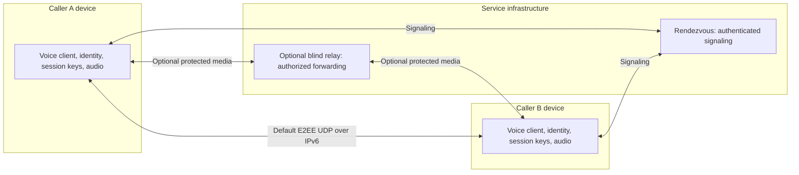

# Deployment and operations

Account event delivery requires reviewed migrations 019 and 020 before the event-enabled backend. Bootstrap reads the 019 sequence table even for older clients; deploy the backend only after that table is present. The backend serves ticketed streams and runs bounded expiry cleanup, requiring the runtime privileges in the [migration review](migration-020-review.md). Deploy the compatible backend before the Expo consumer. No migration has been executed as part of this change.

Apply the reviewed registered foundations migration before deploying the new backend. Establish the signer pin while the existing X25519 key remains current. Configure a canonical HTTPS origin, a base64 SEC1 P-256 signing key, and an integer epoch. When switching the advertised X25519 key, increment the epoch and retain the previous private key and ID across replicas until its outstanding challenges expire. See the [migration and cutover review](migration-018-review.md).

The v2 acknowledgement request now contains a recovery code from the displayed set. Deploy the updated backend and rebuilt Android client together after verifying the required migrations and configuration on the target. The native bridge adds an enrolled-key presence check, so an older installed native module cannot run the new setup flow. No database migration is added by this change.

`V1_CREDENTIAL_ISSUANCE` defaults to `staging`. Set `upgrade_required` after the V2 client cutover gates pass. Session validation and staged credential issuance require migrations 015 and 017. Public proof endpoints use bounded in-process minute buckets keyed by socket peer and proof scope. Configure `PUBLIC_AUTH_IP_PER_MINUTE` and `PUBLIC_AUTH_SCOPE_PER_MINUTE` to override the defaults of 10 and 5. The limiter is for single-instance staging. Shared enforcement is required before scaling to multiple instances.

The local Android voice bridge event contract now includes call and preparation-attempt IDs. JavaScript rejects events without matching IDs, so a native app rebuild is required when deploying this change; an older installed native module is not compatible with the updated coordinator.

The backend example is `backend/.env.example`; provide real service secrets through an ignored `.env` or injected server environment. Expo public variables are bundled and must not contain secrets. Production requires `EXPO_PUBLIC_BACKEND_URL` to name an HTTPS origin, from which the WebSocket origin is derived. Changes require restarting development tooling and may require rebuilding the app. TLS and service endpoint configuration must match the deployment. No live service provisioning is implied by these examples.

The local and VPS backend examples include the current call-setup configuration keys alongside the common backend settings. The frontend example uses a placeholder public origin; replace it with the appropriate origin in local configuration or the build environment.

History retention is runtime-configurable through versioned backend policy, initially 90 days; prospective changes are the default and retroactive changes require reviewed impact/worker coordination. The initial 100-call validation target is configurable per versioned load-test profile, with parameter overrides and a new measured run for each target. Neither value is a permanent code constant; see the [implementation plan](user-management-implementation-plan.md) for transition semantics.

> Planned user-management rollout (2026-10-31): [implementation milestones and operational prerequisites](user-management-implementation-plan.md) require additive reviewed migrations, primary authority, bounded expiry/deletion/email/outbox workers, a Resend adapter and authenticated callbacks, and deliberate old-client cutover. The user must supply a verified sending subdomain/provider configuration and separately authorize isolated database/email test targets before live execution. No purchases, sending, DNS or migration execution is implied. Benchmark 100 calls/200 participants plus the documented other workload on stated hardware; this is a validation target, not measured capacity. Registered visible-history expiry, audit/accounting/report retention, guest cleanup and backup deletion handling are separate policies.

> Accepted session operations (2026-10-20): [session V2](session-management-proposed-v2.md#15-storage-topology-and-failures) specifies PostgreSQL authority, Redis transient coordination, outbox/reconciliation, short transactions, per-API independent rates, aggregate connection/worker budgets and fail-closed authorization. Weekly guest policy/config transitions and 90-day cleanup require indexed bounded workers and reviewed migrations. Capacity values require measurement; no arbitrary account cap or unlimited-concurrency promise. Calling V2 leases remain unchanged; no migration/deployment is executed by this plan.

> Design update (2026-10-17): follow [V2 persistence/failure handling](call_implementation_proposed_v2.md#19-persistence-and-backend-failure) and its implementation/acceptance phases. PostgreSQL is authoritative, Redis coordinates temporary state, a transactional outbox retries notifications, and workers reconcile expired calls/reservations. Share participant/generation readiness across instances; no process-local production security fallback. New authorization fails closed when authority is unavailable; healthy direct media lasts only through its existing 30-second lease, renewed every 10 seconds with no extra grace. HTTPS/WSS and reachable IPv6 UDP rendezvous are required. Relay below is future scope. This plan executes no migration or deployment; migration 014 remains a separate destructive review item for every environment except the user's local development database, where the user applied 014 and 016 on 2026-11-01.

This is a proposed deployment model, not runnable production configuration. Ports, capacity, providers, and the current code's support for this transport are not established here.

## 1. Topology

Rendezvous and relay remain separate responsibilities even if operated together. Rendezvous carries signaling; relay carries ciphertext; neither receives endpoint media keys.

## 2. Prerequisites

| Component | Needs |
| --- | --- |
| Endpoint | Supported audio APIs, Opus, selected secure-session library, protected identity storage, required networking APIs |
| Direct path | Usable bidirectional IPv6 reachability, permitted UDP, authenticated path validation |
| Rendezvous | Protected authenticated signaling, join authorization, expiring state, admission/rate limits |
| Relay | Chosen relay protocol, authorized short-lived allocations, bounded forwarding, expiry, bandwidth |
| Operations | Minimal logs/metrics, health checks, abuse controls, updates, incident handling |

Having an IPv6 address does not establish end-to-end UDP reachability. Validate paths under a bounded policy and handle failure explicitly.

## 3. Platform decision

The active Expo client uses native `react-native-webrtc`; its current packages, paths, and native-build requirements are in [current-implementation.md](current-implementation.md). The separate web client is deferred. This package does not establish that custom UDP framing or the proposed Noise session can simply replace the existing media stack.

Choose whether to retain and extend the current native WebRTC integration or adopt a separate transport for the target design. Document where identity verification, packet protection, replay handling, path selection, and privacy policy are enforced. Built-in transport encryption alone does not settle the intended-person identity model. A browser mapping belongs to the later web phase.

The conceptual `VOICE_FRAME` format is not a description of current WebRTC wire traffic. Browser integration needs its own mapping and verification.

## 4. Required configuration categories

These are decisions to specify, not invented environment variables or default values.

| Category | Choices |
| --- | --- |
| Identity | Storage, verification, rotation, recovery, guests |
| Signaling | Address, transport security, authentication, admission, expiry, limits |
| Handshake | Complete profile, supported versions, context binding, time/resource budgets |
| Media | Codec parameters, frame duration, maximum payload/datagram, buffer bounds |
| Protection | Cipher profile, nonce mapping, usage limits, replay window, stream domains |
| Connectivity | UDP binding, direct timeout, relay protocol/credentials, recovery/migration |
| Privacy | Mode selection, allowed metadata, relay-only policy, mode changes |
| Operations | Metrics, redaction, retention, quotas, liveness, cleanup |

No credentials, private keys, or deployment secrets are included in this package.

## 5. Media/network operations

Proposed completions include congestion-aware sending, pacing, bounded buffering, and datagram sizing that accounts for path MTU plus encryption/relay overhead. Loss must not create unbounded queues or uncontrolled retransmission of obsolete audio. Essential controls need their own delivery policy.

These are transport concerns separate from encryption. See [RFC 8085: UDP Usage Guidelines](https://www.rfc-editor.org/rfc/rfc8085) for congestion and message-sizing guidance.

## 6. Failure behavior

| Condition | Target response |
| --- | --- |
| Rendezvous unavailable at setup | Fail setup without bypassing authentication |
| Rendezvous lost during working call | Proposed: retain functioning authenticated media if policy allows; signaling-dependent recovery may fail |
| Direct IPv6 blocked in normal mode | Attempt configured E2EE relay within a bounded budget |
| Relay unavailable in IP-hidden mode | Fail without direct fallback |
| Invalid peer/handshake | Abort; no weaker authentication fallback |
| Invalid media tag | Drop without decoding or changing trusted state |
| Address/interface changes | Validate a permitted new path or establish a fresh session |
| Key/counter limit approaches | Reviewed renewal or termination/re-establishment before exhaustion |
| Process restarts | Fresh session keys before new media |
| Audio device/permission failure | Explain local failure; clean up or follow a defined receive-only policy |

## 7. Observability and readiness

Useful metrics include setup outcomes/duration, direct versus relay usage, relay failures, recovery results, packet loss, late arrivals, jitter, buffer pressure, malformed/authentication/replay rejection counts, service resource use, and expired-allocation cleanup.

Keep metrics bounded and free of media, secrets, and unnecessary identifiers. Define retention and access before production.

Exercise direct IPv6, blocked UDP, relay-only policy, outages, loss/reordering, and interface changes on representative networks. Complete the [acceptance checklist](decisions.md) before claiming tested behavior. Publish numeric latency, scale, privacy, or assurance claims only with supporting measurements/review.
