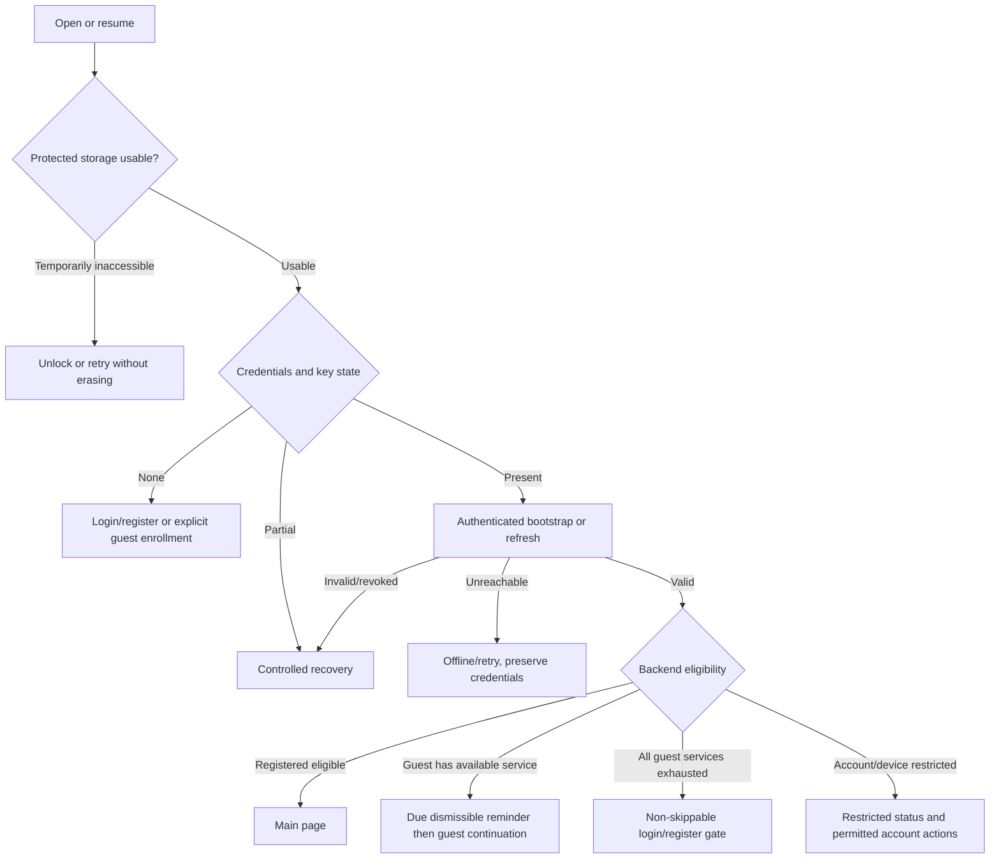
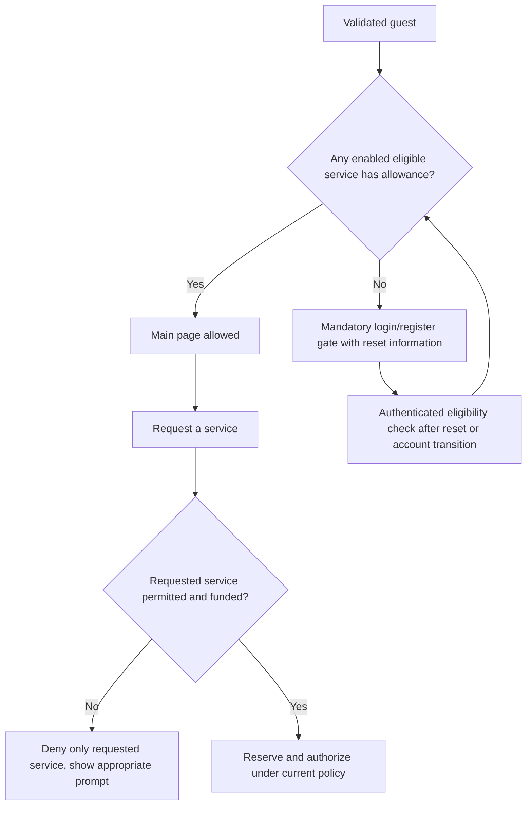

# System flows

## Target New Flow (To Be Implemented)

These sections define the target behavior for call and account journeys. See [system status](system.md#currently-implemented-in-code) and [verification evidence](user-management-evidence.md) for what exists and what has been checked. The first media path is direct IPv6/UDP. Relay and IP-hidden routing are deferred.

## Calling V2

### 2. Prerequisites, ownership, and identifiers

#### User/session contract

Calling receives a validated principal, account type/tier, enrolled device/public key, auth-session reference, permissions, and identity authorization generation. It never receives raw passwords or refresh tokens from other modules. The private device key stays in the native identity component.

Device enrollment uses the accepted candidate Noise IK exchange over HTTPS: authorized enrollment attempt, single-use challenge, possession proof, explicit finish, and atomic activation. The exact enrollment/library profile is a user/session implementation prerequisite, not a second calling handshake. A public key or installation ID alone is not possession proof.

Account recovery and offline recovery codes are provisionally accepted user-flow work and are not specified here. Calling only requires their effects: revoked old sessions/keys, no silent trust inheritance, and explicit replacement-device verification. Guests have a principal and authenticated device session despite lacking email or username.

#### Ownership

| Owner | Data/responsibility |
| --- | --- |
| PostgreSQL/Go | Active-phone authorization, accepted call membership, policy, reservations, lifecycle, accounting, revocation, minimal audit |
| Redis/Go | Short-lived tickets/results, bounded presence/readiness coordination, caches, notifications and rate limits |
| Native endpoint | Identity private key, handshake state, traffic keys, packet counters/replay, sockets, codec, audio and timers |
| Local trust store | Verified remote device-key binding scoped to the local account/guest |

#### Distinct identifiers

Use separate principal/device/session IDs, invitation locator, logical call ID, identity authorization generation, cryptographic key generation, connection identifier, migration operation ID, control operation ID, security sequence, and media sequence/timestamp. Do not conflate them.

An address change is a new path, not necessarily a new key generation. A fresh handshake creates a new connection identifier/key generation. The call ID and media timeline persist during permitted in-call renewal/recovery. All asynchronous callbacks carry enough identity/call/generation ownership to reject stale results. Generations must not wrap or be reused within their owning lifecycle.

### 4. Invitations and caller permissions

#### Registered direct invitation

1. A requests a voice/direct-IPv6 invitation to B using an idempotency key.
2. Go derives A from validated credentials, checks both relevant policy/permission boundaries and caller blocking, and reserves the pending operation atomically.
3. Approved callers may ring B's currently authorized connected phone. Unknown registered callers create a non-ringing request. A verified key alone is not caller approval.
4. B sees identity labels and Accept/Decline/Block. Fetch current server state before accepting a delivered event; delivery is not consent.
5. Accept checks current session/device, invitation expiry, membership/capacity and active-call availability. Commit both participant-device/session bindings and consent atomically.
6. Start secure setup. Do not disclose direct endpoints or unnecessary peer key metadata before the appropriate acceptance gate.

Caller approval is a separate communication-permission record/interface. Do not assume historical contacts already implement it. Unknown/blocked callers receive generic unavailable outcomes where detailed online/busy status would disclose unnecessary information. The non-ringing-request expiry and approval-management UX remain product parameters to specify before that entry point ships.

#### Code/link invitation

1. A creates a call with a short-lived locator and holds an expiring reservation. Registered and guest creators may use this entry point if policy permits.
2. Display/share the locator on a waiting screen, including the active waiting overlay; no hidden code/share action.
3. B submits it with B's own valid session. Check expiry/state, self-join, policy, device and conflicts. Atomically admit at most one joiner and consume the invitation.
4. A sees B's registered/guest join label and approves or rejects. B's submission expresses a request, not microphone permission or verified peer trust.
5. On approval, bind participants as above. Rejection requires a new invitation initially; do not silently recycle membership.

An invitation code/link is not a media secret or identity proof. Hash lookup secrets server-side. Define request idempotency so lost create/join responses return the accepted operation rather than duplicate calls/reservations. Invitation-token encoding and entropy are protocol/security prerequisites, not authorization to reuse the verification URL payload.

#### Races and unavailable users

- Thirty-second ringing and code-join approval deadlines; repeats do not reset them.
- A cancel committed before B's accept makes accept fail; expiry/end cannot be reversed by delayed delivery.
- Crossed A-to-B/B-to-A invitations resolve transactionally to one deterministic surviving invitation; still require explicit acceptance.
- Busy users receive no call waiting/automatic replacement initially. Explicitly end the current call before accepting another.
- Bound pending invitations and rate-limit unwanted requests.
- New-phone activation invalidates invitations bound to the old phone; caller retries rather than silently transferring a device-key binding.
- Offline/closed-app ringing is deferred; do not promise immediate delivery to a force-stopped app.

### 8. IPv6 endpoint discovery and path proof

1. Select an eligible Android network using native callbacks/link properties; bind a UDP socket to it. Reject unsuitable local/candidate addresses.
2. Request a short-lived, purpose-bound rendezvous ticket/secret under current call authorization.
3. Register from that socket using an authenticated request binding ticket, nonce, call/generation and expiry.
4. Rendezvous observes source IPv6/port, returns an authenticated response, and forwards only authorized endpoint metadata. Client-supplied address text is not proof.
5. Configure the peer destination before sending protected confirmations. Local user confirmation may be retained pending endpoint availability.
6. Each peer sends a fresh 256-bit random path challenge; accept only a protected matching response for the outstanding operation, generation, endpoint and expiry.
7. Require both directions and both protected verification confirmations. Report ready to backend; activate only with both accepted reports and valid authorization.

Rendezvous authenticates registration, not peer identity or final reachability. Public IPv6 does not imply firewall/UDP access. Initial validation failure ends clearly within setup deadlines.

```mermaid
sequenceDiagram
    participant A as Caller A
    participant S as Go and rendezvous
    participant B as Peer B
    A->>S: Authorized invitation
    S-->>B: Direct request, or B submits shared locator
    Note over A,B: Correct entry-path recipient explicitly accepts
    A->>S: Fresh ticket, prepared readiness
    B->>S: Fresh ticket, prepared readiness
    A->>S: Noise XX message 1
    S->>B: Forward
    B->>S: Noise XX message 2
    S->>A: Forward
    A->>S: Noise XX message 3
    S->>B: Forward
    Note over A,B: Expected-key checks and independent QR/link verification or remembered trust
    A->>S: Authenticated UDP registration
    B->>S: Authenticated UDP registration
    S-->>A: Authorized B endpoint
    S-->>B: Authorized A endpoint
    A->>B: Protected confirmation and challenge
    B->>A: Protected confirmation, response and reverse challenge
    A->>B: Reverse response
    A->>S: Ready/activation report
    B->>S: Ready/activation report
    S-->>A: Active authorization
    S-->>B: Active authorization
    Note over A,B: Permission/resources ready; capture and playback start
    A->>B: Encrypted Opus
    B->>A: Encrypted Opus
```

### 10. Native audio and quality adaptation

#### Pipeline and negotiation

Android AudioRecord -> libopus -> protected paced UDP -> authentication/replay/schema -> adaptive jitter buffer -> libopus FEC/PLC/decode -> AudioTrack. Keep codec/encryption/network work outside JS/UI threads. Use maintained native dependencies with explicit integration approval, compatible pinned versions, license/security review and no toolchain upgrades hidden in implementation.

Negotiate mono speech-oriented Opus, 48 kHz codec timeline, fixed 20 ms frames, 24 kbit/s start and provisional 12-32 kbit/s adaptation range. Adapt hardware sample rates where needed. Authenticate the common profile through handshake context. No common profile fails clearly; changes outside negotiated capabilities require protected negotiation. DTX is initially disabled; mute still stops voice while liveness continues.

The bundled-libopus direction provides explicit bitrate, loss/FEC and decoder controls; verify Android integration/ABI support. Do not assume MediaCodec exposes equivalent controls consistently. Basic permission/audio focus/interruption/route safety and cleanup are first delivery requirements; advanced echo/noise/gain/Bluetooth tuning and broad device optimization follow core lifecycle validation.

#### Adaptive buffering and drift

- Playback buffer starts at 40 ms, targets 20-120 ms. These are target values, not unlimited queue capacity.
- Schedule against media timestamps and a monotonic local clock. Increase buffering for sustained late arrivals; reduce gradually after stability.
- Bound packet/sample storage independently of potentially hostile timestamps. Drop past-deadline frames rather than postpone the entire stream.
- Send queue holds at most two waiting frames (40 ms); discard oldest stale unsent media and preserve timeline gaps. Do not reclaim crypto sequences.
- Pace frame delivery; never burst a growing backlog. Bound priority of essential controls.
- Estimate long-term capture/playback clock drift separately from short-term jitter; use bounded gradual resampling/time adjustment. Never reset security state to fix audio timing.

#### Feedback and FEC

Send an authenticated aggregate report after 25 received audio packets or 500 ms, whichever comes first. The timer still fires under severe loss. Intentional mute is not media loss; use media coverage/sender status and peer probes. Optional bounded scheduling variation must not extend deadlines or be advertised as traffic-analysis security.

Reports bind report ID/generation and measurement interval; include audio sequence coverage, received/missing/late/reordered counts, arrival variation, buffer target, FEC/PLC counts and RTT timing. Validate/clamp counters and adaptation inputs even for authenticated peers. Do not subtract unsynchronized wall clocks to claim exact one-way latency. Duplicate/old feedback cannot reverse newer settings.

Use a five-second loss window. FEC is normally off below 1%; enable at >=3% only with negotiated support, headroom and playback budget; between thresholds retain state; disable after loss remains below 1% for 10 seconds. Severe congestion response need not wait for that window. Opus mode/settings determine whether recovery data is actually present. Decode suitable recovery data before deadline; otherwise PLC; late originals are discarded. PLC synthesizes sound and cannot restore original long missing segments.

FEC data travels peer-to-peer, not through the server. Include redundancy, headers and controls within the offered-load budget; do not automatically add redundancy under growing congestion.

#### Experimental congestion controller

Each direction independently uses receiver feedback plus local queue age and RTT variation. Repeated queue pressure or sustained RTT growth with late/lost audio proposes a 20% bitrate reduction; severe sustained loss reduces load promptly. After 10 seconds of stability, propose a 10% increase, then observe. Clamp to negotiated limits, smooth observations and avoid double reactions to overlapping intervals. Loss alone is not proof of congestion. At minimum bitrate, persistent degradation is shown honestly; handshakes cannot fix a congested but responsive path. New path gets a new measurement baseline without resetting security state.

These are experimental control rules, not a validated complete congestion algorithm. Test fairness, stability, overhead at low bitrates, burst handling and recovery; revise or replace the controller before production if evidence requires it.

#### Performance interpretation

Twenty Mbit/s is ample bandwidth relative to expected voice traffic but guarantees neither latency nor stability. Distance creates propagation delay; stable long-distance audio may be clear but delayed. Target mouth-to-ear delay below 150 ms where feasible, not as an intercontinental guarantee. Measure final-format bandwidth, latency, jitter, loss, underruns, CPU and battery; earlier 28-byte-header bandwidth estimates do not apply unchanged to this 38-byte header plus encrypted media metadata.

### 12. Network changes and migration

#### Network scenarios

| Scenario | Response |
| --- | --- |
| Stable Wi-Fi/Ethernet | Preserve socket/path while valid; newly added temporary address alone does not force a switch |
| Deprecated but still valid IPv6 | Prepare replacement as appropriate; do not abruptly kill working audio |
| Router/ISP prefix change or old address removed | Validate replacement or enter recovery |
| Stationary mobile | Monitor actual route/liveness; location/tower sameness is no guarantee |
| Moving between towers | Preserve working path if endpoint continuity remains; conceal short loss; migrate for real path change |
| Hotspot | Validate the calling device's own usable endpoint, not just the hotspot host's IPv6; handle upstream/client changes |
| No usable direct IPv6/UDP | Bounded failure; no implicit IPv4/relay fallback |

Use native network availability/loss/capability/link-property callbacks, not just transport-type changes or a storage-polling script. Network objects/sockets can become unusable while the label remains Wi-Fi or cellular. Coalesce event bursts and rate-limit registrations. Active endpoints are in-memory connection state; persisted addresses are stale hints. Registration updates belong to a device/call generation, not a global user IP.

#### Same-session migration

1. Keep old path carrying media if it still works. Bind one pending candidate socket to the replacement network.
2. A sends a protected candidate-path control from the new socket to B's known reachable endpoint, or uses fresh authorized rendezvous registration.
3. B authenticates but treats the source as a candidate. Before validation, only bounded path controls are processed; no candidate audio dispatch or main-stream redirection.
4. Bind fresh challenges to migration operation, endpoint, call/connection/generation and expiry. Prove both directions; a connection ID, one authenticated packet or arbitrary ACK is insufficient.
5. Confirm promotion under an explicit idempotent transition. Switch media only after proof and readiness. Preserve keys/counters/replay and media timeline.
6. Retire the old validated path after at most two seconds of transition overlap. Both paths share the same replay state; keep unique send counters across sockets.

Before validation, proposed outbound amplification cap is 3x authenticated, non-replayed bytes received on that candidate, plus bounded challenge/candidate rates. A replay from a spoofed source cannot redirect media or replenish candidate sending credit. Exact budget accounting, probing bootstrap and rate caps must be specified and tested; do not interpret this ratio as complete DoS protection.

A migration attempt has 10 seconds, constrained by the 20-second recovery episode when applicable. If both addresses change with neither endpoint known, rendezvous is needed again. Unchanged usable keys may migrate; uncertain crypto continuity requires fresh-handshake recovery. Serialize migration and renewal through one coordinator; explicit end/revocation always wins.

### 13. Liveness and bounded recovery

Track inbound authenticated traffic and matching round-trip responses separately. Approximately every two seconds send a protected challenge; mute does not disable it. Invalid/replayed traffic or an unvalidated candidate does not reset trusted liveness. Inbound audio alone cannot prove reverse reachability.

Proposed thresholds: around three seconds of no valid peer traffic marks suspicion and prompts a bounded probe; around six seconds or sustained failed RTT-aware checks enters recovery. Android declaring the bound network unusable triggers recovery immediately. Do not terminate after one lost response; account for scheduling and measured RTT.

#### Recovery episode

1. Show Reconnecting, pause audio transmission on broken paths and discard stale queued audio.
2. Use short concealment, then silence/local reconnect indication; do not synthesize speech for the entire outage.
3. Preserve logical call/membership and attempt validated migration or a coordinated fresh handshake.
4. At most three attempts share one 20-second overall window. Substage deadlines and current lease/key deadlines further constrain it.
5. Repeated callbacks do not restart timers. Ten seconds of stable bidirectional operation is required before a later disruption receives a fresh episode budget; otherwise retain the existing deadline/attempt count.
6. On success resume authorized current-generation media. On exhaustion terminate; no indefinite loops.

Coordination fixes initiator/responder and next generation; independent local epoch increments are insufficient. Backend outage with healthy direct audio is not peer-path failure. Call authorization expiry overrides any remaining recovery time. Broader recovery-rate limits must protect against storms without restoring the old one-attempt-for-the-entire-call restriction.

### 17. Guest interruptions and process loss

Guests own authenticated principal/device/session and policy records. They do not need email/username to perform call authorization or peer verification. Show honest Guest labels; no verified-human claims. Network change does not create a new guest or reset allowance.

Crash, force-stop, uninstall and lost connectivity may send no end request. Remaining peer performs liveness/recovery; backend lease expiry/reconciliation releases stale state and reconciles usage. Never require a goodbye for correctness.

Valid surviving identity/tokens restore the same guest via session management, but process restart does not restore the lost media session. Reconcile the old call before admitting a new one. Without original credentials/private key, device ID/IP alone cannot restore ownership. Reinstall/new keys may create a new apparent guest; permanent physical-device identification and reinstall-proof quotas are not promised. Guest enrollment/lifetime/anti-abuse policy belongs to the user-flow plan. Shared IP blocks can affect unrelated users and must not substitute for identity.

### 18. Termination and safety intervention

#### Unified finalizer

Local/notification hangup, peer end, block, admin termination, session replacement/revocation, quota/lease expiry, timeout and fatal failure use one idempotent native-aware finalizer:

1. Atomically mark Ending; reject media and stale callbacks, cancel setup/migration/renewal.
2. Stop microphone/outgoing audio and playback immediately; discard queued media.
3. Best-effort protected CALL_END with operation ID and bounded reason. Proposed at most three transmissions within one second, fresh packet sequence each. Media never waits for ACK.
4. Retain only minimal shutdown-control key/socket state during that interval; then close and destroy transient keys regardless of response. Do not disable sends before scheduling the sole termination message.
5. Release codecs, buffers, audio focus/routes, sockets, signaling ownership, timers, background service and notification. Work when JS/UI is interrupted.
6. Independently issue authenticated idempotent backend end. Server closes accounting, invalidates tickets/pending work, frees both slots and unused reservations, records minimal reasons and notifies peer. Network failure cannot delay local stop; leases/outbox/reconciliation finish later.

Simultaneous ends settle once. Preserve useful participant/admin reasons without allowing duplicate requests to overwrite evidence arbitrarily. Old CALL_END cannot end a different call. Retain separately protected identity and account-scoped peer trust.

#### Local/admin intervention and evidence

Provide End, End and block, and Report call. Local block stops acceptance immediately without server permission. Reports may be submitted afterward. Admin per-call termination commits terminal state, invalidates authorization/tickets and notifies peers; current lease expiry is fallback. Do not expose an unauthenticated remote kill operation.

Record restricted call/participant/device references, key fingerprints, lifecycle/generation/path events, relevant observed endpoints under retention policy, bounded aggregate security/quality counters, reports and audited termination outcomes. No default audio, packet payloads, private keys, enrollment secrets or media keys in logs.

Invalid-tag traffic does not prove the claimed peer sent it. Authenticated malformed content identifies a key holder, not necessarily the human operator. Client reports require assessment. High loss/migration alone is not abuse. Do not automatically permanently ban someone from a forged source IP or single bad packet. Broader admin roles, retention and suspensions are outside this call plan; their call effects are termination and refusal of future server operations.

An accepted call never grants arbitrary filesystem/OS access. Authenticate before decoding, bound even authenticated codec input, maintain native libraries, use least privilege, and evaluate restricted-process media isolation where feasible. A kill switch cannot undo a completed exploit or guarantee cooperation by a compromised app. Server firewall bans do not prevent direct packets reaching a phone; the legitimate app rejects the session and closes its socket. IP/key bans cannot guarantee recognition after address change/reinstall.

## Session V2

### 4. First access and enrollment

#### Entry

1. Initialize protected storage. Determine whether credentials/key survive; inaccessible storage means retry/unlock, not new identity.
2. Returning credentials follow restoration. Otherwise show login/register and Skip/Cancel.
3. Login module validates registered authentication. OAuth cancellation/failure returns to entry rather than silently creating a guest.
4. Skip/Cancel explicitly initiates guest enrollment. Offline creation fails clearly with retry; never show a locally invented success/identity.

#### Enrollment and activation

1. Load/create the correctly scoped local identity key. Private material stays protected in native storage; platform/library compatibility must be verified.
2. Backend authorizes a bounded provisional enrollment attempt. Account credential verification is separate from possession proof; guests get abuse-limited provisional attempts.
3. Complete the accepted purpose-separated Noise IK enrollment candidate over HTTPS: context-bound single-use challenge, device possession proof, explicit finish, atomic activation. Exact encoding, server-key bootstrap, compatible library and vectors must be completed first. Do not replace it with ad hoc X25519 signatures or a public-key upload.
4. Validate request purpose, ownership, status, expiry and replay before consumption. No transaction stays open while waiting for client cryptography or user action.
5. PostgreSQL transaction activates principal/device/session, enforces unique/current ownership, links guest recognition/bucket under policy, and writes required audit/outbox. Successful new-phone activation atomically replaces old authorization; failed proof must not disturb it.
6. Return committed credentials and authorized snapshot. Persist a versioned bundle successfully before claiming durable login.
7. For a new guest, display creation confirmation and UUID only after backend success/storage success. UUID is not a recovery secret. Then route by backend eligibility.

Duplicate taps/retries use operation-scoped idempotency. Lost response must not create another principal or reservation; credential/result recovery needs an explicitly safe operation contract, not indiscriminate secret replay. Storage failure shows an error and performs bounded best-effort cleanup/revocation. No silent production memory-only downgrade. Expire abandoned attempts.

### 5. Persistent login and startup

The server session exists independently of the app process. Protected persistent credentials permit restoration after process death/reboot; ordinary UI cache is not proof. Do not run an idle background loop just to keep login alive. Clear app data/uninstall and inaccessible/corrupt key storage are distinct outcomes and must be tested on devices.



Bootstrap supplies schema version, validated principal/device/session references, authorization generation, account type/capabilities, allowance/reset information, mandatory gate and reminder eligibility, snapshot revisions and event-resume context. Exact response schema is a prerequisite. Never trust a cached screen or submitted account type to override server denial.

Valid credentials avoid unnecessary password prompts; expiry follows section 7. Temporary backend failure retains identity and offers retry without creating another guest. Offline cached information is clearly non-authoritative and grants no new protected operation. Reopening/resuming reconciles abandoned call state: surviving auth does not resume lost media keys/counters. Quota refresh allows continuation after a fresh eligibility check, without replacing identity.

### 6. Recovery and partial storage

| Material/state | Required handling |
| --- | --- |
| Key and valid credentials | Restore same identity/session |
| Key and usable refresh | Rotate expired access through coordinated refresh |
| Key only | Fresh purpose-bound guest recovery proof if backend eligible; registered login uses login module |
| Tokens only, required key absent | Never restore enrolled-device authorization; controlled login/enrollment |
| Temporary locked storage | Unlock/retry; do not delete or allocate guest |
| Key/token ownership mismatch | Reject combination; controlled recovery |
| Complete guest key/token loss | New guest identity after enrollment; recognized bucket restrictions remain where match is available |
| Registered complete loss | Authenticate account through login/recovery module and enroll replacement key |

Guest key-only recovery is a new challenge/possession exchange bound to the enrolled guest, purpose, operation and expiry. Backend checks current device/principal, eligibility and active ownership before issuing a new session. A UUID/public key does not prove possession. Ordinary expiry may recover; revoked, blocked, converted, explicitly logged-out or replaced authorization cannot be bypassed using the old key. Define eligible states and credential lineage in the exact recovery contract.

No separate guest recovery code/backup service initially. Lost ownership material loses old guest identity, even if allowance recognition succeeds. Reinstall/new key does not inherit peer trust. Fresh enrollment and recovery are bounded, rate-limited, transactional and idempotent. A server-owned recovery operation must not silently overwrite an account created by a concurrent flow.

### 8. Guest allowance and gating

| Service | Accepted initial guest allowance | Availability |
| --- | --- | --- |
| IPv6 voice | 25,200 seconds per week (7 hours) | Direct calling V2 implementation required |
| IPv4 voice | 3,600 seconds per week (1 hour) | Dormant until route supported |
| Contacts | Not permitted | Registration required |
| Visible call history/logs | Not shown for guests | Minimal backend accounting/security still required |
| FTP | No implementation or allowance implied | Deferred |

Initial weekly boundary is Monday 00:00 UTC, calculated server-side. Week is a calendar period, not a moving seven-day window. Store period/service/account-type/policy references and authoritative usage plus outstanding reservations. Guest buckets share across associated recognized-device enrollments; registered usage follows account. No per-reinstall quota allocation, per-app-clock reset, Redis-reset allowance, or midnight full-table reset job.

For each service request, backend atomically checks/reserves that service's available allowance. In-flight reservations prevent concurrent spending of the same balance. Count duration under calling V2's both-participant activation, server-authorized intervals, recovery/abandonment settlement and idempotent finalization. Guest schedule extends V2's earlier day-oriented policy examples to the accepted weekly period. Split boundary-crossing usage into correct periods; exact reservation transitions remain prerequisite work. Limits do not weaken authorization/crypto checks.



Exhausting one service blocks that service only. Global gate applies only when all enabled guest services are exhausted. Unsupported/disabled services are excluded; denied features such as Contacts do not supply fictitious allowance. A currently unreachable route is not silently reclassified as consumed quota. All services exhausted means no Skip/Continue into protected main-page activity; direct API requests remain denied even if UI is modified.

Login/register, reset/eligibility checks, local logout/cleanup and immediate hangup remain available. Quota-blocking does not delete identity or revoke authentication solely for exhaustion. Service ends at the authorized deadline, finalizes once, then shows the applicable prompt/gate. Any enabled service regaining allowance restores continuation on validated check; no new guest is needed. Registration must not accidentally erase usage; guest-to-registered entitlement mapping must be specified before conversion ships.

### 9. Registration reminders

| Trigger | Accepted behavior |
| --- | --- |
| First foreground opening of each UTC calendar day | Dismissible registration reminder |
| Each completed service session | Dismissible post-service reminder |
| Service exhaustion while another service remains | Registration prompt; only exhausted service blocked |
| All enabled guest services exhausted | Mandatory login/register gate |

Use backend UTC time and stored presentation/operation state, not device wall clock or an automatic 24-hour timer. Opening a feature, failed setup or rejected invitation is not completed service use. Never interrupt active media or wake a stopped app for reminders. Pending reminders wait for a suitable foreground point. First opening and later successful call can legitimately produce two prompts that day.

Coalesce overlapping triggers; mandatory gate wins. Prompt issuance alone is not presentation: acknowledge shown state idempotently and identify completed service operations to suppress duplicates. Reconnect/retry cannot stack prompts. Offline retains state and checks eligibility on reconnect rather than replaying stale prompts. Exact event/ack schema and bounded recovery after lost acknowledgements need tests. Registered users receive no guest-registration reminders.

### 11. Logout and replacement

One idempotent identity coordinator/finalizer handles explicit logout, invalid credentials, replacement and revocation:

1. Enter terminating state; block new protected work and fence pending refresh/recovery/reconnect generations.
2. Stop local capture/media immediately; cancel setup and call finalization under calling V2. Network success cannot delay stopping.
3. Best-effort call-end/current-session revocation with bounded waits while appropriate credentials remain available.
4. Release sockets, native audio/background service, timers and pending operations; discard transient secrets and old account projections/query caches.
5. Clear tokens and profile. Report offline server revocation as unconfirmed, never as completed.
6. Guest explicit logout removes local guest key and revokes key-recovery authorization when reachable. Backend recognition bucket restrictions remain.
7. Registered protected device keys may remain for subsequent controlled login/enrollment, but do not independently grant account access. Separately scoped peer trust follows calling V2 retention rules.
8. Show signed-out entry; no automatic guest creation/recovery.

Offline deletion prevents normal recovery by that installation, not guaranteed revocation of copies of credentials already stolen. Server checks/deadlines remain required. Successful new-phone activation atomically changes ownership/generation, revokes old sessions and stops old call continuation; notify affected participants and use lease expiry as fallback. Failed attempts do not affect old authorization. No automatic active-call/trust transfer. Controlled shared/resold-device account replacement is separate explicit specification work.

### 18. Calling integration

Session management supplies validated principal, account type, enrolled device/public verification key, auth-session reference, capabilities and authorization generation. Native component owns private-key operations; call code receives no refresh token/private-key export. Calling V2 performs admission/consent, full-fingerprint peer verification, endpoint/path proof, protected audio, migration/recovery and unified finalization.

Call membership/leases bind authorizing sessions/devices and generation. Every start/renewal checks current ownership, permission, both participants and allowance. Keep 30-second lease, ten-second renewal and no-extra-grace defaults. Access rotation alone changes neither media keys nor call identity. Session revoke/replacement denies affected continuation for both sides as calling V2 requires; notify promptly, expiry remains offline fallback. Local hangup always wins. No server can instantly stop two uncooperative endpoints already holding direct-call keys.

Guest-to-registered transition proves guest ownership and target authentication, changes state transactionally/idempotently, and fences old callbacks/resources. Stop the old call before principal replacement; no automatic transfer. Usage cannot disappear during conversion. Exact destination entitlement mapping is required before that feature ships. Registration page gate is not permission to grant new free quota merely because a UI field changed.

## Account management

### 2. Feature behavior and recovery

#### A. Entry, registration and protected persistence

Keep explicit registered login, registration and Skip-to-guest actions. Cancellation returns to entry. Never create a guest because login failed, storage was locked or infrastructure was unavailable.

Registered setup progresses through credential verification, provisional enrollment, device possession proof, recovery-code setup and final activation. Provisional/setup grants have narrow purposes and bounded expiry; they cannot call, access contacts or become ordinary sessions. Show optional recovery-email setup without blocking registration on email delivery. Final activation requires recovery-code acknowledgement and successful durable credential storage before the UI claims persistent login.

If an account was committed before a response/storage failure, reauthentication resumes its incomplete setup; do not create a second account or silently treat a duplicate username as a fresh success. Lost activation credentials require controlled reauthentication/proof and replacement of the uncertain session. Do not replay raw credentials from an ordinary idempotency cache.

Use a versioned credential bundle with principal/device/session references and local identity generation. Propagate storage failures; remove production memory fallback. Distinguish missing, partial, corrupt and temporarily inaccessible material. A refresh token without an access token is a recovery/refresh state, not absence of identity. Tokens without the required native key cannot restore enrolled-device access.

Scope durable native identity and peer trust by stable principal/device references, not username. Define a reviewed migration of existing username-scoped identities; prove key continuity before linkage. Do not silently generate a replacement key when decrypting a surviving key fails. Check native key writes for durability and serialize creation so concurrent requests cannot create competing keys.

#### B. Enrollment, active-phone ownership and authorization

Keep credential authentication, device possession, Android recognition and peer trust distinct. Freeze the purpose-separated Noise IK enrollment/recovery application profile, authenticated server-key bootstrap/rotation, messages, finish semantics, library compatibility, bounds and negative vectors before implementing the exchange. No raw public-key upload or ad hoc signature construction substitutes for it.

Activate principal/device/session ownership transactionally with generation fencing, constraints and audit/outbox. Successful replacement of a phone revokes superseded account authorization; failed proof leaves it unchanged. Ordinary same-phone restoration does not allocate a fresh device, bucket or quota. Every protected request checks current durable session/device/principal state, generation, permission and resource ownership.

Recognized-device profile replacement must not be authorized by ANDROID_ID alone. A resold phone may clear its local profile and authenticate another account without old-owner credentials. This grants no old data/trust and cannot revoke unrelated old-owner sessions elsewhere. Revoke only authorization established by valid credentials/proofs. Preserve restrictions in matched guest buckets.

#### C. Bootstrap, refresh, events and logout

Model initializing, signed out, enrolling, recovery setup, restoring, offline/retry, storage locked, recovery required, active, restricted, quota gated, pending deletion and terminating states explicitly. Unknown account types/schema versions deny protected continuation and offer update/retry; do not default them to registered.

Bootstrap returns a revisioned authorized snapshot: principal/device/session/generation, current username/account type, capabilities, policy version, eligibility/reset information, reminder state, deletion state and event-resume context. Foreground/network resumption reconciles it; cached profile information is display-only and cannot grant operations.

Refresh is single-flight per identity generation, deadline-bound and cancellable. Persist validated replacement credentials before waking waiters. Mark every eligible request as retried once, including queued requests. Never retry foreign-generation work after logout, rename-state reconciliation, recovery or account replacement. A timeout after possible refresh consumption enters controlled recovery, preserving identity material; it is not proof of compromise. Confirmed reuse revokes the session lineage. Check device/principal restrictions as well as session expiry during rotation.

Use one idempotent local identity finalizer. First fence work and stop capture/native activity; then attempt bounded call-end/session revocation while credentials remain available; cancel requests, close connections, clear account-scoped caches and credentials. Record local sign-out intent before cleanup where storage permits. If offline revocation or durable local clearing cannot be confirmed, report it accurately and offer retry; never promise stolen credential copies were revoked. Explicit logout must not trigger automatic guest creation/recovery.

Events are recipient-authorized and versioned. Ignore stale generations/revisions; repair gaps/reconnects with snapshots. Outbox delivery is at least once, consumers deduplicate, and notifications do not replace durable authorization. Bound queues, reconnect attempts and resume cursors.

#### D. Password, saved codes and recovery email

Password change verifies fresh credentials, atomically changes the credential and revokes existing sessions; the current device may obtain a fresh session through possession/reauthentication. Stop the old call. Preserve its device key/trust only when ownership continuity is proven. Benchmark and bound Argon2 work and parsed hash parameters; preserve supported existing hashes and upgrade only after successful verification under a reviewed compatibility policy.

Show new saved recovery codes once and require acknowledgement before registered setup completion. Interrupted setup or lost code response requires authenticated regeneration, invalidating the prior set. Regeneration and consumption are atomic. Codes must never be logged or placed in analytics, routine screenshots or clipboard history controlled by the application; copy is explicit and accompanied by secure-storage guidance. Do not claim the app can prevent all OS/user copying.

Recovery initiation returns generic outcomes and is throttled before expensive work. A valid saved code or email proof creates a narrowly scoped recovery grant; it does not log the user in. Successful account recovery changes the credential, revokes previous sessions/device authorization and old recovery grants, requires fresh device enrollment, and replaces the recovery-code set. No old call or peer trust automatically returns. Failed recovery cannot revoke an account or disturb its active phone. Without password, usable saved codes or a verified recovery inbox, explain that recovery is unavailable; do not create an IP/UUID/support bypass.

Email add/change/remove requires fresh appropriate authentication. Verify the new inbox before atomic assignment; enforce uniqueness at that point. An unverified pending address cannot block another account's verified ownership. Keep the previous verified address effective until replacement succeeds. Notify the previous address on removal/replacement where available; never silently substitute it after a failed challenge. Email remains private and is not a login alias or discovery input.

Email recovery works when the current username is forgotten because verified addresses are unique. After successful inbox proof, bind the grant to the exact account and email version; never accept a caller-supplied replacement principal. Use the same challenge security for deletion cancellation through recovery. Pending-deletion accounts expose only authorized cancellation/recovery actions.

Go owns Resend calls; the Expo bundle contains no provider key. Use standard Go HTTP tooling unless an additional dependency is explicitly approved. Keep one provider adapter, send timeouts, bounded retry and short-lived encrypted delivery payloads; ordinary outbox/log records must not retain plaintext recovery codes. Do not deliver expired authorizations after queue delays. Verify webhook authenticity using the documented provider scheme, bound/replay-check/deduplicate events and handle bounces/complaints without treating delivery as identity proof. Disable open/click tracking on security messages. Expose quota/delivery failures honestly while leaving registration and saved-code recovery available.

#### E. Username, deletion and local profile removal

Allow fresh-authenticated, rate-limited username changes. Atomically reserve the new canonical name, retire the old current mapping to an owner-private reservation, update account revision and publish invalidation. UUID ownership never changes. Existing sessions resolve current labels from snapshots; stale token usernames are never ownership inputs. Reclaiming an owned former name uses the same checks. Old names do not authenticate, redirect or reveal the new name.

Apply the stated new-username grammar/length and case policy consistently across Go, SQL and UI. Preserve existing valid account access; migration preflight reports incompatible/colliding historical names for review rather than silently reassigning them. Signup availability includes current, reserved and permanently retired names, returning unavailable without disclosing reservation history. Repository failures are service failures, not availability results.

Deletion requires fresh authentication, enters pending deletion with a server deadline seven days later, revokes sessions and fences calls/invitations immediately. Normal use is blocked. Cancellation requires fresh authentication or completed recovery and issues new authorization; it never revives old tokens. Cancellation and the deletion worker lock/check the same state/version so only one outcome wins.

After the deadline, an idempotent worker removes personal account data and secrets under the retention policy. An irreversible deletion has no recovery route. Retire all current/previous names using minimal non-public availability-blocking records without retaining the account/profile linkage unnecessarily. Retained keyed identifiers still require access controls; do not label them anonymous. Clean the user's contact/history projections, use an unavailable/deleted marker for another user's historical references where retained, and never rebind them to a later account. Backups follow documented expiry and restoration procedures that reapply deletion/revocation; no claim of instant backup erasure.

Local profile removal stops local activity and clears local account data/keys/trust needed for shared-device replacement. It does not delete the backend account. Require this transition before another account's login. A failed subsequent login leaves signed-out entry. Backend revocation remains bounded best effort offline; recognition restrictions remain separate.

#### F. Guests, policy and conversion

Implement explicit authenticated guest enrollment and Android recognition under Session V2, with purpose-scoped keyed recognition values and independent allowance buckets. Minimize recognition responses. Matching recognition never restores old UUIDs, data, keys or trust. Key-only recovery requires current eligible guest ownership proof; explicit logout, revocation, replacement, conversion, blocking or deletion prevents that recovery. Guest key/token loss creates a new principal only through enrollment while matched restrictions survive.

New-account conversion proves guest ownership, creates registered credentials and completes mandatory recovery-code setup before committing the transition. Linking to an existing account first ends guest activity and completes guest logout/profile removal, then authenticates the target account using a purpose-bound, expiring handoff if guest linkage is required. Do not retain two active local profiles. Settle guest reservations/usage, preserve the guest bucket and grant unlimited registered direct-IPv6 entitlement only after success. Never merge contacts/private records merely because a submitted guest ID or recognition value matches.

Backend policy supplies capability routing, weekly allowance/reset and reminder eligibility. Guests cannot access Contacts or visible history. Preserve per-service denial, the all-enabled-service gate, daily UTC/post-service reminders, coalescing and idempotent shown acknowledgements. Gate/refusal paths keep account actions and immediate hangup available. Reinstall, policy changes and conversion cannot erase usage. Actual call reservation/charging/renewal integration remains a calling milestone.

#### G. Discovery, contacts, caller controls and history

Rebuild the disconnected discovery/contact contracts against the current identity schema; do not simply reconnect historical handlers or expose global IP/public-key phonebook data. Exact current-username lookup returns minimal authorized account information only. Blocked/disabled/deleted/foreign resources get appropriately generic outcomes. Signup username availability remains a separate public, bounded surface.

Add Contact explicitly explains future-ringing permission. In one transaction create/update the directional contact relation and its separate caller-permission record, with source/version and audit/outbox. Rename does not alter these UUID bindings. Removing a contact revokes its ringing permission; future allowed attempts become non-ringing requests. Block overrides both contacts and invitation entry paths, ends relevant active/pending work, and denies future operations from that principal until explicitly unblocked. Unblocking is an explicit authenticated action and re-evaluates the remaining contact permission; it cannot revive a prior call or invitation.

Unknown requests show Accept and Block together when opened. Acceptance grants this call only; a later attempt remains unknown until added to Contacts. Known callers still need recipient acceptance and all native security gates. Protected key verification is separate from permission to communicate. Do not reveal online/busy status to discovery/blocked callers. Reports record bounded reasons and minimal evidence; submitting one does not automatically prove abuse or permanently suspend another account. Administrative adjudication/dashboard work stays separate, but authorization for report access and call-intervention hooks must be enforced.

Registered history exposes only the requesting participant's projection, with policy-configured expiry (initially 90 days) and clear-one/clear-all operations. Clearing one projection cannot delete another's record or the minimal accounting/report ledger. Guests have no history API access. Do not store audio, media keys or exposed IPs in visible history. Populate real history and verify participant revocation/usage stops during calling integration.

Store visible-history retention as a validated, versioned PostgreSQL policy value, not a constant in the UI, query or cleanup worker. Authorized policy changes record actor, old/new values, version and effective time. Default changes apply prospectively to new history entries; existing entries retain their assigned expiry. An explicitly reviewed retroactive change may recompute expiry for surviving entries, with a preview of affected rows and coordinated reads/cleanup. Workers recheck the current policy/row version before deletion. Increasing retention cannot restore expired or user-cleared history. UI labels and expiry information come from backend policy. Changing this value alone needs no app release or schema migration once the policy mechanism exists; accounting/report retention is independently configured.

Pending invitation/verification links remain distinct. Signed-out invitation entry retains a bounded local intent through authentication, then refetches current authorization/expiry and requests consent. Verification links compare locally under Calling V2; opening a link never joins, installs trust or starts capture. User management must survive process loss without claiming to resume lost media keys/counters.
