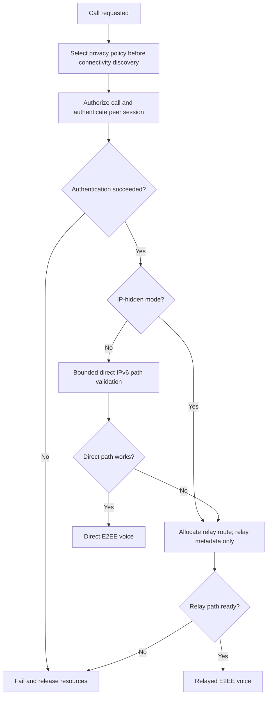
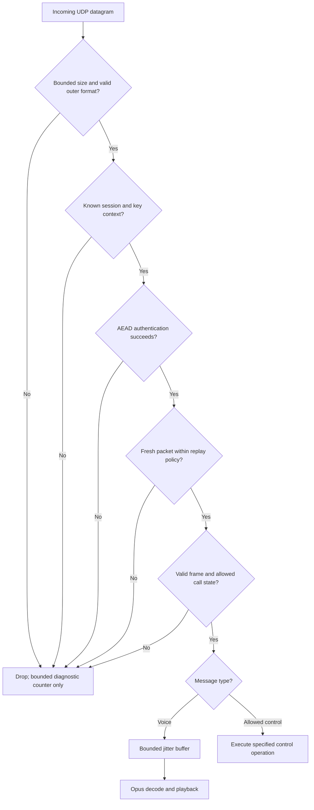
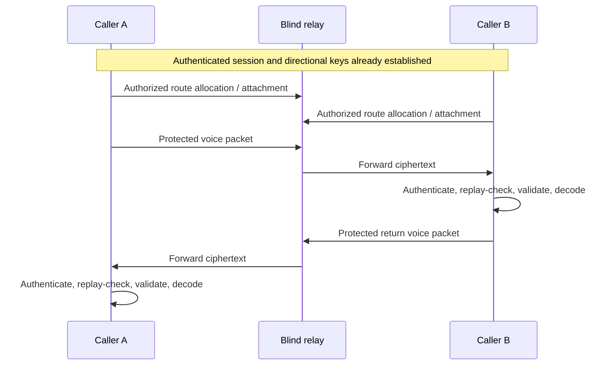

# System flows

An active registered client starts account-event delivery from the cursor in its verified bootstrap. It checks every notification against that cursor, reconciles through bootstrap, and requests a fresh snapshot on a gap or retention expiry. Logout and account replacement fence late messages and close the stream. Reconnect attempts and the pending-message queue are bounded.

Signed-out profile removal checks that the identity generation and signed-out state are still current after reading secure storage. A storage read failure displays a retry action on the entry screen.

Signed-out entry offers local profile removal when a retained profile exists. Another account can enroll after removal completes. The same principal can sign in with its current username without removing its native identity.

Logout starts local shutdown and credential cleanup. Call-end delivery and current-session revocation each get the shared five-second window. A confirmed revocation clears the server warning. If the user has already dismissed the warning, a late retry result leaves their current profile alone.

An active Expo session checks V2 bootstrap when the app returns to the foreground or reconnects while active. An offline restore can retry on reconnection. A verified rename refreshes the displayed username and fences work tied to the old profile. Unsupported snapshots route to the app-update screen.

When an access token expires, Expo writes the uncertainty marker and shares one refresh for the current identity. A request may cancel its wait while the rotation continues. After secure storage saves the replacement, eligible reads replay once. If storage is unavailable before the refresh is sent, the app offers storage retry. A lost refresh response after dispatch requires sign-in.

> Password change asks for the current and new passwords. After fresh authentication, the app fences older work, stops local voice and attempts to end the call on the server. It persists an uncertainty marker before submitting the change. Success signs the user out; a lost or ambiguous response asks the user to try the new password and then the previous one. A definite validation, authorization, conflict or rate-limit rejection restores the prior local session. Call-end delivery and database-backed revocation are not yet verified end to end.

> Registration and returning sign-in now use v2 device enrollment in the Expo source. After the protected session is stored, bootstrap verifies its principal, device, session and generation. A setup account must generate, save and acknowledge its current recovery-code set before activation; after an interruption it can regenerate a set or retry a previously acknowledged activation. Existing v1 sessions still restore through the legacy path. Database and Android device tests remain pending.

> Terminating call signaling clears the socket outbox and ping timer, rejects pending waits, and ignores late events from a replaced socket. A new call registers its peer wait after initiating its own socket connection.

> If registration returns an account but secure credential persistence fails, the app does not publish an authenticated session. It tells the user that the account may already exist and to sign in after resolving secure-storage access. A lost, malformed, or server-error response also leaves account creation uncertain, so the screen suggests trying sign-in before another registration attempt.

> Registered login and registration currently require a signed-out state; successful authentication clears private account projections before showing the new user. Guest conversion is deferred and is not implemented by signing into another profile in place.

> During session termination, native events are ignored when there is no authenticated active call, and stale call polling is stopped. For an active call, events must also match the call ID and the random ID of the current native preparation attempt. The coordinator starts native shutdown immediately and prevents the next native preparation until overlapping preparation and shutdown have settled. The native implementation still requires build and device validation.

> Current partial implementation: startup distinguishes signed-out, offline, secure-storage unavailable and reauthentication-required outcomes. Refresh-only legacy credentials are rotated explicitly, and uncertain refreshes require reauthentication. Logout starts local native shutdown before remote cleanup, shows a retry on local clearing failure and reports unconfirmed server revocation. The captured access token is kept only in process memory for a revocation retry and discarded when the warning is dismissed or revocation succeeds. Full lifecycle and native race coverage remains incomplete.

> Planned user journeys consolidated 2026-10-31: follow [user-management feature flows](user-management-implementation-plan.md#2-feature-behavior-and-recovery) for registration/recovery-code setup, optional email verification/recovery, username changes, deletion/cancellation, logout-first account replacement, guests/conversion, contacts/blocks and history. Entry is credential proof -> provisional device enrollment -> saved-code acknowledgement -> authorized activation -> durable storage -> bootstrap routing. Email recovery proof permits credential replacement and fresh enrollment, not revival of old authorization. Unknown requests show Accept/Block when opened; adding a contact explicitly grants future ringing. The call setup/media diagrams remain governed by Calling V2 and do not bypass these account gates.

> Accepted session flows (2026-10-20): [session V2](session-management-proposed-v2.md) owns first access, explicit guest creation, bootstrap routing, partial-storage/key recovery, uncertain-refresh recovery, per-service quota denial/all-enabled-service gate, UTC reminders, logout and replacement. [Calling V2](call_implementation_proposed_v2.md) remains the call flow authority. Earlier session links and conceptual flows below are historical where inconsistent.

> Design update (2026-10-17): [V2](call_implementation_proposed_v2.md) is the detailed first-delivery call plan, including both invitation paths, full-fingerprint verification, activation, adaptive audio, migration, recovery, renewal, leases, accounting and finalization. Its diagrams/defaults override the earlier conceptual flows below where they differ. Relay/IP-hidden branches remain future extensions; September implementation references are historical. User/session prerequisites remain separate in [session management](session-management.md).

**These are target-design flows.** Current registered-user, guest, login/upgrade, contact-call, code-call, and token-lifecycle paths are documented separately in [current-implementation.md](current-implementation.md). Read that baseline and [session-management.md](session-management.md) before implementing the next section; do not assume the flows below are already wired in the app.

Authentication before media, validation order, direct-first routing, and relay-only privacy mode are source requirements. Explicit consent sequencing, recovery, buffering, migration, and cleanup details are proposed completions. Actions shown below are logical operations, not finalized API names.

## 1. Session discovery and authentication

```mermaid
sequenceDiagram
    participant A as Caller A
    participant R as Rendezvous
    participant B as Caller B
    A->>R: Authenticate and create or locate session
    R-->>A: Room code / session locator
    B->>R: Authenticated join request with locator
    R->>R: Check admission and limits
    R-->>A: Authorized join request
    A->>R: Approve participant / consent
    R-->>B: Join accepted
    Note over A,B: Agree privacy policy before endpoint exchange
    A->>R: Authenticated-handshake message
    R->>B: Forward handshake message
    B->>R: Handshake response
    R->>A: Forward response
    Note over A,B: Continue all messages required by selected protocol
    Note over A,B: Verify intended peer, transcript, and agreed context
    Note over A,B: Complete required key confirmation; install directional keys
    alt Normal mode
        A->>R: Authorized direct endpoint metadata
        R->>B: Forward permitted metadata
        B->>R: Authorized direct endpoint metadata
        R->>A: Forward permitted metadata
        A->>B: Bounded authenticated path validation
        B->>A: Matching validation response
    else IP-hidden mode
        Note over A,B: Exchange relay routing metadata only; no direct probes
    end
    Note over A,B: Media starts only after consent and validated path readiness
```

The illustrated handshake messages are placeholders, not a two-message protocol. The chosen construction determines message count and when authentication is complete. Invalid joins are rejected before peer signaling; identity or handshake failures abort setup and discard temporary secrets.

## 2. Path selection



Fallback changes routing, not peer identity or encryption requirements. Timeouts and retry budgets remain open. Resolve privacy-policy disagreement before disclosing direct metadata; never silently weaken a caller's policy.

## 3. Sending voice

1. Confirm `CONNECTED` state and permission to transmit local audio.
2. Capture audio and encode a bounded Opus frame under negotiated limits.
3. Assign a packet number unique within the sending key's nonce domain.
4. Construct the header and authenticate its canonical encoding as AAD.
5. Encrypt with the directional key and profile-defined nonce.
6. Send over the validated direct or relay path.

The opposite direction uses its own key and counters. Packet loss must never cause a packet number to be reused for a newly encrypted payload.

## 4. Receiving and validating packets



Pre-authentication parsing performs bounded framing and state lookup only. Forged high packet numbers must not move the replay window. Authenticated replay admission must be atomic so concurrent handlers cannot dispatch duplicates.

Authentication does not authorize arbitrary operations: a valid peer may send invalid codec data, unsupported types, or actions forbidden by current state.

## 5. Replay and reordering example

Assume the replay window contains packet numbers 1841 through 1843.

| Arrival | Authentication | Action |
| --- | --- | --- |
| 1842, first arrival | Valid | Admit if semantics/state permit; record as seen |
| 1842, captured and retransmitted | Valid | Drop duplicate before dispatch |
| 1841, first arrival after 1842 | Valid | Admit if inside the window; timing policy may discard late audio |
| Packet older than the window | Valid | Drop as too old |
| Forged packet with a very high number | Invalid | Drop without changing replay state |

Replay eligibility and usefulness for playback are separate checks.

## 6. Relay operation



Relay outer routing metadata must not require media decryption or rewriting authenticated inner fields. Allocation, credentials, route binding, quotas, and expiry remain open protocol details.

## 7. Loss of connectivity and migration

Proposed completion:

1. Detect sustained liveness failure with bounded authenticated checks.
2. Enter `RECOVERING`; do not send media to an unvalidated new address.
3. Discover another policy-permitted path through authorized signaling. IP-hidden calls remain relay-only.
4. Validate session possession and return reachability before switching destinations. A connection ID alone is insufficient.
5. Preserve counters and replay state when keys are unchanged. If continuity is lost, establish a new authenticated session.
6. Return to `CONNECTED` on success; otherwise terminate after a bounded recovery budget.

Changing a path must not reset nonce counters under the same key. Switching an already direct call to privacy mode cannot undo disclosed addresses; the proposed UI requires a new call for fresh relay-only negotiation.

## 8. Key renewal

The source lists `KEY_UPDATE` but supplies no update protocol. Never implement it as an arbitrary peer instruction to replace keys.

Until a reviewed mechanism is selected, end or re-establish the authenticated session before cipher usage or packet-number limits. A future update design must specify synchronization, epochs, loss/reordering, overlap, replay windows, and old-key deletion.

## 9. Termination

Proposed completion:

1. Local hang-up immediately stops capture and outgoing voice.
2. Send authenticated `CALL_END` when possible; receipt moves the peer toward closure.
3. Stop playback, discard queued media, and release session audio devices and sockets.
4. Expire relay allocations and notify rendezvous where supported.
5. Discard ephemeral secrets, traffic keys, and transient state. Retain separately managed identity keys and permitted minimal records only.

If `CALL_END` is lost or a peer vanishes, bounded timeouts perform cleanup. UDP does not guarantee delivery; the essential-control retry strategy is still open.

