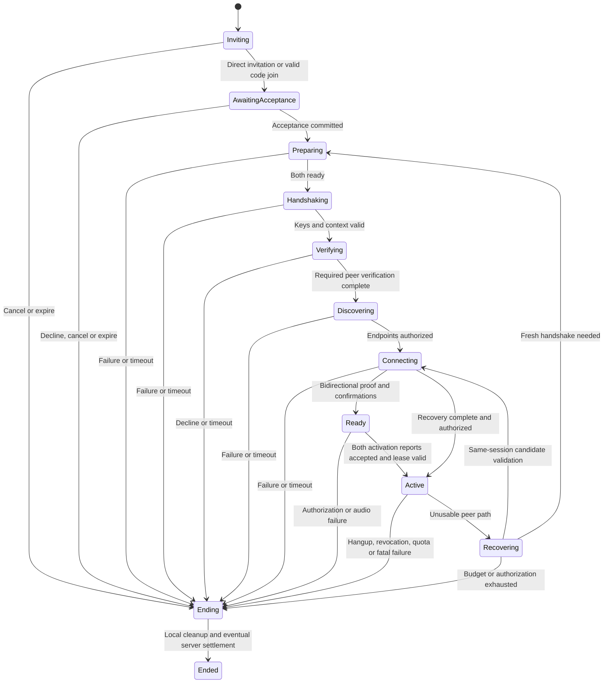

# Logical protocol and session state

## Currently Implemented in Code

Bootstrap accepts `snapshot=extended` independently of `include=device_key_fingerprint`. The event cursor is populated in the same database snapshot; eligibility, reset, reminders and deletion deadline remain optional and reserved for their owning features. Clients that omit the opt-in retain the existing shape. The ticket and WebSocket event contract is specified in [user-management contracts](#3-bootstrap-snapshot).

Registered enrollment uses Noise IK with X25519, ChaChaPoly, and SHA-256. The prologue starts with UTF-8 `ipv6ftp/noise-ik/v1/enroll` followed by a zero byte. Two unsigned 16-bit big-endian lengths prefix the challenge ID and the 32-byte nonce respectively. Message 1 is 96 bytes with an empty payload. Message 2 is 48–4096 bytes including the encrypted session grant. A submitted challenge is consumed once before proof verification. Commit checks the challenge's credential version and device generation under the account lock.

Clients request rotation metadata with `?rotation=1` and set `rotation_supported` on challenge creation. The signature covers the UTF-8 domain label `ipv6ftp/enrollment-key/v1`, canonical HTTPS origin, key ID, and raw X25519 public key, each prefixed by a 16-bit big-endian length. A 32-bit big-endian epoch follows. Go signs with P-256 ECDSA and SHA-256. The response carries an ASN.1 DER signature and SPKI signer in unpadded base64url. Android checks the pinned signer and increasing epoch before accepting a new responder key and persists the pin after authenticating message 2.

Expo opts in to `device_key_fingerprint` using the authenticated bootstrap query parameter `include`. The value is lowercase SHA-256 hex of the enrolled X25519 public key. Restore checks the installed key before publishing the profile. Fresh password-authenticated enrollment can replace a missing or unusable key.

> `POST /api/v2/account/password` retains its request and response contract. The backend now carries the credential version from the verified fresh-authentication grant to the atomic password update, rejecting a change if another credential update wins the race. The Expo client treats a response other than the expected 204, or a lost response, as an uncertain outcome and does not automatically replay the mutation.

> V2 registration and sign-in now use the enrollment exchange in the Expo source. The persisted session includes principal, device, session and generation references, which the client checks against bootstrap before granting normal UI access. Recovery setup acknowledgement supplies a saved code from the displayed set; the server validates its verifier against the current active set under the account lock. This changes the v2 acknowledgement request from an empty object to `{ "code": "..." }` and requires a coordinated client/server rollout. Native and PostgreSQL verification remain pending.

> The current Android receiver authenticates each eligible datagram before queueing it, so a failed tag cannot occupy a sequence or advance the receive position. Its existing bounded ordered queue is still distinct from the proposed V2 replay window. Native build, forged-packet and device validation remain pending.

> Concurrent expired read requests for the same identity share a refresh and each retries at most once after replacement credentials are persisted. New protected requests wait for an active rotation, and a late expired response from before a completed rotation uses the newer credential version instead of rotating again. Mutating requests are not replayed automatically after refresh. These behaviors have mocked interceptor tests; backend idempotency for future mutation-specific retries remains separate work.

> `ACCESS_EXPIRED` is reserved for an expired access-purpose JWT whose other checked properties do not invalidate it. An expired token with the wrong purpose, issuer, audience, signature or not-before state is classified as `SESSION_INVALID`; it does not trigger automatic refresh.

> Shared HTTP requests capture the local identity generation at invocation, before asynchronous credential loading. Requests carrying a caller abort signal also observe identity cancellation. Successful late responses are rejected when their captured generation is stale.

> The staged v1 registration path distinguishes a username uniqueness conflict (`USERNAME_TAKEN`) from a native device-key uniqueness conflict (`DEVICE_IDENTITY_CONFLICT`). V2 registration and enrollment use their own structured errors.

> A refresh rotation can commit before the server finishes loading its response. A post-commit profile failure is treated as an uncertain server failure, not as proof that the submitted refresh token was invalid. The client retains its uncertain-refresh marker and requires reauthentication. The database-backed path has not been exercised against a live database in this slice.

> The client rejects ordinary protected requests unless its session is authenticated, except for the profile request used during restoration. Android voice state, handshake, verification and error events carry `callId` and an `attemptId` generated per preparation; the coordinator accepts only the current authenticated call and attempt. This local bridge contract is implemented but not yet validated with a native build or device test.

> Partial local persistence: credential record version 1 stores active credentials, signed-out intent or uncertain refresh. The uncertain state is persisted before dispatch and prevents automatic reuse; public login/registration can still reauthenticate. Startup presents recovery and retry actions. Full refresh-race and end-to-end validation remain outstanding. Server request/response contracts are unchanged by this storage change.

> Partial client implementation: generic HTTP retries are limited to GET, HEAD and OPTIONS on network/5xx failures; mutations are not replayed by that retry policy. This does not implement operation-scoped idempotency or the separate authentication-refresh safeguards.

> Partial implemented HTTP contract: session middleware returns `ACCESS_EXPIRED` or `SESSION_INVALID` with HTTP 401, and `AUTH_UNAVAILABLE` with HTTP 503 for repository validation errors. The client refreshes only on `ACCESS_EXPIRED`, applies generation checks and persists refresh uncertainty; complete response classification and outage-safe restoration remain outstanding. Successful response shapes and endpoint paths are unchanged.

## Target New Flow (To Be Implemented)

The sections below define the target protocol, including draft fields and compatibility requirements. Source status alone does not establish interoperability.

## Calling V2

### 3. Safety gates and state machine

Before audio, require all gates:

1. Enrolled device possession and active device/account or guest.
2. Valid API token and live, non-revoked session bound to that device.
3. Eligible tier/route, rate limits and no conflicting active call.
4. Valid invitation, accepted membership and explicit user consent.
5. Call/device/session-bound signaling authorization and mutual readiness.
6. Successful context-bound Noise handshake and expected remote key checks.
7. First-contact verification or matching previously verified keys, plus protected confirmations from both sides.
8. Authenticated observed endpoint registration and bidirectional path proof.
9. Valid call authorization and server acceptance of both participants' activation reports.
10. Microphone permission and usable native audio resources; no capture before all media gates pass.



Cancel/end is legal from every nonterminal state even where not separately drawn. Key renewal is a coordinated sub-operation of an active call; it does not reset admission, allowance or media timeline. Local state and backend state need explicit mappings; one participant's report cannot prove the other is active. An ended call cannot be revived.

### 5. Signaling and ticket recovery

Each accepted participant obtains a purpose-bound ticket through current API authorization. Bind it to call, participant, device, authorizing session, generation and expiry. Authorize before upgrade/forwarding. Fetch a fresh ticket on reconnect, and fence superseded sockets. Do not log credential-bearing URLs.

Readiness records are participant/generation-specific and shared across instances. Two sockets do not imply two distinct ready devices. Duplicate readiness is idempotent. No handshake starts until both native states are prepared.

#### Signaling establishment loss

On failed upgrade/uncertain establishment, reauthenticate and obtain a replacement ticket. Invalidate superseded pending tickets; replace the participant's connection slot and reject old-socket callbacks. Reconcile the existing handshake generation before deciding to resume or restart. Rate-limit and deduplicate ticket issuance.

#### Rendezvous response loss

Retain a bounded completion result for an authenticated registration. A retry with the same ticket/request identity, nonce, contents, call/generation and observed endpoint receives the same authenticated result without a second registration side effect. Re-authenticate the retry.

A changed source address/port is not an identical retry: obtain fresh authorization and register a new candidate. Missing/expired result after Redis loss requires reissue after current membership checks, not blind ticket reuse.

Ticket processing has atomic Issued/Processing/Completed/Expired transitions, with validation before consumption, bounded processing recovery and idempotent completion. Separate read/delete is insufficient. An invalid request cannot consume another participant's ticket. Processing/result retention and issuance TTL values must be fixed with retry/deadline tests; current source's 30-second ticket TTL is not automatically the V2 profile.

### 9. Packet format, nonces, and replay

#### Protected UDP header

| Field | Bytes | Rule |
| --- | ---: | --- |
| Protocol version | 1 | Supported version only |
| Packet type | 1 | Explicit allowed type; untrusted until authentication |
| Reserved flags | 2 | Zero in initial version |
| Connection identifier | 16 | Random reference agreed in handshake context |
| Key generation | 8 | Match installed receive state |
| Security packet sequence | 8 | Directional nonce input and replay identity |
| Ciphertext length | 2 | Includes 16-byte tag; exact framing match |
| **Header** | **38** | Authenticate exact bytes as AAD |

Integer header fields use network byte order. Keep 64-bit counters/generations exact in native code and serialization; never round them through a JavaScript Number or an incompatible signed-integer conversion. Noise nonce encoding follows its library/profile, not an arbitrary byte reinterpretation. The header is readable and authenticated; exclude account IDs, tokens and keys. Whole UDP payload cap is 1,200 bytes, excluding IP/UDP headers. Thus encrypted plaintext capacity is 1,146 bytes after header/tag.

Audio plaintext is an 8-byte media sequence, 8-byte timestamp in the negotiated 48 kHz sample timeline, and one 20 ms Opus frame. Media sequencing continues across routine renewal; controls do not create false media-loss gaps. Specify mute, discarded-before-send frames, wrap limits and timestamp origin explicitly in the wire appendix. FEC stays within the Opus frame; it is not a separate original audio sequence. No application fragmentation; bound encoder output and decoder samples, reject oversize input safely.

#### Send

One 64-bit counter per directional key generation, starting at zero for fresh keys. Audio and controls share the allocator. Serialize allocation/encryption safely across threads. Never reclaim numbers for failed/unsent packets, wrap counters or encrypt different plaintext under the same key/nonce. Retries receive fresh packet numbers while retaining the logical operation ID.

#### Receive

1. Bound size and fixed parsing; locate known connection/generation without unbounded allocation.
2. Authenticate header/payload using the expected directional key and nonce.
3. Atomically recheck/admit the sequence and update a proposed 1,024-number sliding replay window.
4. Validate packet type/schema/state; only then dispatch media or permitted controls.
5. Apply jitter-buffer/playback deadlines separately from replay eligibility.

Unseen authenticated numbers within the window permit reordering; duplicates/too-old packets are dropped. A valid new highest number advances the bounded window without allocating the intervening range. Failed authentication never advances trusted state or reserves a sequence. No unauthenticated buffering may poison valid sequence positions. A captured genuine packet accepted first still contains the original sender's bytes; later copies are discarded. Separate directional keys reject reflection. Source-IP filtering complements, never replaces, these checks.

### 11. Control acknowledgements and retries

| Class | Behavior |
| --- | --- |
| Audio | Send continuously; no routine retransmission of stale frames |
| Periodic quality/status observations | Newer observations supersede older ones |
| Essential operations | Explicit responses, bounded retry and idempotent application |

Use 128-bit random control operation IDs distinct from packet sequences. Retrying operation R7 sends a newly encrypted packet with a fresh sequence but the same operation identity/content. Receiver authenticates/replay-checks, then applies a valid new operation once. Identical valid retries return the cached result; conflicting contents under one ID are rejected. Packet replay protection does not substitute for operation deduplication.

Responses distinguish received, ready/completed and rejected. Bind to operation/call/generation; receipt is not proof keys were installed or audio activated. No ACK-of-ACK loop. Bound request/result storage and keep deduplication valid for the entire retry lifetime; never evict protection early then execute a duplicate. Invalid requests do not allocate unlimited state.

Initial timeout 500 ms without RTT history; adaptive range 250 ms-2 seconds, based on RTT/variation and backoff. At most five transmissions including original; every stage deadline overrides retries. Cancel on completion, supersession, ending, revocation or expiry. Exact estimator, jitter/backoff formula, cache lifetimes/capacity and per-type payload codes require implementation-level specification and tests.

## Session V2

### 12. Authorization and operation contracts

Every protected API operation validates credential signature/expiry, durable session/device/principal status, active authorization generation, permission, resource ownership, applicable quota and valid state. A JWT signature, cached role, locally edited balance or hidden button is insufficient. Enrollment/login/refresh are not exempt from validation: they use their own public or credential/proof-specific authorization contracts, bounded schemas and rate limits. Health checks expose no protected data.

Protected sockets authorize before upgrade/forwarding, check message permissions/generations and handle expiry/revocation throughout connection lifetime. Reconnect obtains fresh tickets; do not reuse consumed or stale credential-bearing URLs. Access rotation does not automatically rekey media. Client responses/events require authenticated transport and schema/operation/ownership/revision checks; a success flag is not enough.

Input validation precedes side effects: types, maximum lengths, payload/frame size, enum values and strict unknown-field handling where specified. Derive actor from trusted authentication context; reject foreign resource IDs or caller-supplied privilege fields. Even authenticated data can be malformed or malicious. Parameterized SQL and DB constraints complement validation.

Retryable mutations use idempotency scoped to principal/device and canonical operation, with payload fingerprint, bounded result/processing state and ownership checks. Same key/request yields the original authorized result, not another mutation; changed payload conflicts. No secret replay or current-auth bypass. Account changes, call end and usage settle once. Refresh uses section 7's conservative recovery rather than generic response replay. Concurrent in-progress retries receive a defined bounded pending/conflict outcome.

Errors distinguish invalid input, unauthenticated, forbidden, state conflict, quota exhaustion/reset, API rate limiting and infrastructure failure without exposing unrelated users/secrets. Exact endpoints, schemas, codes and compatibility rules remain to define before implementation. No arbitrary remote code/instruction execution.

### 13. Events and reconciliation

1. UI sends intent; Go validates/commits authoritative changes.
2. Respond with committed outcome and revision; transactional outbox records required notifications.
3. Go delivers recipient-authorized events over protected connections, using Redis for routing/wake-up where appropriate.
4. Client applies only current revision/identity generation; ignore duplicate/older events. A gap or reconnect obtains an authorized snapshot or bounded retained replay then resnapshot.

Events carry ID, schema, entity/revision, relevant authorization/session/device generations and scoped payload. Exclude other users' credentials/private records. Limit cursor retention and define expired-cursor fallback. Redis Pub/Sub is not durable delivery; outbox retries plus reconciliation/leases repair loss. Consumers deduplicate; publishing is not proof a peer stopped.

Presence is approximate availability, not login validity or evidence audio stopped. Heartbeat/socket loss may expire Redis presence without revoking session. Use event/network callbacks, bounded timers and backoff, not tight full-state polling or secure-storage polling. Coalesce updates, avoid per-frame PostgreSQL writes and protect slow clients with bounded queues/disconnect-and-resume behavior. Share readiness/ownership across instances rather than relying on local socket counts.

## Account API V2

### 1. Conventions

- Base path `/api/v2/`. v1 stays only for compatible interim fixes and is disabled for credential issuance at cutover (typed `upgrade_required`).
- JSON only, `Content-Type: application/json`, body limit 16 KiB, unknown fields and trailing data rejected, wrong method gives 405 before any lookup.
- Bearer token in `Authorization` only. Never in query strings.
- Mutating account requests carry `Idempotency-Key` (UUID, actor scoped) and the server stores a payload fingerprint for 24 h. Same key and payload returns the original non-secret outcome. Same key and different payload returns `409 operation_conflict`. Credential-bearing responses (tokens, recovery codes) are never replayed from this cache.
- Every authorized response carries `X-Account-Revision`. Snapshots carry `principal_id`, `device_id`, `session_id`, `generation`, `revision`.
- Go request/response structs and strict Zod schemas are written together under `backend/internal/transport/http/contracts` and `frontend/src/core/api/schemas`. Fixtures live in `testdata/contracts/v2/{valid,invalid}/*.json` and both sides test against the same files.

#### Error envelope

```json
{"error":{"code":"rate_limited","message":"...","retry_after_seconds":30,"details":{}}}
```

| Code | HTTP | Client action |
| --- | --- | --- |
| `validation_failed` | 400 | Fix input; no retry |
| `access_expired` | 401 | Only code that triggers refresh |
| `session_invalid` | 401 | Terminate local identity |
| `forbidden` / `restricted` | 403 | Show state; no retry |
| `not_found` | 404 | Also used for foreign, blocked and deleted resources |
| `conflict` / `operation_conflict` | 409 | Re-read state |
| `pending_operation` | 409 | Poll or resume |
| `quota_exhausted` | 429 | Show reset time |
| `rate_limited` | 429 | Honour `retry_after_seconds` |
| `unavailable` | 503 | Retry with backoff; never fall back to guest |
| `upgrade_required` | 426 | Offer update |

### 2. Auth and enrollment

| Operation | Method and path | Notes |
| --- | --- | --- |
| Registered begin | `POST /auth/registered/begin` | username, password, client schema version. Creates account in `setup_pending`; returns a setup grant (purpose `setup`, 15 min). No ordinary session. |
| Guest begin | `POST /auth/guest/begin` | Explicit user action only. Android recognition value is purpose scoped. |
| Server key | `GET /auth/server-key` | Public. `{key_id, public_key}` (base64url X25519). The phone pins it on first fetch; clients that opt in can receive signed rotation metadata. The authenticated finish establishes a separate P-256 signer pin. See the [wire profile](protocol.md). |
| Enrollment challenge | `POST /auth/enroll/challenge` | `{setup_grant}` returns `{challenge_id, nonce (32 bytes), expires_in_seconds (120), server_key_id}`. One open challenge per account; a new one supersedes the old. |
| Enrollment finish | `POST /auth/enroll/finish` | `{challenge_id, handshake}`: `handshake` is Noise IK message 1 (`Noise_IK_25519_ChaChaPoly_SHA256`, empty payload, prologue = `Prologue("enroll", challenge_id, nonce)`). The response `{handshake}` is message 2; **its encrypted payload is the `SessionGrant`** (access/refresh tokens, session, device, generation, state), so tokens are readable only by the holder of the device private key. The challenge is consumed even if the handshake fails. In one transaction: revoke every earlier session and every other device, bind the device and session, bump `device_generation`. A revoked key can never re-enroll; the same phone restoring keeps its device id. |
| Setup resume | `POST /auth/setup/resume` | `{username, password}` returns a new setup grant. Serves an incomplete registration and a returning user on a new phone alike; never creates an account; every failure is identical. |
| Activate | `POST /auth/setup/activate` | Session required. 409 until recovery codes were acknowledged; then sets `activated_at` (`recovery_setup` becomes `active`). |
| Recovery-code acknowledgement | `POST /auth/setup/ack-recovery-codes` | Required before `active`. |
| Bootstrap | `GET /auth/bootstrap` | Revisioned snapshot (section 3). |
| Refresh | `POST /auth/refresh` | Single use token rotation with lineage; reuse revokes lineage. |
| Logout | `POST /auth/logout` | Idempotent; also `POST /auth/logout-all`. |

Account states: `setup_pending`, `recovery_setup`, `active`, `restricted`, `pending_deletion`, `deleted`. Unknown values deny protected continuation.

### 3. Bootstrap snapshot

The current endpoint returns the existing shape by default. Clients may request `snapshot=extended` alongside the independent fingerprint opt-in. The event cursor is populated from the same database snapshot as the profile. Eligibility, reset, reminder and deletion deadline remain reserved for their owning milestones.

Account events use `GET /api/v2/events/snapshot` for an authenticated extended bootstrap snapshot, `POST /api/v2/events/ticket` for a one-use 30-second ticket, and `GET /api/v2/events/stream?cursor=<cursor>` for the WebSocket. Pass `account-events-v1` and `ticket.<ticket>` as WebSocket subprotocols; only the first is echoed. Cursors are opaque, account-local strings. Each frame is `{"kind":"event","event":{"cursor":"<cursor>","previous_cursor":"<previous>","type":"username_changed","version":1,"payload":{}}}` or `{"kind":"resync_required"}`. Recipients and sessions are checked server-side; events invalidate cached state and do not grant authority. A fresh snapshot repairs gaps and expired cursors. Connections and batches are bounded, sessions are revalidated, and expired records are removed by bounded retention work. Implementation depends on migrations 019 and 020; live database and device verification are pending.

```json
{"schema_version":2,"revision":12,"principal_id":"uuid","device_id":"uuid","session_id":"uuid",
 "generation":3,"username":"alice","account_type":"registered","account_state":"active",
 "capabilities":["direct_ipv6_call","contacts"],"policy_version":4,
 "eligibility":{"allowed_seconds":null,"reset_at":null},"reminder":null,
 "deletion":null,"events":{"resume_cursor":"opaque","ticket_endpoint":"/api/v2/events/ticket"}}
```

Cached snapshots are display only and never grant operations.

### 4. Account security

| Operation | Method and path | Fresh auth |
| --- | --- | --- |
| Password change | `POST /account/password` | Yes (5 min, operation bound) |
| Recovery codes create or regenerate | `POST /account/recovery-codes` | Yes |
| Recovery email start, verify, remove | `POST /account/email/challenge`, `/verify`, `DELETE /account/email` | Yes |
| Recovery begin | `POST /recovery/begin` | No; generic response, throttled first |
| Recovery prove | `POST /recovery/prove` | Code or email proof gives a scoped grant |
| Recovery complete | `POST /recovery/complete` | New password; revokes sessions and devices; new code set |
| Fresh-auth | `POST /account/reauth` | Returns a short grant bound to a named operation |

Defaults from the plan apply: 10 recovery codes of 128 bits, 8-digit email challenge with 10 min lifetime and 5 attempts, resend cooldown 60 s.

### 5. Profile, social, policy, history

| Family | Operations |
| --- | --- |
| Profile | `GET /account`, `GET /account/username-available?name=`, `POST /account/username`, `POST /account/deletion`, `GET /account/deletion`, `DELETE /account/deletion` (cancel), `GET /account/sessions`, `DELETE /account/sessions/{id}` |
| Social | `GET /users/lookup?username=` (exact), `GET/POST/DELETE /contacts`, `GET/POST/DELETE /blocks`, `GET /call-requests`, `POST /call-requests/{id}/accept`, `POST /call-requests/{id}/block`, `POST /reports` |
| Policy/history | `GET /policy/eligibility`, `POST /policy/reminders/ack`, `GET /history`, `DELETE /history/{id}`, `DELETE /history` |
| Events | `GET /events/snapshot`, `POST /events/ticket`, `POST /webhooks/resend` (signature verified, replay checked) |

Foreign, blocked, disabled and deleted resources all return `not_found`. Lookup never discloses IP, email, guest data or presence.
