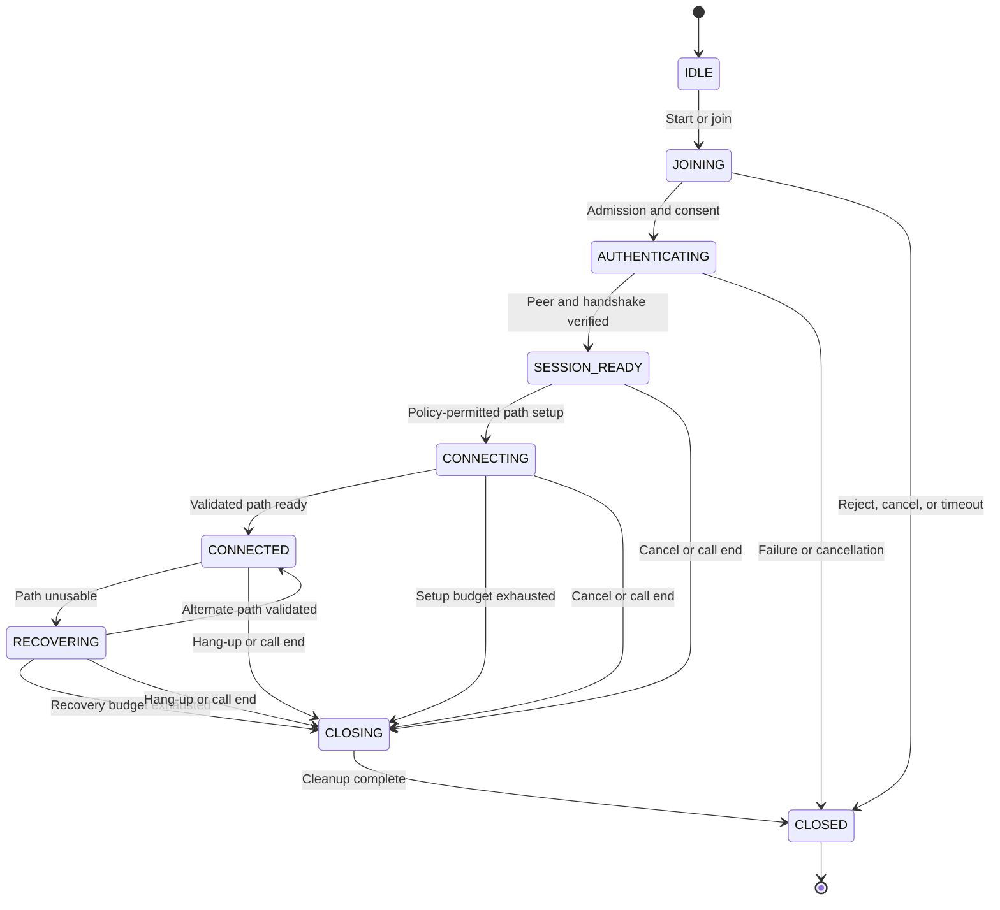

# Logical protocol and session state

Bootstrap accepts `snapshot=extended` independently of `include=device_key_fingerprint`. The event cursor is populated in the same database snapshot; eligibility, reset, reminders and deletion deadline remain optional and reserved for their owning features. Clients that omit the opt-in retain the existing shape. The ticket and WebSocket event contract is specified in [user-management contracts](user-management-contracts-v2.md#3-bootstrap-snapshot).

Registered enrollment uses Noise IK with X25519, ChaChaPoly, and SHA-256. The prologue starts with UTF-8 `ipv6ftp/noise-ik/v1/enroll` followed by a zero byte. Two unsigned 16-bit big-endian lengths prefix the challenge ID and the 32-byte nonce respectively. Message 1 is 96 bytes with an empty payload. Message 2 is 48–4096 bytes including the encrypted session grant. A submitted challenge is consumed once before proof verification. Commit checks the challenge's credential version and device generation under the account lock.

Clients request rotation metadata with `?rotation=1` and set `rotation_supported` on challenge creation. The signature covers the UTF-8 domain label `ipv6ftp/enrollment-key/v1`, canonical HTTPS origin, key ID, and raw X25519 public key, each prefixed by a 16-bit big-endian length. A 32-bit big-endian epoch follows. Go signs with P-256 ECDSA and SHA-256. The response carries an ASN.1 DER signature and SPKI signer in unpadded base64url. Android checks the pinned signer and increasing epoch before accepting a new responder key and persists the pin after authenticating message 2.

Expo opts in to `device_key_fingerprint` using the authenticated bootstrap query parameter `include`. The value is lowercase SHA-256 hex of the enrolled X25519 public key. Restore checks the installed key before publishing the profile. Fresh password-authenticated enrollment can replace a missing or unusable key.

> `POST /api/v2/account/password` retains its request and response contract. The backend now carries the credential version from the verified fresh-authentication grant to the atomic password update, rejecting a change if another credential update wins the race. The Expo client treats a response other than the expected 204, or a lost response, as an uncertain outcome and does not automatically replay the mutation.

> V2 registration and sign-in now use the enrollment exchange in the Expo source. The persisted session includes principal, device, session and generation references, which the client checks against bootstrap before granting normal UI access. Recovery setup acknowledgement supplies a saved code from the displayed set; the server validates its verifier against the current active set under the account lock. This changes the v2 acknowledgement request from an empty object to `{ "code": "..." }` and requires a coordinated client/server rollout. Native and PostgreSQL verification remain pending.

> The current Android receiver authenticates each eligible datagram before queueing it, so a failed tag cannot occupy a sequence or advance the receive position. Its existing bounded ordered queue is still distinct from the proposed V2 replay window. Native build, forged-packet and device validation remain pending.

> Concurrent expired read requests for the same identity share a refresh and each retries at most once after replacement credentials are persisted. New protected requests wait for an active rotation, and a late expired response from before a completed rotation uses the newer credential version instead of rotating again. Mutating requests are not replayed automatically after refresh. These behaviors have mocked interceptor tests; backend idempotency for future mutation-specific retries remains separate work.

> `ACCESS_EXPIRED` is reserved for an expired access-purpose JWT whose other checked properties do not invalidate it. An expired token with the wrong purpose, issuer, audience, signature or not-before state is classified as `SESSION_INVALID`; it does not trigger automatic refresh.

> Shared HTTP requests capture the local identity generation at invocation, before asynchronous credential loading. Requests carrying a caller abort signal also observe identity cancellation. Successful late responses are rejected when their captured generation is stale.

> The staged v1 registration path distinguishes a username uniqueness conflict (`USERNAME_TAKEN`) from a native device-key uniqueness conflict (`DEVICE_IDENTITY_CONFLICT`). V2 registration and enrollment use their own structured errors.

> A refresh rotation can commit before the server finishes loading its response. A post-commit profile failure is treated as an uncertain server failure, not as proof that the submitted refresh token was invalid. The client retains its uncertain-refresh marker and requires reauthentication. The database-backed path has not been exercised against a live database in this slice.

> The client rejects ordinary protected requests unless its session is authenticated, except for the profile request used during restoration. Android voice state, handshake, verification and error events carry `callId` and an `attemptId` generated per preparation; the coordinator accepts only the current authenticated call and attempt. This local bridge contract is implemented but not yet validated with a native build or device test.

> Partial local persistence: credential record version 1 stores active credentials, signed-out intent or uncertain refresh. The uncertain state is persisted before dispatch and prevents automatic reuse; public login/registration can still reauthenticate. Startup presents recovery and retry actions. Full refresh-race and end-to-end validation remain outstanding. Server request/response contracts are unchanged by this storage change.

> Partial client implementation: generic HTTP retries are limited to GET, HEAD and OPTIONS on network/5xx failures; mutations are not replayed by that retry policy. This does not implement operation-scoped idempotency or the separate authentication-refresh safeguards.

> Partial implemented HTTP contract: session middleware returns `ACCESS_EXPIRED` or `SESSION_INVALID` with HTTP 401, and `AUTH_UNAVAILABLE` with HTTP 503 for repository validation errors. The client refreshes only on `ACCESS_EXPIRED`, applies generation checks and persists refresh uncertainty; complete response classification and outage-safe restoration remain outstanding. Successful response shapes and endpoint paths are unchanged.

> Planned account contract work (2026-10-31): [user-management contracts](user-management-implementation-plan.md#3-contracts-persistence-and-rollout) introduce versioned `/api/v2/` account journeys, bounded purpose-scoped setup/recovery grants, structured errors, generation/revision fencing, stable principal-based key ownership and idempotent non-secret mutation outcomes. Email codes and offline recovery codes are distinct from call invitation and peer-verification material. Exact messages, enrollment Noise IK profile/server-key trust/library vectors and compatibility fixtures must pass M0 before affected implementation. Legacy token-issuance paths cannot remain a bypass at cutover. Calling V2's wire/nonce/lease profile is unchanged.

> Accepted session contract (2026-10-20): [session V2 operation contracts](session-management-proposed-v2.md#12-authorization-and-operation-contracts) and [events](session-management-proposed-v2.md#13-events-and-reconciliation) require bounded schemas, ownership/generation/revision checks, operation-scoped idempotency, fresh socket authorization and snapshot repair. Enrollment/recovery use purpose-separated Noise IK candidate; exact schemas/server-key trust/vectors remain prerequisites. Calling V2 wire choices are unchanged. Server responses cannot override local consent or safety.

> Current profile (2026-10-17): follow [V2 sections 6-14 and 20](call_implementation_proposed_v2.md#6-handshake-and-canonical-context). Accepted direction: Noise XX, deterministic CBOR context/control data, full 256-bit verification fingerprint, fixed 38-byte authenticated header, 1,200-byte UDP payload, directional 64-bit nonce counters, 1,024-number replay window, separate encrypted media sequence/time, idempotent controls, validated migration and bounded generation renewal. These are proposed contracts/test defaults, not verified wire interoperability. Exact schemas/type codes, vectors, bounded state and transition-loss handling must be completed. Earlier conceptual formats below are background; V2 takes precedence.

**Status: conceptual background plus V2's selected draft profile, not verified wire interoperability.** V2 defines initial field widths, algorithms, counters, retry defaults and framing. Numeric message assignments, exact structured schemas, transition rules and vectors still need completion. See [decisions.md](decisions.md).

The September implementation baseline exchanged WebRTC signaling and delegated packets to WebRTC. Newer native working-tree code is partial and is not a verified implementation of V2. The sections below preserve the broader conceptual protocol requirements; do not use their older field/profile placeholders instead of V2's accepted choices.

## 1. Protocol responsibilities

| Part | Purpose | Status |
| --- | --- | --- |
| Rendezvous signaling | Discovery, admission, consent, handshake forwarding, permitted metadata | API and transport open |
| Authenticated handshake | Verify peer, bind context, establish directional keys | Established construction required; exact profile open |
| Protected datagrams | Carry bounded voice and explicit controls | Logical format specified; binary encoding/profile open |

Server admission differs from peer authentication. Before traffic keys exist, handshake messages follow the chosen handshake's validation and resource limits, not the media packet validation path.

## 2. Handshake contract

Inputs are identity credentials, peer verification policy, fresh ephemeral material, session context, and supported parameters. Success produces an authenticated peer binding, agreed parameters, and independent directional traffic keys.

Proposed context binding includes session ID, participant roles, version, privacy policy, and negotiated media profile. Exact encoding and placement must follow the chosen protocol. Do not replace its key schedule with a homemade `HKDF(shared_secret)` construction.

Noise provides handshake patterns and cryptographic processing; the application chooses a pattern and defines why the remote static key is trusted. Datagram transport also needs explicit loss/reordering handling. See the [Noise Protocol Framework](https://noiseprotocol.org/noise.html), including application responsibilities and out-of-order transport.

## 3. Conceptual packet

```text
IPv6 header / UDP header                Network envelope
+------------------------------------+
| Protocol version                   |
| Connection ID                      |
| Packet number                      |  Application header
| Stream ID                          |  Proposed: canonical bytes are AAD
| Frame type                         |
| Ciphertext length                  |
+------------------------------------+
| Encrypted voice or control payload |
+------------------------------------+
| AEAD authentication tag            |
+------------------------------------+
```

The application fields come from the source. Authenticating them as AAD is a proposed completion. Do not indiscriminately bind mutable network headers or relay envelopes; migration and relay forwarding must work under the selected profile.

| Field | Meaning | Validation |
| --- | --- | --- |
| Version | Format/profile selection | Reject unsupported versions; bind negotiation against downgrade |
| Connection ID | Candidate session lookup | Never authorization by itself |
| Packet number | Nonce input and replay tracking | Unique in its key domain; no wrap or reuse |
| Stream ID | Negotiated stream selection | Reject unknown/unauthorized streams |
| Frame type | Payload schema selection | Authenticate before interpreting as an operation |
| Ciphertext length | Bound payload parsing | Exact consistency with datagram and tag size |
| Ciphertext | Encoded voice or control data | No consumer receives unauthenticated plaintext |
| Tag | Integrity/authenticity evidence | Failure causes drop before dispatch |

A key epoch identifier may be needed if key updates are adopted. It is a proposed extension, not a source-defined field. Decide whether explicit or implicit before finalizing encoding.

## 4. Key, nonce, and replay rules

- A's A-to-B sending key matches B's receiving key; B-to-A uses a distinct key.
- Proposed default: voice and control share one monotonic packet counter per sending key. Separate stream counters require separate cryptographic domains.
- The selected cipher/profile defines nonce construction and usage limits. Packet numbers alone do not define a safe nonce scheme.
- Path changes preserve counters/replay state while keys remain unchanged. Restart must not restore old keys with reset counters.
- Receive replay state is independent per receiving key/generation. V2 proposes a 1,024-number sliding window: only authenticated fresh numbers advance it, with bounded arithmetic/storage even for a large jump. Replay eligibility is separate from audio playback deadlines.
- Optional replay prefilters may reject obviously stale input, but unauthenticated input never advances state. Authenticated admission must be atomic.

AEAD requires correct nonce management and authenticates associated data without encrypting it. See [RFC 5116](https://www.rfc-editor.org/rfc/rfc5116) for the generic interface and requirements.

## 5. Message types

Names are source examples; permissions below are proposed completions.

| Type | Purpose | Proposed permission |
| --- | --- | --- |
| `VOICE_FRAME` | Bounded encoded voice | `CONNECTED`; negotiated stream and codec only |
| `PING` | Bounded liveness check | `CONNECTING`, `CONNECTED`, `RECOVERING`; not a replacement for migration validation |
| `PONG` | Reply to an outstanding probe | Same states; match a valid outstanding request |
| `CALL_ACCEPT` | Optional protected confirmation | `SESSION_READY` or `CONNECTING`; relationship to signaling acceptance must be specified |
| `CALL_END` | Terminate session | Any post-handshake live state; duplicate effects harmless |
| `KEY_UPDATE` | Future reviewed key renewal | Disabled/rejected until a complete profile exists |

Pre-key invitation acceptance is a signaling action, not an encrypted media control frame. Unknown types are dropped. Generic commands, shell execution, filesystem actions, and arbitrary RPC dispatch are excluded.

## 6. Proposed call state machine



`SESSION_READY` means key establishment is complete, not that media connectivity works. Only `CONNECTED` accepts voice. Late packets for closed sessions are dropped. Pre-session cancellation/failure releases temporary state as well.

## 7. Processing and delivery contract

1. Cap datagram sizes and allocations before processing.
2. Bounds-check framing without unbounded parsing.
3. Resolve an existing protected session; a media packet cannot create authenticated state.
4. Authenticate ciphertext and protected header using the correct directional key.
5. Apply race-safe replay admission.
6. Validate type, exact schema, stream, negotiated parameters, and current state.
7. Deliver voice to bounded buffering/decoding, or execute the one authorized control action.

Malformed input is dropped without an amplifying response. Late audio may be discarded; essential controls require a defined loss/retry strategy. No generic ACK message is defined here despite the source's illustrative mention of authenticated ACKs.
