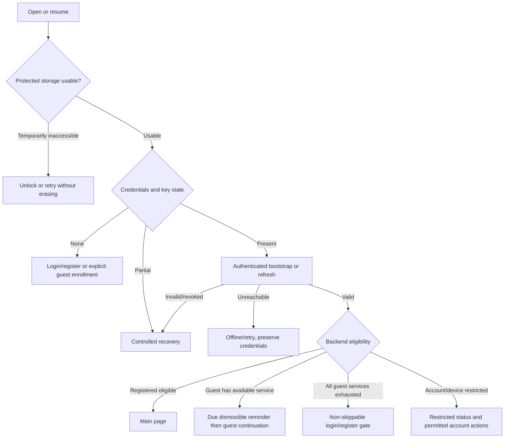
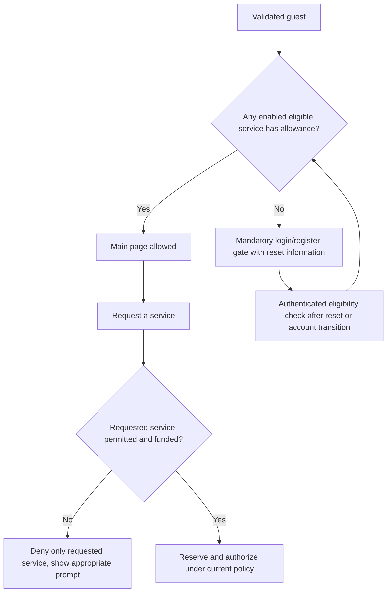
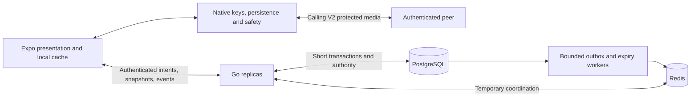

# Session management proposed V2

> User-flow decisions consolidated 2026-10-31: the [user-management implementation plan](user-management-implementation-plan.md) supplies the previously separate registered login/recovery module and resolves selected prerequisites: username/password, acknowledged saved codes, optional unique verified recovery email via Resend/in-app codes, username changes/reservations/retirement, seven-day deletion cancellation, logout-first device-profile replacement and unlimited registered direct-IPv6 entitlement with guest usage preserved. It also supplies exact discovery, contact-granted caller permission, registered history retention and phased verification. Its D01-D17 register is user-selected; engineering defaults and unresolved contract/review gates are separately identified. The invariants below remain in force; this addition verifies no implementation.

**Status: accepted implementation plan, 2026-10-20. Not an implementation, migration, security certification or verified deployment.** This consolidates the user-reviewed session decisions and supersedes [the initial session proposal](session-management.md). [system.md](system.md) remains the canonical system overview. [Calling V2](call_implementation_proposed_v2.md) owns peer connection, media, call accounting mechanics and call termination. Read this document first for identity/session prerequisites, then calling V2 for the complete unit.

Accepted behavior below must be preserved during implementation. Items explicitly marked as specification prerequisites still need concrete contracts before the affected phase can ship. They are not permission to invent security protocols or silently change policy. No code, database or dependency change is authorized merely by preparing this plan.

## Contents

1. [Scope and boundaries](#1-scope-and-boundaries)
2. [Identities and replaceable providers](#2-identities-and-replaceable-providers)
3. [Ownership and conceptual records](#3-ownership-and-conceptual-records)
4. [First access and enrollment](#4-first-access-and-enrollment)
5. [Persistent login and startup](#5-persistent-login-and-startup)
6. [Recovery and partial storage](#6-recovery-and-partial-storage)
7. [Expiry and refresh](#7-expiry-and-refresh)
8. [Guest allowance and gating](#8-guest-allowance-and-gating)
9. [Registration reminders](#9-registration-reminders)
10. [Versioned database policy](#10-versioned-database-policy)
11. [Logout and replacement](#11-logout-and-replacement)
12. [Authorization and operation contracts](#12-authorization-and-operation-contracts)
13. [Events and reconciliation](#13-events-and-reconciliation)
14. [Transactions and concurrency](#14-transactions-and-concurrency)
15. [Storage topology and failures](#15-storage-topology-and-failures)
16. [Capacity and per-API rate limits](#16-capacity-and-per-api-rate-limits)
17. [Retention and audit](#17-retention-and-audit)
18. [Calling integration](#18-calling-integration)
19. [Implementation phases](#19-implementation-phases)
20. [Acceptance matrix](#20-acceptance-matrix)
21. [Specification prerequisites](#21-specification-prerequisites)
22. [Decision register and evidence](#22-decision-register-and-evidence)

## 1. Scope and boundaries

Registered users and unregistered guests both use backend-authenticated device sessions. A guest lacks registered login credentials but is not an unauthenticated protected-API caller. Account type changes permissions and allowance, never cryptographic strength. Authentication establishes authorized account/device access, not verified real-world human identity or intended-peer trust.

Initial delivery targets the Expo Android app and Go/PostgreSQL/Redis backend. Calling initially supports direct IPv6 under calling V2. IPv4 allowance is defined but inactive until the route is implemented and authorized. FTP, multiple account profiles per device, iOS native implementation, and web remain deferred. Do not treat an unimplemented feature as an available guest service.

Email/password, OAuth/OIDC provider choices, verification and registered account recovery belong to a separate login module. That module supplies a backend-validated authentication result, not a client assertion or email string. Registered recovery-code direction from calling V2 remains separate from the explicit decision to omit guest recovery codes.

Go owns business rules, permissions and durable transitions. UI presents validated projections and submits typed intents. Native components must still protect keys, perform possession/peer proofs, validate packets, process audio, enforce deadlines and stop locally. A ban on client loops/conditions is not part of this architecture. Server actions are a finite versioned allowlist, never executable code or instructions overriding local consent/safety. Keys and plaintext media never move to the server to simplify the UI.

## 2. Identities and replaceable providers

| Concept | Purpose | Not sufficient for |
| --- | --- | --- |
| Principal UUID | Registered/guest subject and ownership | Proving possession |
| Backend device UUID | Stable enrolled-device reference | Permanent physical-phone identity |
| Device key | Protected private material plus enrolled public verification key | Account recovery after key loss without other proof |
| Auth session UUID | Device-bound server authorization | Proof that an old token is still valid |
| Access/refresh credentials | Present/renew session authorization | Ignoring revocation or active-phone rules |
| Recognition signal | Best-effort reinstall quota continuity | Restoring prior identity, data or peer trust |
| Allowance bucket | Shared accounting scope for recognized guest enrollments | Account authentication |
| Call/connection generations | Fence stale call/identity operations | Independent permission |

UUIDs reduce simple enumeration; ownership checks and parameterized SQL remain necessary. IDs, usernames, IPs and public keys alone are not authentication secrets.

### Recognition and identity providers

Keep separate interfaces for recognition, cryptographic identity, backend device ownership and allowance policy. Record provider/type, algorithm or credential profile where relevant, version, scope and status. The rest of session management depends on those contracts, not a hardcoded Android API or cipher.

Android recognition initially uses ANDROID_ID, not IMEI. Backend derives a purpose-scoped, versioned keyed representation for lookup. This minimizes raw identifier handling; it does not validate truth of the client signal or make records anonymous. Modified clients can falsify signals. Ordinary reinstall deterrence is the objective; factory-reset resistance and permanent physical-device bans are not promised. Android user/profile and signing changes can affect recognition.

Provider changes require explicit linkage/migration, controlled key rotation and retirement; they must not silently allocate fresh quota. Changing cryptographic keys requires ownership/re-enrollment checks and fresh peer trust as calling V2 requires. A DB toggle cannot implement an unsupported algorithm. Define transition tests before replacing providers. iOS recognition is not assumed equivalent: identifierForVendor can change after uninstall, and DeviceCheck offers limited anti-abuse state rather than an arbitrary quota identifier. Exact iOS policy remains deferred.

### Binding rules

One current account profile per recognized device in first delivery, and one active phone per account under calling V2. Do not provide simultaneous account profiles or independent fresh guest allowances through reinstall. Same-account restoration/recovery remains possible. Controlled account replacement/removal must support shared/resold devices without exposing old data; its exact authorization/UX is a prerequisite, not an irreversible lifetime device-to-owner binding.

## 3. Ownership and conceptual records

| Owner | Records/responsibility |
| --- | --- |
| PostgreSQL | Principals, login credential references/hashes, enrolled devices, active bindings/generations, auth sessions, refresh lineage/status, allowance/usage/reservations, policy versions, reminder state, critical audit and outbox |
| Redis | Temporary purpose-bound operation tickets/results, bounded rate counters, presence, shared readiness/socket routing, notifications and non-authoritative caches |
| Native storage | Protected device secrets, versioned token bundle and separately scoped peer trust |
| UI memory/cache | Display projection, pending user input and connection state; no authorization authority |

Proposed logical records include a recognition association and period/service allowance bucket independent of guest principal; enrollment/operation records with bounded lifetime; session issuance/absolute expiry/revocation; and revisioned policy/reminder/outbox entries. This is a conceptual model, not executable schema or permission to alter historical migrations.

Recognition buckets carry restrictions across associated guest enrollments. They do not confer access to another principal. Minimize metadata returned during recognition; never disclose an old guest UUID, history, credentials or trust merely because a device signal matches. Registered allowance follows the authenticated account. Account conversion's entitlement mapping remains explicit prerequisite work.

## 4. First access and enrollment

### Entry

1. Initialize protected storage. Determine whether credentials/key survive; inaccessible storage means retry/unlock, not new identity.
2. Returning credentials follow restoration. Otherwise show login/register and Skip/Cancel.
3. Login module validates registered authentication. OAuth cancellation/failure returns to entry rather than silently creating a guest.
4. Skip/Cancel explicitly initiates guest enrollment. Offline creation fails clearly with retry; never show a locally invented success/identity.

### Enrollment and activation

1. Load/create the correctly scoped local identity key. Private material stays protected in native storage; platform/library compatibility must be verified.
2. Backend authorizes a bounded provisional enrollment attempt. Account credential verification is separate from possession proof; guests get abuse-limited provisional attempts.
3. Complete the accepted purpose-separated Noise IK enrollment candidate over HTTPS: context-bound single-use challenge, device possession proof, explicit finish, atomic activation. Exact encoding, server-key bootstrap, compatible library and vectors must be completed first. Do not replace it with ad hoc X25519 signatures or a public-key upload.
4. Validate request purpose, ownership, status, expiry and replay before consumption. No transaction stays open while waiting for client cryptography or user action.
5. PostgreSQL transaction activates principal/device/session, enforces unique/current ownership, links guest recognition/bucket under policy, and writes required audit/outbox. Successful new-phone activation atomically replaces old authorization; failed proof must not disturb it.
6. Return committed credentials and authorized snapshot. Persist a versioned bundle successfully before claiming durable login.
7. For a new guest, display creation confirmation and UUID only after backend success/storage success. UUID is not a recovery secret. Then route by backend eligibility.

Duplicate taps/retries use operation-scoped idempotency. Lost response must not create another principal or reservation; credential/result recovery needs an explicitly safe operation contract, not indiscriminate secret replay. Storage failure shows an error and performs bounded best-effort cleanup/revocation. No silent production memory-only downgrade. Expire abandoned attempts.

## 5. Persistent login and startup

The server session exists independently of the app process. Protected persistent credentials permit restoration after process death/reboot; ordinary UI cache is not proof. Do not run an idle background loop just to keep login alive. Clear app data/uninstall and inaccessible/corrupt key storage are distinct outcomes and must be tested on devices.

Bootstrap supplies schema version, validated principal/device/session references, authorization generation, account type/capabilities, allowance/reset information, mandatory gate and reminder eligibility, snapshot revisions and event-resume context. Exact response schema is a prerequisite. Never trust a cached screen or submitted account type to override server denial.

Valid credentials avoid unnecessary password prompts; expiry follows section 7. Temporary backend failure retains identity and offers retry without creating another guest. Offline cached information is clearly non-authoritative and grants no new protected operation. Reopening/resuming reconciles abandoned call state: surviving auth does not resume lost media keys/counters. Quota refresh allows continuation after a fresh eligibility check, without replacing identity.

## 6. Recovery and partial storage

| Material/state | Required handling |
| --- | --- |
| Key and valid credentials | Restore same identity/session |
| Key and usable refresh | Rotate expired access through coordinated refresh |
| Key only | Fresh purpose-bound guest recovery proof if backend eligible; registered login uses login module |
| Tokens only, required key absent | Never restore enrolled-device authorization; controlled login/enrollment |
| Temporary locked storage | Unlock/retry; do not delete or allocate guest |
| Key/token ownership mismatch | Reject combination; controlled recovery |
| Complete guest key/token loss | New guest identity after enrollment; recognized bucket restrictions remain where match is available |
| Registered complete loss | Authenticate account through login/recovery module and enroll replacement key |

Guest key-only recovery is a new challenge/possession exchange bound to the enrolled guest, purpose, operation and expiry. Backend checks current device/principal, eligibility and active ownership before issuing a new session. A UUID/public key does not prove possession. Ordinary expiry may recover; revoked, blocked, converted, explicitly logged-out or replaced authorization cannot be bypassed using the old key. Define eligible states and credential lineage in the exact recovery contract.

No separate guest recovery code/backup service initially. Lost ownership material loses old guest identity, even if allowance recognition succeeds. Reinstall/new key does not inherit peer trust. Fresh enrollment and recovery are bounded, rate-limited, transactional and idempotent. A server-owned recovery operation must not silently overwrite an account created by a concurrent flow.

## 7. Expiry and refresh

| Parameter | Accepted configurable default |
| --- | --- |
| Access lifetime | 15 minutes |
| Auth session | Absolute 30 days from issuance |
| Additional idle expiry | None initially |
| Call continuation | Calling V2: 30-second lease renewed every 10 seconds, no extra grace |

Refresh preserves absolute auth expiry and never resets usage. Policy changes follow section 10; local time changes cannot extend authorization. Registered users reauthenticate after underlying expiry; eligible guests may key-recover to a new session. Early revocation overrides remaining token lifetime.

### Successful refresh

1. One coordinated refresh per client credential/identity generation. Eligible expired requests wait; do not refresh indiscriminately on every error.
2. Backend verifies refresh/session/device/principal/active ownership and expiry. Refresh cannot be used after explicit logout/replacement/revocation.
3. In one transaction consume old token and issue replacement, preserving session reference and absolute deadline. Persist hashed secrets and enough lineage to detect reuse.
4. Persist the replacement bundle before unblocking requests. Each eligible waiting request retries at most once; prevent loops.
5. Logout/account switch/recovery invalidates outstanding generation; late refresh responses cannot restore previous credentials.

### Lost response and reuse

Timeout alone does not prove revocation or rollback. Do not blindly replay a potentially consumed refresh token. Mark uncertain credentials as needing controlled recovery, preserving device identity. Guest uses approved key recovery, registered user login. Successful recovery atomically replaces the uncertain session and invalidates remaining refresh credentials without resetting allowance. No stored seamless refresh-response replay service initially. Confirmed token reuse invokes session/descendant revocation under the defined lineage policy; distinguish it from merely observing a timeout. A committed successor must never be reactivated by a stale retry/result. Active calls stop if renewal misses their existing lease deadline.

## 8. Guest allowance and gating

| Service | Accepted initial guest allowance | Availability |
| --- | --- | --- |
| IPv6 voice | 25,200 seconds per week (7 hours) | Direct calling V2 implementation required |
| IPv4 voice | 3,600 seconds per week (1 hour) | Dormant until route supported |
| Contacts | Not permitted | Registration required |
| Visible call history/logs | Not shown for guests | Minimal backend accounting/security still required |
| FTP | No implementation or allowance implied | Deferred |

Initial weekly boundary is Monday 00:00 UTC, calculated server-side. Week is a calendar period, not a moving seven-day window. Store period/service/account-type/policy references and authoritative usage plus outstanding reservations. Guest buckets share across associated recognized-device enrollments; registered usage follows account. No per-reinstall quota allocation, per-app-clock reset, Redis-reset allowance, or midnight full-table reset job.

For each service request, backend atomically checks/reserves that service's available allowance. In-flight reservations prevent concurrent spending of the same balance. Count duration under calling V2's both-participant activation, server-authorized intervals, recovery/abandonment settlement and idempotent finalization. Guest schedule extends V2's earlier day-oriented policy examples to the accepted weekly period. Split boundary-crossing usage into correct periods; exact reservation transitions remain prerequisite work. Limits do not weaken authorization/crypto checks.

Exhausting one service blocks that service only. Global gate applies only when all enabled guest services are exhausted. Unsupported/disabled services are excluded; denied features such as Contacts do not supply fictitious allowance. A currently unreachable route is not silently reclassified as consumed quota. All services exhausted means no Skip/Continue into protected main-page activity; direct API requests remain denied even if UI is modified.

Login/register, reset/eligibility checks, local logout/cleanup and immediate hangup remain available. Quota-blocking does not delete identity or revoke authentication solely for exhaustion. Service ends at the authorized deadline, finalizes once, then shows the applicable prompt/gate. Any enabled service regaining allowance restores continuation on validated check; no new guest is needed. Registration must not accidentally erase usage; guest-to-registered entitlement mapping must be specified before conversion ships.

## 9. Registration reminders

| Trigger | Accepted behavior |
| --- | --- |
| First foreground opening of each UTC calendar day | Dismissible registration reminder |
| Each completed service session | Dismissible post-service reminder |
| Service exhaustion while another service remains | Registration prompt; only exhausted service blocked |
| All enabled guest services exhausted | Mandatory login/register gate |

Use backend UTC time and stored presentation/operation state, not device wall clock or an automatic 24-hour timer. Opening a feature, failed setup or rejected invitation is not completed service use. Never interrupt active media or wake a stopped app for reminders. Pending reminders wait for a suitable foreground point. First opening and later successful call can legitimately produce two prompts that day.

Coalesce overlapping triggers; mandatory gate wins. Prompt issuance alone is not presentation: acknowledge shown state idempotently and identify completed service operations to suppress duplicates. Reconnect/retry cannot stack prompts. Offline retains state and checks eligibility on reconnect rather than replaying stale prompts. Exact event/ack schema and bounded recovery after lost acknowledgements need tests. Registered users receive no guest-registration reminders.

## 10. Versioned database policy

Store validated policy values in PostgreSQL: supported account/service/route assignment, allowance/unit, period type/timezone/boundary, reminder rules, auth lifetimes, rate limits, retention and effective version/time. Clients display returned policy and cannot grant benefits. Code implements a finite validated policy vocabulary. DB configuration cannot add a new service/algorithm or safely accept nonsensical durations/combinations.

Default policy changes take effect next applicable period; explicit immediate changes are supported. Preserve consumed usage and reservations; never interpret a policy-version change as a fresh allowance. An increase can restore eligibility. Reduction may deny subsequent grants/renewals; issued leases remain bounded by their deadlines unless separately revoked. New auth/session limits need explicit effective handling for existing issued credentials rather than pretending their embedded expiry changed.

Publish invalidation/version changes to instances; critical decisions must not rely on stale policy cache. Boundary/timezone changes require explicit transition mapping so periods cannot overlap, double-allocate or erase usage. Audit who changed what and when; exact administrative authorization and reservation transition schemas remain prerequisites. Never weaken accepted 30/10 call authorization or cryptographic hard limits through an unreviewed tuning change.

## 11. Logout and replacement

One idempotent identity coordinator/finalizer handles explicit logout, invalid credentials, replacement and revocation:

1. Enter terminating state; block new protected work and fence pending refresh/recovery/reconnect generations.
2. Stop local capture/media immediately; cancel setup and call finalization under calling V2. Network success cannot delay stopping.
3. Best-effort call-end/current-session revocation with bounded waits while appropriate credentials remain available.
4. Release sockets, native audio/background service, timers and pending operations; discard transient secrets and old account projections/query caches.
5. Clear tokens and profile. Report offline server revocation as unconfirmed, never as completed.
6. Guest explicit logout removes local guest key and revokes key-recovery authorization when reachable. Backend recognition bucket restrictions remain.
7. Registered protected device keys may remain for subsequent controlled login/enrollment, but do not independently grant account access. Separately scoped peer trust follows calling V2 retention rules.
8. Show signed-out entry; no automatic guest creation/recovery.

Offline deletion prevents normal recovery by that installation, not guaranteed revocation of copies of credentials already stolen. Server checks/deadlines remain required. Successful new-phone activation atomically changes ownership/generation, revokes old sessions and stops old call continuation; notify affected participants and use lease expiry as fallback. Failed attempts do not affect old authorization. No automatic active-call/trust transfer. Controlled shared/resold-device account replacement is separate explicit specification work.

## 12. Authorization and operation contracts

Every protected API operation validates credential signature/expiry, durable session/device/principal status, active authorization generation, permission, resource ownership, applicable quota and valid state. A JWT signature, cached role, locally edited balance or hidden button is insufficient. Enrollment/login/refresh are not exempt from validation: they use their own public or credential/proof-specific authorization contracts, bounded schemas and rate limits. Health checks expose no protected data.

Protected sockets authorize before upgrade/forwarding, check message permissions/generations and handle expiry/revocation throughout connection lifetime. Reconnect obtains fresh tickets; do not reuse consumed or stale credential-bearing URLs. Access rotation does not automatically rekey media. Client responses/events require authenticated transport and schema/operation/ownership/revision checks; a success flag is not enough.

Input validation precedes side effects: types, maximum lengths, payload/frame size, enum values and strict unknown-field handling where specified. Derive actor from trusted authentication context; reject foreign resource IDs or caller-supplied privilege fields. Even authenticated data can be malformed or malicious. Parameterized SQL and DB constraints complement validation.

Retryable mutations use idempotency scoped to principal/device and canonical operation, with payload fingerprint, bounded result/processing state and ownership checks. Same key/request yields the original authorized result, not another mutation; changed payload conflicts. No secret replay or current-auth bypass. Account changes, call end and usage settle once. Refresh uses section 7's conservative recovery rather than generic response replay. Concurrent in-progress retries receive a defined bounded pending/conflict outcome.

Errors distinguish invalid input, unauthenticated, forbidden, state conflict, quota exhaustion/reset, API rate limiting and infrastructure failure without exposing unrelated users/secrets. Exact endpoints, schemas, codes and compatibility rules remain to define before implementation. No arbitrary remote code/instruction execution.

## 13. Events and reconciliation

1. UI sends intent; Go validates/commits authoritative changes.
2. Respond with committed outcome and revision; transactional outbox records required notifications.
3. Go delivers recipient-authorized events over protected connections, using Redis for routing/wake-up where appropriate.
4. Client applies only current revision/identity generation; ignore duplicate/older events. A gap or reconnect obtains an authorized snapshot or bounded retained replay then resnapshot.

Events carry ID, schema, entity/revision, relevant authorization/session/device generations and scoped payload. Exclude other users' credentials/private records. Limit cursor retention and define expired-cursor fallback. Redis Pub/Sub is not durable delivery; outbox retries plus reconciliation/leases repair loss. Consumers deduplicate; publishing is not proof a peer stopped.

Presence is approximate availability, not login validity or evidence audio stopped. Heartbeat/socket loss may expire Redis presence without revoking session. Use event/network callbacks, bounded timers and backoff, not tight full-state polling or secure-storage polling. Coalesce updates, avoid per-frame PostgreSQL writes and protect slow clients with bounded queues/disconnect-and-resume behavior. Share readiness/ownership across instances rather than relying on local socket counts.

## 14. Transactions and concurrency

For authoritative mutation: validate input/actor, begin transaction, lock necessary records, recheck ownership/status/allowance/state, apply related updates/constraints and audit/outbox, then commit. Any failure rolls back all of that transaction. Do not announce success before commit. DB commit and external response/Redis delivery are not one distributed atomic operation; idempotency/outbox handles that boundary.

Use unique constraints for ownership/operation invariants, row-level locks for conflicting modifications and consistent ordering when multiple principals/buckets are touched. Unrelated accounts proceed concurrently; avoid global locks. Bounded retries handle deadlock/serialization failures without manual repair. Redis locks alone do not establish durable correctness. Never hold SQL transactions/connections while awaiting human consent, OAuth/Noise exchange or live sockets. Check current versions before workers finalize stale records.

Examples requiring race tests: two guest enrollments selecting one recognition bucket; concurrent reservations spending last allowance; refresh versus revoke/recover; two replacement-phone activations; policy change versus renewal; simultaneous call end; retention worker versus session recovery. Database constraints and durable version fencing, not UI timing, determine winners.

## 15. Storage topology and failures

PostgreSQL owns grants/revocation/bindings/usage; Redis owns transient coordination and non-authoritative caches. Sensitive grants/renewals consult current durable authority, not stale positive auth cache or lagging replica. Profile/catalog caching is permitted with version/TTL invalidation. Do not rebuild permissions from missing tickets or Redis restart. Production security coordination has no process-local memory fallback.

| Failure | Required behavior |
| --- | --- |
| PostgreSQL unavailable | Deny new grants/mutations/renewals; existing call stops at current lease deadline |
| Redis unavailable | Only explicitly designed safe durable fallbacks; required unavailable coordination fails clearly |
| Redis contents lost | Rebuild non-authoritative state; reissue tickets only after current authorization |
| Go replica crash | Fresh authorized reconnect elsewhere, snapshot/generation reconciliation |
| Response lost after commit | Operation-specific idempotency/recovery; refresh follows section 7 |
| Missed notification | Authority and lease/snapshot checks still enforce restrictions |
| Cleanup delayed | Local stop already complete; indexed expiry/reconciler settles durable state |

Workers claim indexed due work in small batches with concurrency-safe locking, e.g. SKIP LOCKED for queues, not to skip locked authorization checks. Repeat safely to expire reservations, settle abandoned calls, publish outbox and clean bounded operation state. Redis expiry events alone are not reliable SQL cleanup. Exact worker timing and recovery thresholds need capacity/fault tests.

## 16. Capacity and per-API rate limits

No arbitrary total-account cap; no unlimited-concurrency promise. Start with the existing modular Go service, horizontally replicable, and optimize measured bottlenecks before adding new infrastructure. Live event sockets do not each hold PostgreSQL connections. Bound per-replica pools, aggregate connection budgets, workers, memory/queues, payloads and retry work. Scale replicas without multiplying DB pools beyond safe capacity. Separate expensive password/proof work from renewal/termination capacity. Backpressure returns retry guidance instead of silently buffering unlimited work.

### Independent API allowances

Rate counters are scoped to canonical route template plus HTTP method and relevant principal/device/anonymous scope. Login, registration, refresh, recovery, profile, call creation and lease renewal each have their own configured allowance. One API does not spend another API's rate allowance. Resource UUID/query-string variations do not create fresh counters. Route aliases/versioning need explicit canonicalization; no global per-user API counter replaces these independent budgets.

Before authentication, appropriate network/attempt scopes supplement later identity/device scopes for that same operation. Shared IPs require careful defaults. Socket handshake and distinct message operations also get explicit bounded budgets; opening a socket cannot bypass protected-operation limits. Infrastructure connection/CPU/worker caps remain separate shared capacity controls, not shared API rate allowances. Configure safe limits and an outage behavior for required rate state; don't disable security limits silently.

Bound retries with jitter/backoff, return operation-specific rate/busy outcomes and protect valid existing call renewals/termination from enrollment/reconnect storms. Overload never extends leases. Authenticated network operations remain subject to finite capacity even with unlimited product minutes.

Calling V2 creates roughly C/5 participant renewals/second for C simultaneous two-party calls (two participants every ten seconds), before retries/other operations. This is workload arithmetic, not measured capacity. Do not send media frames to databases. Measure p50/p95/p99 latency, error/denial rates, hash cost, pool/lock wait, DB I/O, Redis latency/memory/eviction, event/outbox lag, queue depth and lease-deadline success. Select values from representative load tests and infrastructure budget, not guessed universal numbers.

## 17. Retention and audit

Accepted configurable starting defaults: inactive guest cleanup after 90 days and device-recognition association retention for 90 days after last legitimate service use. Do not let repeated registration-gate openings or token refresh alone extend recognition retention indefinitely. Temporary attempts/challenges/tickets/results expire promptly under bounded policies. Audit records use separately chosen category retention; 90 days does not automatically apply to all logs.

Before deleting records, reconcile active auth/calls/reservations/accounting and preserve applicable period restrictions so cleanup cannot grant fresh quota. Resolve concurrent recovery/cleanup transactionally. Exact inactive-guest timestamp/eligibility, recognition rotation/deletion, shared-device replacement and minimum accounting retention are specification prerequisites. Recognition expiry can intentionally end best-effort continuity; do not promise permanent device tracking.

Guest call history remains unavailable in the app, while minimal backend usage/security records remain. Critical audit contains server time, restricted internal references, operation ID, policy/generation, outcome/bounded reason and authorized administrative changes. Critical records/outbox commit with corresponding mutations. Diagnostic logs are bounded and cannot block all work or grow indefinitely. Restrict audit access.

Never log raw access/refresh credentials, passwords, private keys, recovery/enrollment secrets, full authorization headers, audio payloads or routine raw recognition identifiers. Retained keyed identifiers and metadata still require access/retention controls; do not call them anonymous. Independent evidence review distinguishes reported events from proven state.

## 18. Calling integration

Session management supplies validated principal, account type, enrolled device/public verification key, auth-session reference, capabilities and authorization generation. Native component owns private-key operations; call code receives no refresh token/private-key export. Calling V2 performs admission/consent, full-fingerprint peer verification, endpoint/path proof, protected audio, migration/recovery and unified finalization.

Call membership/leases bind authorizing sessions/devices and generation. Every start/renewal checks current ownership, permission, both participants and allowance. Keep 30-second lease, ten-second renewal and no-extra-grace defaults. Access rotation alone changes neither media keys nor call identity. Session revoke/replacement denies affected continuation for both sides as calling V2 requires; notify promptly, expiry remains offline fallback. Local hangup always wins. No server can instantly stop two uncooperative endpoints already holding direct-call keys.

Guest-to-registered transition proves guest ownership and target authentication, changes state transactionally/idempotently, and fences old callbacks/resources. Stop the old call before principal replacement; no automatic transfer. Usage cannot disappear during conversion. Exact destination entitlement mapping is required before that feature ships. Registration page gate is not permission to grant new free quota merely because a UI field changed.

## 19. Implementation phases

| Phase | Work | Exit evidence |
| --- | --- | --- |
| 1. Contracts and prerequisites | Enrollment/recovery schemas/vectors, binding/removal, policy model, typed operations/errors, storage bundle | Reviewed contracts and threat/race cases; no custom crypto shortcuts |
| 2. Durable identity/session core | Atomic enrollment/activation, active-phone binding, auth validation, refresh lineage, idempotency/audit | Focused mock/unit and authorized isolated DB concurrency tests |
| 3. Native persistence and recovery | Secure writes, cold-start matrix, key-only recovery, uncertain-refresh recovery, logout fencing | Device process/storage interruption tests; no memory-only production fallback |
| 4. Guest policy and UI routing | Recognition buckets, per-service quotas, weekly period/config transitions, reminders/gate, retention | Boundary/race tests; altered local state cannot bypass denial |
| 5. Events and call integration | Bootstrap/revisions, outbox/reconnect, per-API counters, V2 lease/finalizer integration | Multi-instance/outage/revocation/reconnect tests |
| 6. Release validation | Load/slow clients, retention/audit, physical devices, security review | Stated workload/hardware, measured bounds, migration review and accurate remaining limitations |

Reuse existing Expo/Go modules and installed versions; no new dependencies/toolchain/database resets just to pass checks. Current native/session code is partial and the September baseline is historical. Inspect actual implementation while implementing each phase. Prepare new ordered migrations with review/verification/rollback notes only when needed; do not execute without explicit target authorization. Migration 014 is a separate destructive prepared reset, not deployment evidence for this plan. No commit/push is implied.

## 20. Acceptance matrix

All scenarios require explicit outcome and no unauthorized side effects; a happy-path login test is insufficient.

| Area | Required scenarios and outcome |
| --- | --- |
| Entry/enrollment | Registered/guest, Skip, cancelled login, offline, duplicate/lost response, failed proof/storage; exactly one authorized outcome |
| Persistence | Process kill, reboot, locked storage, interrupted write, missing/corrupt credentials; no silent new guest |
| Recovery | Every section 6 row; revoked/blocked/converted/logged-out/replaced keys cannot recover |
| Recognition | Ordinary reinstall preserves matched bucket restrictions; spoof/missing/provider-version change never grants old identity/private data |
| Binding | Concurrent replacements, failed activation, shared/resold policy; one allowed current profile/active phone; no trust/call transfer |
| Authorization | Expiry/revoke, foreign IDs, modified local role/balance, stale socket/response; denial enforced backend |
| Refresh | Concurrent expired calls, rotation vs logout, response lost, late success and reuse; bounded retries and correct uncertain-session replacement |
| Allowance | Shared-bucket races, last seconds, concurrent reservations, service exhaustion and all-service gate; no double spend |
| Periods/policy | Monday UTC rollover, clock manipulation, boundary-spanning call, immediate/scheduled changes, cache lag; no erased usage/duplicate periods |
| Reminders | First UTC opening, every completed service, failed setup, overlap, retry/reconnect, lost ack; no active-service interruption |
| Events | Duplicate/out-of-order/missing events, old cursor, slow consumer, instance change; snapshot authority restored |
| Transactions | Multi-instance create/recovery/reserve/replace/end and worker races; all-or-nothing durable effects and safe bounded retry |
| Infrastructure | DB/Redis loss/restart, replica crash, outbox retry; no stale grant or local-memory security fallback |
| Rates | Independent limits by canonical API/method; UUID/query changes cannot bypass; login cannot consume renewal counter |
| Load | Reconnect/enrollment storms, hot records, slow clients; bounded resources and protected renewal capacity, no deadline extension |
| Cleanup/audit | Offline/notification logout, guest key removal, abandoned call expiry, retention races; no secrets/audio in logs |
| Integration | Physical registered/guest/mixed peers, quota stop/reset, replacement/revoke; V2 gates/leases/finalizer preserved |

Unit/mocked checks precede isolated integration; inspect external side effects. Database-writing tests require a separately authorized target. Native platform and physical two-device tests, realistic load and independent security review precede production/security claims. Report tested workload/hardware, limitations and failed scenarios, not universal capacity.

## 21. Specification prerequisites

These do not reopen accepted behavior; resolve them before the relevant phase ships:

1. Enrollment and guest recovery Noise IK application profile: exact messages/context/finish, pinned or otherwise authenticated server key, library compatibility, result recovery, vectors and failure bounds.
2. Typed endpoint/event/bootstrap schemas, ownership/generation fields, transition tables, error mappings, idempotency TTL/result-secret handling and socket revalidation contract.
3. Controlled account replacement/removal on shared/resold devices; guest reauthentication eligibility without bypassing explicit logout/revoke. Login-method and registered recovery details stay in their separate module.
4. Conversion entitlement mapping: preserve consumed usage while defining registered benefits and guest-bucket association; don't silently double-charge or erase history.
5. Policy effective transitions for issued auth credentials, active reservations and period/timezone changes; safe validated bounds and administrative authorization.
6. Retention inactivity definition, account/device deletion, current-period protection, keyed-recognition/provider rotation and specific audit categories/durations.
7. Concrete rate values per operation, socket budgets, pool/worker/queue limits, cleanup timing, supported workload/region/budget and measured service objectives.
8. iOS recognition/security integration and provider-specific migrations before an iOS phase; unsupported route/service implementations before enabling their allowance.

## 22. Decision register and evidence

Accepted decisions: authenticated guests; explicit Skip enrollment; UUID references; provider-independent recognition/identity; Android ANDROID_ID deterrence without IMEI/permanent tracking; one profile per recognized device and one active phone per account; shared guest allowance buckets; recovery matrix without guest codes; 15-minute access/absolute 30-day auth/no idle expiry; conservative uncertain-refresh recovery; per-service guest limits with all-enabled-service gate; Monday UTC weeks; daily/post-service coalesced reminders; DB-versioned policy with next-period default and explicit immediate option; immediate local logout/stop; versioned events/snapshot repair; PostgreSQL transactional authority; Redis temporary coordination/outbox; independent per-API rates; bounded capacity; configurable 90-day cleanup defaults; minimal audit and comprehensive validation.

Defaults and contracts are accepted design choices, not measured production guarantees. This document supersedes conflicting initial session research and supplies user-session policy deferred by calling V2; it does not replace calling V2's peer/media profile. Source notes remain unchanged.

Primary references used during the preceding research (reviewed in discussion; links are supporting evidence, not application certification):

- [Android identifiers](https://developer.android.com/identity/user-data-ids) and [ANDROID_ID](https://developer.android.com/reference/android/provider/Settings.Secure#ANDROID_ID): platform scope/reset limits.
- [Android Keystore](https://developer.android.com/privacy-and-security/keystore) and [Expo SecureStore](https://docs.expo.dev/versions/latest/sdk/securestore/): protected storage considerations; verify the locked native package, no SDK upgrade implied.
- [Apple identifierForVendor](https://developer.apple.com/documentation/uikit/uidevice/identifierforvendor) and [DeviceCheck](https://developer.apple.com/documentation/DeviceCheck): why iOS reinstall recognition is separate work.
- [OWASP authorization](https://cheatsheetseries.owasp.org/cheatsheets/Authorization_Cheat_Sheet.html) and [SQL injection prevention](https://cheatsheetseries.owasp.org/cheatsheets/SQL_Injection_Prevention_Cheat_Sheet.html): request/resource checks and query boundaries.
- [RFC 9700 refresh replay defenses](https://www.rfc-editor.org/rfc/rfc9700.html#section-4.14): rotation principles; no claim this custom service is a complete OAuth server.
- [PostgreSQL locking](https://www.postgresql.org/docs/current/explicit-locking.html), [connection settings](https://www.postgresql.org/docs/current/runtime-config-connection.html) and [Redis Pub/Sub](https://redis.io/docs/latest/develop/pubsub/): concurrency/resource and missed-notification boundaries.
