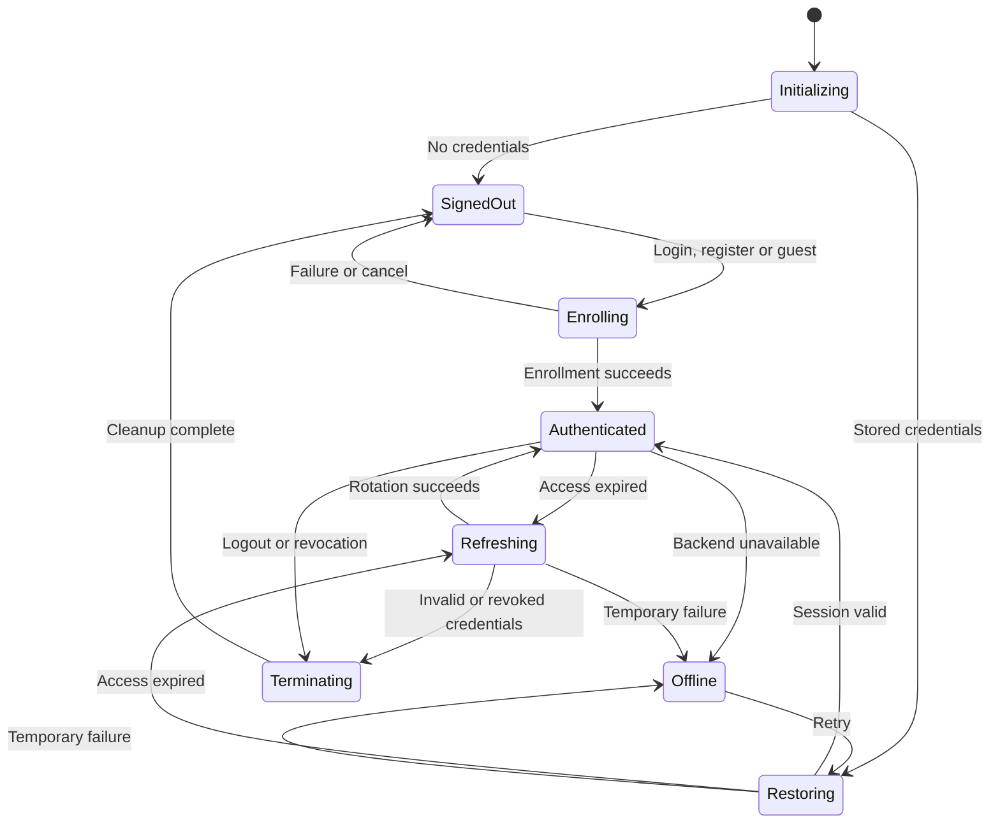

# Proposed session management

> Superseded (2026-10-20): use [session-management-proposed-v2.md](session-management-proposed-v2.md) for accepted decisions, defaults, detailed flows, delivery phases and acceptance. This initial proposal/research is retained as historical input; its open choices/defaults are not current where V2 settles them. Calling behavior is owned by calling V2.

> Calling integration update, 2026-10-17: [V2](call_implementation_proposed_v2.md) now owns detailed calling behavior and supersedes the initial call proposal. Enrollment's accepted candidate is purpose-separated Noise IK over HTTPS with a single-use context-bound challenge, explicit finish and atomic activation; compatibility/encoding remain implementation prerequisites. Successful new-phone activation revokes the old authorization and ends its call. V2 specifies 30-second call leases renewed every 10 seconds, no post-expiry grace, full-fingerprint link/QR trust, and no automatic call/trust transfer. Account recovery via an offline recovery code is provisionally accepted for the later user-flow review. The older open-decision text below must be read with this update; it does not reopen accepted calling behavior or complete the separate user-flow specification.

**Status: research-expanded proposal, 2026-10-18; not a verified implementation.** This document owns account, guest, device, and authentication-session behavior. [Calling V2](call_implementation_proposed_v2.md) owns invitation, peer authentication, endpoint validation, audio, and teardown; it supersedes the initial call proposal. Together they describe first access through disconnect; [system.md](system.md) remains the canonical overview.

This replaces the September session gap report. The [September implementation baseline](current-implementation.md) is historical: newer working-tree code includes registered-only native IPv6 calling and session APIs. Guest support and several proposed controls below remain unimplemented. Replacing documentation does not certify old findings as fixed.

## 1. Scope and concepts

Registered users and unregistered guests use authenticated device sessions. A guest has no registered account credentials, but is not an unauthenticated API caller. Account type affects permissions and limits, never encryption strength.

| Concept | Purpose and lifetime |
| --- | --- |
| Principal | Backend account/guest identity; owns permissions and records |
| Installation ID | Local correlation hint; never ownership proof |
| Device identity | Locally protected private key and enrolled public-key record |
| Auth session | Backend authorization for a principal/device, until expiry/revocation |
| Access token | Short-lived credential referring to that session |
| Refresh token | Rotating secret; only its hash is persisted by backend |
| Call session | One call's membership, consent, policy and lifecycle |
| Peer crypto session | Temporary directional media keys and packet state for one generation |

An IP address, installation ID, public key alone, or call code does not prove device ownership. Account authentication, private-key possession, intended-peer trust, and IP reachability are separate checks.

## 2. First access and enrollment

1. Initialize protected storage; load existing device identity and credentials.
2. Restore existing credentials as described below, or offer login, registration, and guest access.
3. Generate/load an account-scoped or guest-scoped device identity locally. Never upload the private key.
4. Begin enrollment over HTTPS. Account enrollment requires account credentials; guest enrollment creates an abuse-limited provisional guest.
5. Backend issues a short-lived single-use challenge bound to the enrollment attempt, principal/provisional guest, public key, purpose, and expiry.
6. Device completes a reviewed proof-of-possession exchange. Backend validates it and atomically consumes the challenge before activating the device/session.
7. Persist tokens securely and expose authenticated identity to the app. Expire abandoned provisional records and challenges.

**Enrollment direction:** use the accepted purpose-separated Noise IK candidate over HTTPS: authorize attempt, issue context-bound single-use challenge, prove device-key possession, explicitly finish, and activate atomically. Exact encoding, server-key trust, compatible library and test vectors remain prerequisites. Raw X25519 is not a signature; public-key submission alone is insufficient. Re-enrollment/login must follow the same possession policy.

Rate-limit enrollment, guest creation, challenges and login independently. Registration uniqueness and device attachment must be atomic. Bounded idempotency prevents lost responses creating duplicate devices/guests. A device key already owned by another principal cannot be silently reassigned.

## 3. Authentication lifecycle

Auth state is separate from call state. Offline state preserves credentials and identity; it cannot grant new backend-authorized operations. Temporary profile/network errors must not create a replacement guest.

Proposed defaults: 15-minute access tokens and an absolute 30-day auth-session lifetime. Refresh rotation preserves that absolute expiry. Idle expiry remains an open policy decision. These are proposed defaults, not guarantees about every legacy path.

For every protected request: validate token signature/expiry, session ownership/expiry/revocation, device/principal status, then operation permission. Guest sessions receive the same checks. Disabling an account or revoking a device invalidates dependent sessions.

Restoration distinguishes no credentials, expired access, revoked session, invalid response, and temporary network/server failure. Invalid credentials require cleanup/reauthentication; temporary failures retain state and allow retry.

## 4. Refresh and concurrency

Use one refresh operation per client credential generation. Queue eligible requests; retry each at most once. Atomically consume the old refresh token and create its replacement; preserve session ID in the proposed first version. Confirmed reuse revokes that session and all refresh descendants according to the selected policy.

Logout/account switching invalidates outstanding generations. A late refresh response cannot overwrite credentials from a newer login. Fresh socket connections obtain new call tickets rather than reusing token-bearing URLs or consumed tickets.

A lost response after server rotation needs a bounded idempotency/recovery design. Until chosen, require safe reauthentication rather than permitting indefinite old-token reuse. Refresh failure caused by temporary network errors must not be treated identically to confirmed revocation.

## 5. Guests, upgrades and key loss

A returning guest restores its stored identity/session. Installation ID alone cannot recover a guest after key/token loss. Define expired-guest recovery versus new-guest creation explicitly; guest lifetime, limits and retention remain open product decisions.

Upgrade/merge requires the current guest session and device ownership plus authorization for the target account. Specify transferable records; perform the change transactionally and idempotently. First version ends any call before switching principal. Freeze new calls during transition, reissue credentials, clear old caches, and rebuild identity-bound resources after success. Failure preserves the prior valid identity.

Reinstall/key loss creates a new device identity. Do not inherit previous peer trust silently. V2 permits one active phone: successful replacement revokes old authorization and ends its call. Offline recovery-code details and device removal UX still need specification.

## 6. Logout and revocation

One lifecycle coordinator performs all identity transitions:

1. Enter terminating state; block new refreshes, calls, and reconnects; invalidate pending generations.
2. Immediately stop capture/media and cancel call setup. Attempt call-end notification with existing credentials without blocking local shutdown.
3. Request current-session revocation with a bounded network timeout when reachable.
4. Release audio, sockets, signaling and background services; cancel requests/timers, discard ephemeral secrets/pending messages, and clear previous-user caches/prompts.
5. Clear tokens/profile. Retain separately protected device identity unless explicitly removed under identity policy.
6. Show signed-out UI. Do not silently create another guest.

Offline logout removes local access but cannot claim server revocation succeeded. Current-session logout affects that session only. Explicit all-device logout revokes all account sessions; device removal revokes the device and its sessions. Ownership checks apply to each operation. Session/device list and revoke controls belong in Settings.

Remote revocation uses the durable outbox/notification/reconciliation boundary and bounded call lease defined by calling V2; exact user-session event schemas remain to implement. Compliant clients stop on observed revocation or current lease expiry, with no extra grace. The backend cannot instantly stop two uncooperative endpoints already holding direct-call keys.

## 7. Contract with call management

Auth supplies validated principal, device, session, account type, permissions and identity generation. It never gives media/signaling code the refresh token or private identity key. Call operations acquire participant-bound tickets through current API credentials.

Call membership records bind authorizing sessions and devices. Auth termination invokes call finalization immediately; call end alone does not sign out. Access-token renewal does not change media keys. Call and identity generations reject stale callbacks and reconnect work.

Calling V2 defines 30-second authorization leases renewed every 10 seconds, with no extra grace, and owns peer disappearance/network recovery. See [V2 authorization](call_implementation_proposed_v2.md#15-authorization-leases-and-one-phone-enforcement).

## 8. Persistence and privacy

Backend persists principals, enrolled public keys/devices, session expiry/revocation, hashed refresh tokens, consumed challenges, and minimal audit records. Client protects tokens/private keys; remembered peer trust is scoped to local principal and remote device/key. Never log private keys, tokens, enrollment secrets, media keys, plaintext audio, or credential-bearing URLs.

Retention/deletion periods and audit access need policy. Preparing this design does not authorize database changes or migration execution. Migration 014 is a destructive prepared reset, not evidence this proposal is deployed.

## 9. Acceptance and delivery

| Scenario | Required result |
| --- | --- |
| Registered/guest enrollment | Possession checked; accepted retry creates no duplicates |
| Expired/replayed challenge or foreign device | Reject without transferring ownership |
| Offline startup | Preserve identity and offer retry |
| Concurrent expired requests | One rotation; bounded retry; no loop |
| Logout/account switch during refresh | Old responses cannot restore credentials |
| Reuse/revoked session/disabled device | Reject access and clean up identity-bound resources |
| Lost refresh response | Defined safe recovery or reauthentication |
| Guest conversion | Prove both ownership boundaries; atomic/idempotent transition |
| Logout during call/offline logout | Immediate local stop; accurate server outcome |
| Reinstall/key loss | New device; fresh trust verification |

Implement enrollment/ownership, then restore/refresh, guest transitions, unified cleanup/revocation, Settings controls, and call integration. Validate with mocks before separately authorized database/device integration tests.

Before coding finalize the remaining user-flow choices: enrollment encoding/server-key trust; absolute/idle expiry and lost-refresh recovery; guest limits/recovery; offline recovery-code lifecycle; retention. Accepted V2 calling behavior is preserved. The research and proposed control-plane design below expand this plan without claiming implementation.

## 10. Server authority and a thin application

Research expansion, 2026-10-18. Sections 10-18 specify the proposed user-session control plane; calling V2 remains authoritative for media and call behavior. New choices here are recommendations for review, not implied user approval or deployed guarantees.

The objective is a thin presentation layer and server-owned business rules, not a ban on programming constructs. Forbidding loops, conditionals or state in every client component is incompatible with responsive UI, networking and direct E2EE. Moving every packet decision to Go would add network delay/server bandwidth and make the design a different media architecture. Sending media keys to Go would also change the trust boundary.

| Responsibility | Owner |
| --- | --- |
| Credential verification, enrollment acceptance, active-phone ownership | Go/PostgreSQL |
| Permissions, call admission, consent recording, quotas, leases and lifecycle transitions | Go/PostgreSQL |
| Temporary ticket operations, rate counters, presence and notification routing | Go/Redis with durable authorization checks |
| Display validated snapshots, collect input/consent, submit typed intents | Expo UI |
| Secure key/token storage, cryptographic proof, peer fingerprint checking | Native client/security component |
| Audio capture/encode/encrypt, receive authentication/replay checks, timers and network callbacks | Native client/media component |
| Local hangup, permission denial, expired-lease stop and unsafe-packet rejection | Client immediately; server reconciliation follows |

UI must not independently grant benefits, select policy limits, extend leases, declare backend membership, or derive account ownership from cached labels. It may perform input checks for usability, but Go repeats all validation. The server returns a finite versioned action vocabulary; never arbitrary code, URLs to execute, OS commands, or instructions that bypass local consent/safety checks. The client cannot outsource proof that a peer holds its private key to an unverified label from the server.

## 11. Registration and login from the beginning

### Registration

1. UI collects username/password and submits over HTTPS. Backend normalizes and validates fields, limits attempts and performs password hashing using the existing approved implementation. Passwords are never logged or cached by the app.
2. Backend creates a short-lived pending registration/enrollment attempt. It does not issue usable account authorization merely because a public key was submitted.
3. Native component completes the purpose-separated enrollment exchange. Backend validates challenge purpose, proof, expiry, request ownership and explicit finish.
4. One PostgreSQL transaction checks username uniqueness, creates/activates principal and device, establishes active-phone authorization generation, creates auth session/refresh hash and records an outbox event. No database transaction is held while waiting for user/network proof.
5. Return the issued tokens and authorized account snapshot only after commit. The client persists the credential bundle successfully before treating login as durable; persistence failure exposes a storage error and cleans up/revokes best-effort rather than silently claiming it will survive restart.
6. Start authenticated control synchronization, not microphone/media. Calling needs its separate consent and safety gates.

### Existing account login

Verify credentials first, then enrolled-device possession. Successful new-phone enrollment/activation atomically replaces active-phone ownership, increments authorization generation and revokes old sessions/call continuation according to V2. A failed login/proof never disturbs the old phone. Same-device app restoration is not new-phone replacement. A successful replacement does not migrate an active call or peer trust.

Return generic credential failures with bounded retries/backoff. Cap expensive password-hash concurrency so login floods cannot starve existing calls. Account recovery uses the provisionally accepted offline recovery-code direction, but issuance, one-time consumption, loss/replacement and authentication-strength rules still need a separate detailed decision. No email/SMS recovery provider is silently introduced.

### Guest access

Explicit Continue as guest creates a provisional guest and completes possession proof before issuing tokens. Restore that same guest while original device credentials remain usable. Define guest lifetime/allowances before release; IP sharing or reinstall cannot reliably identify a permanent physical person. Guest-to-account transfer requires proven ownership and atomic credential transition.

## 12. Staying logged in after the app stops

Being logged in does not require the process or a socket to run continuously. The backend session is a durable record, and the app keeps credentials in protected persistent storage. Ordinary cached UI data is not authorization.

| Event | Credentials / proposed behavior |
| --- | --- |
| App swiped from recents or process killed | Protected storage normally remains; reconnect and validate on next launch |
| Actual force-stop | No expectation of background timers or network work; restore on user launch |
| Phone restart | Read protected storage once available/unlocked; validate session online |
| Temporary offline launch | Retain identity/credentials; show offline/retry; grant no new protected operations |
| Clear ordinary cache | Should not deliberately erase auth storage; verify target-device behavior |
| Clear app data/storage | Treat lost keys/tokens as lost identity; login/enroll again |
| Uninstall/reinstall | Do not promise credential/key survival or automatic trust recovery |
| Session expired/revoked/replaced | Stored tokens do not override backend denial; terminate or reauthenticate |

Proposed launch sequence: read one versioned secure credential bundle and device key; request session bootstrap; rotate access if expired; backend validates session/device/active-phone generation; return current snapshot and event cursor; rebuild local UI and reconnect with a fresh ticket. No password prompt while the surviving session is valid. Refresh-token rotation must be persisted crash-safely; bundle replacement and interrupted-write handling need platform tests.

The existing secure-storage helper has an in-memory fallback and suppresses write errors. That fallback cannot survive process death and must not satisfy production persistence/security acceptance. Storage unavailability is an explicit error, not permission to silently weaken persistence. Store no long-lived live-call keys for crash restoration; reconcile abandoned calls, then create a fresh one. Auth sessions may survive while media sessions do not.

Expo documents SecureStore persistence across restarts, Android uninstall loss and iOS reinstall caveats. This research does not upgrade the project's dependencies; the requested SDK 54 URL currently redirects to current docs, so verify behavior against the locked package/native builds. [Expo SecureStore](https://docs.expo.dev/versions/latest/sdk/securestore/).

## 13. Keeping sender, receiver and server synchronized

### Data paths

| Data | Path / authority |
| --- | --- |
| Credentials and device proof | Originating device to Go only; never to another user |
| Profile/session/capabilities | Go returns authorized projection; PostgreSQL authority |
| Peer identity and invitation metadata | Go sends only after the relevant visibility/admission checks |
| Presence | Connection/heartbeat observations with Redis TTL; approximate availability |
| Current endpoint | Generation-bound authenticated rendezvous observation; not a permanent user-IP field |
| Consent and call status | User intent to Go; committed transition to authorized participants |
| Audio | Native sender directly to native receiver; Go/Redis/PostgreSQL never process every frame |
| Quality reports | Bounded aggregate telemetry; reports are untrusted observations, not proof of audible delivery |

Clients submit intent and observations; they never upload a replacement authoritative user/session object. Backend derives ownership from authenticated context, allows only supported editable fields and increments record versions. Treat client timestamps/IP claims/peer status as hints. Never expose peer refresh tokens, private keys or unrelated sessions.

Use protected event connections for prompt updates rather than a tight polling loop per user. Each event identifies event ID, entity, authoritative revision, relevant generation and payload schema. Scope payloads by recipient permissions. UI keeps a projection, not authority. An old/duplicate event cannot roll back local accepted state; a version gap triggers an authorized snapshot/reconciliation request. Bound replay retention and resnapshot when a cursor is too old. Reconnect always revalidates authorization; foreground reconnection does not assume a background socket survived.

Presence is distinct from login and call authorization. Heartbeat/socket loss expires presence without revoking a perfectly valid login; it also does not prove direct audio stopped. Store last-seen at coarse lifecycle intervals if needed, not a PostgreSQL row update on every frame/heartbeat. Device/network callbacks report changes; do not poll secure storage to discover network state.

## 14. Authenticated commands and server state machines

A proposed bootstrap response contains schema version, principal/device/session references, account type, authorization generation, snapshot revision, server time, capabilities and event-resume information. A call operation response additionally binds call, participant, connection generation, accepted state/revision, operation ID and lease expiry where applicable. Exact field schemas remain to specify; this is not a list of existing APIs.

For every command Go authenticates the transport/credential, checks current durable ownership/revocation, validates input/role/previous state, performs the transition transactionally, and returns the committed result. Require idempotency keys for retryable mutations, scoped to principal/device/operation; reject reuse with a different payload. Compare expected revision or explicit transition predicates to prevent stale consent/updates. Unknown fields/actions fail safely according to a versioned compatibility contract.

Authenticated response means HTTPS/WSS with server identity validation plus strict schema, operation, ownership, generation and freshness checks; a JSON success flag alone is insufficient. Never blindly trust every message because it came through a socket. Server-generated permission is necessary to start/continue a protected call, but local cryptographic/consent/path checks remain mandatory. An allowlisted server action may request a proof, show a prompt, configure a permitted peer candidate or stop; it cannot force consent or execute arbitrary instructions.

Stopping is deliberately asymmetric: the user can always stop locally, and the native client must stop on unsafe state, lost permission, fatal error or lease expiry even offline. It sends authenticated end best-effort; server expiry/reconciliation closes durable state. Requiring a successful server response before stopping would trap audio capture during outages. Remote/admin stopping requires server authorization and uses V2 notifications/leases; a forged remote end must fail authentication.

## 15. PostgreSQL, Redis and Go responsibilities

| Store/component | Proposed contents and role |
| --- | --- |
| PostgreSQL | Principals, credential hashes, device enrollment/ownership, auth/refresh lifecycle, generation/revocation, permissions, invitations/consent, call records, quota reservations/usage and transactional outbox |
| Redis | Bounded transient tickets/results, connection routing, shared readiness, presence TTLs, rate limits, duplicate-work coordination and non-authoritative caches |
| Go instances | Stateless request authorization/state transitions using shared stores; each owns its live sockets, bounded queues and workers |
| Native endpoint | Protected device identity and media secrets; packet/audio state and immediate safety finalizer |

Start with primary PostgreSQL checks for grant/renewal/revocation-sensitive decisions. JWT signature validity is not enough after revocation. Redis cannot grant permission after an authoritative denial. Do not introduce a positive auth cache that extends stale authorization without an explicitly reviewed bound. Profile/catalog reads may use versioned TTL caches; critical permissions/active-phone state do not read lagging replicas.

Commit transition and outbox record together in PostgreSQL. Publisher retries notification/invalidation through Redis; consumers deduplicate by event/revision. Redis Pub/Sub is at-most-once, so it is a wake-up mechanism, not durable truth. Reconnect snapshots, lease checks and durable outbox state repair missed updates. Streams are an optional implementation choice, not an automatic guarantee of exactly-once delivery. [Redis Pub/Sub delivery](https://redis.io/docs/latest/develop/pubsub/).

Consume transient operations atomically with purpose/owner/generation validation and bounded completed results, not separate GET then DELETE. Do not assume Redis TTL expiry notifications provide reliable database cleanup. Reconciliation reads indexed durable expiry records. Redis loss discards presence/tickets, never resurrects permission; reissue only after authorization. PostgreSQL loss denies new grants/renewals; V2 media ends at its current lease deadline. No per-instance memory fallback for production security coordination.

## 16. Concurrent access and practical optimization

Keep one modular Go service initially, horizontally replicable; do not introduce microservices or sharding before measurement requires them. A live WebSocket does not hold a PostgreSQL connection. Short requests borrow pooled connections and release promptly; never keep transactions open while waiting for human consent, sockets or Noise frames.

Use indexed lookups on token hash/session/device/authorization generation, active-call ownership, invitation lookup/expiry, worker due time and outbox status. Enforce username/device/call-slot invariants with database constraints and transactions, not Redis locks alone. Lock only affected rows in consistent order; serialize conflicting operations on the same account while unrelated accounts proceed concurrently. Retry serialization/deadlock conflicts boundedly with idempotency and jitter. Examine query plans before adding indexes; every index adds write cost.

Claim outbox/expiry work in small bounded batches with row locking and SKIP LOCKED where appropriate; this is queue coordination, not permission to skip locked authorization rows. Multiple workers can share work; transitions remain version-checked and idempotent. PostgreSQL documents that SKIP LOCKED gives an inconsistent view suitable for queue-like work. [PostgreSQL SELECT](https://www.postgresql.org/docs/current/sql-select.html).

Allocate a cluster-wide connection budget: sum of every replica's pool maximum, workers and administration must fit the database's measured safe capacity. Autoscaling application replicas must not multiply database pools unchecked. Existing source uses a 25-connection PostgreSQL pool and Redis pool size 20 per instance; these are observations, not approved sizing recommendations. Consider an external pooler only if measurements justify it and transaction/prepared-statement compatibility is checked. Increasing max_connections alone consumes resources rather than creating unlimited throughput. [PostgreSQL connection settings](https://www.postgresql.org/docs/current/runtime-config-connection.html).

Batch compatible reads/worker writes, paginate lists, avoid per-user fan-out queries, coalesce network/presence updates, cap event queues/payloads, disconnect slow consumers with a resume path, and back off retries with jitter. Password hashing gets its own concurrency/memory budget. Do not buffer unbounded work to hide overload. Protect existing calls from enrollment storms; preserve ordering/authorization while batching.

No audio frame reaches Redis or PostgreSQL in this architecture. V2 still requires both participants to renew every 10 seconds: C simultaneous calls imply roughly 2C/10 = C/5 participant renewals/second, before retries, signaling or accounting. At 10,000 calls that is about 2,000 renewals/second, an illustrative workload calculation, not a capacity claim. Avoid one PostgreSQL heartbeat write per idle logged-in user; logged-in persistence does not require a continuously executing app.

No fixed product account cap is required by the design, but CPU, memory, sockets, bandwidth, hash cost, pool contention and database/Redis capacity are finite. Resource limits, rate limits and overload admission are necessary. Define target concurrent foreground users/calls, burst rate, latency/error objectives, region and infrastructure budget before claiming supported capacity. Scale Go and workers from measurements; add Redis partitioning/database read scaling or partitioning only at demonstrated bottlenecks. Do not weaken 30-second lease/revocation policy as an invisible performance shortcut.

## 17. Validation and execution plan

1. Freeze ownership and schemas: session bootstrap, typed intents/events, revisions, idempotency, error categories, one-phone activation, enrollment finish and storage bundle. Preserve V2 contracts.
2. Implement durable registration/login/enrollment/refresh transactions with mocked possession and explicit failure tests; finish Noise IK compatibility/vectors before enabling real enrollment.
3. Implement secure persistence and cold-start restore, including process death, storage errors, expired access, offline launch and revoked/replaced device. No silent memory-only production path.
4. Implement authorized snapshot/event synchronization, outbox delivery and bounded reconnect reconciliation. Then integrate shared session context and V2 call leases/finalizer.
5. Add guest transition and session/device controls; finalize recovery-code and guest/expiry/retention policies before claiming these flows complete.
6. Load-test realistic read/write/event/renewal mixes, slow clients, reconnect storms, hot accounts, revocation races, Redis loss and PostgreSQL failover/outage. Verify no grants from stale cache, no duplicated usage/end, and no unbounded resource growth.

Measure p50/p95/p99 latency, error rate, reconnect/event lag, database query/pool/lock wait, CPU/memory/I/O, Redis latency/memory/evictions, outbox age, expired-call cleanup lag, heartbeat/renewal load and authorized stop deadline. Compare before/after optimizations on the same workload. No infrastructure sizing or unlimited-concurrency guarantee is asserted by this research.

## 18. Research sources and remaining review

The recommendations above combine repository constraints, accepted calling V2, and primary-source behavior. They are architecture inferences, not claims those sources implement this application.

- [Expo SecureStore](https://docs.expo.dev/versions/latest/sdk/securestore/): persistence/platform caveats; test locked native package.
- [RFC 9700 section 4.14](https://www.rfc-editor.org/rfc/rfc9700.html#section-4.14): refresh replay defense through rotation or sender constraints. This custom auth plan borrows the lifecycle principles; it does not claim to implement a full OAuth authorization server.
- [Redis Pub/Sub](https://redis.io/docs/latest/develop/pubsub/): notification delivery limitations.
- [PostgreSQL connection settings](https://www.postgresql.org/docs/current/runtime-config-connection.html) and [SELECT](https://www.postgresql.org/docs/current/sql-select.html): connection resource limits and worker locking semantics; exact database version remains unchanged.

Still to decide for the user-flow plan: absolute versus sliding login and idle expiry, refresh lost-response recovery, enrollment server-key bootstrap/profile encoding, expired guest ownership recovery, guest anti-abuse/allowances, offline recovery-code lifecycle, retention/deletion, target load/service objectives and deployment budget. Calling V2's active-phone replacement, fingerprint trust, 30/10-second leases and no-extra-grace rules are already accepted and are not reopened here. No migration, dependency upgrade or live database mutation is performed by this document.
