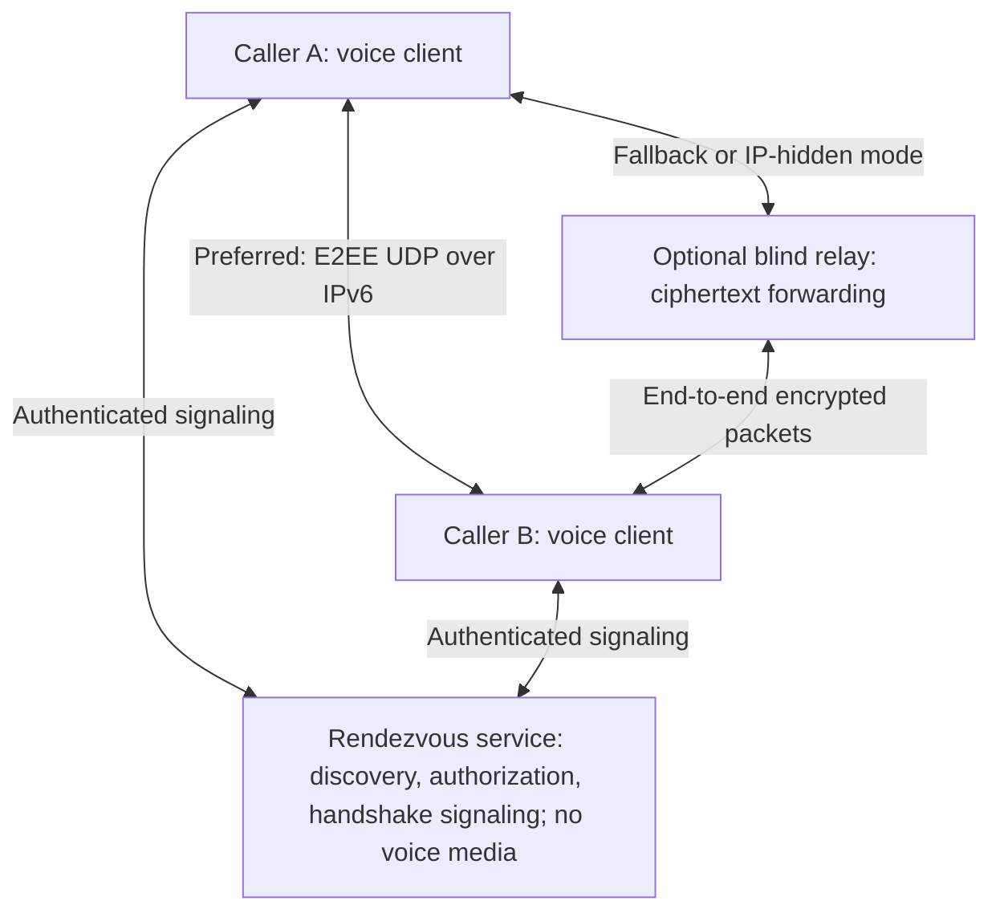
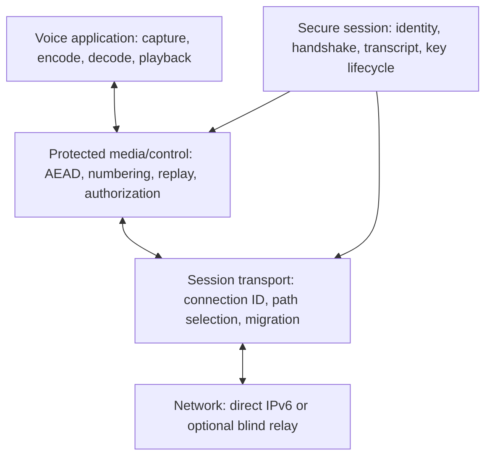

# System architecture

Foreground and reconnect reconciliation includes restricted, pending-deletion, and quota-gated sessions. A typed bootstrap `upgrade_required` response routes to update guidance. Quota-gated entry offers a sign-out path to registered account entry.

Feature 7 source provides account-scoped, transactionally sequenced invalidations. The opted-in bootstrap cursor is read in the same database statement as the authorized snapshot. An authenticated session obtains a one-use, 30-second ticket for a recipient-only WebSocket; the server revalidates the session, reads the retained event log in bounded batches and requests resynchronization when retention or gaps prevent resume. Expo treats messages as invalidations and reconciles a verified snapshot, discards duplicates and stops on identity changes. Ticket and event retention cleanup is bounded. PostgreSQL and installed-app verification remain pending, and migrations 019 and 020 require separate review and execution.

The Expo client records the enrolled principal and native scope in SecureStore before beginning native enrollment proof. Ordinary logout retains this record. A new challenge must identify the same principal until explicit local profile removal completes. Removal intent and the retained record survive interrupted cleanup.

The V2 bootstrap contract includes optional eligibility, reset, reminder, deletion deadline and event cursor fields behind the `snapshot=extended` request opt-in. The event cursor is populated by Feature 7; the other fields remain with their owning features. Expo recognizes restricted, pending-deletion and quota-gated snapshots and blocks ordinary protected navigation in those states.

Logout fences the local identity, initiates native shutdown, and records a signed-out marker before deleting legacy credentials. Startup completes interrupted credential cleanup from the marker. Server revocation retries use the captured authorization for that session, and their results apply only while the same logout warning is active.

Expo refresh shares one rotation per identity generation and publishes the new credential version after SecureStore commits. A caller can cancel its wait independently of the shared rotation. Eligible reads replay once after refresh. A secure-storage failure before dispatch blocks access and exposes storage retry.

Expo revalidates the registered V2 bootstrap snapshot when the app returns to the foreground or reconnects while active. Concurrent checks share one restore per identity generation. A changed username invalidates old account work and private caches. An unsupported snapshot version or account type blocks protected access and shows update guidance.

Registered setup grants carry the credential version and ownership generation from the authenticated account snapshot. Challenge creation and enrollment commit recheck both values under the account lock. Migration 018 stores these values and the selected server key ID. Android learns a P-256 signer through the authenticated enrollment finish and validates signed X25519 key changes. Account registration, enrollment, activation, and first session revocation write audit and outbox records in the mutation transaction. Expo requests the enrolled device-key fingerprint in its bootstrap snapshot and compares it with the fingerprint derived from the existing Android private key before publishing the profile. A missing or unusable identity requires password sign-in and a fresh enrollment challenge before generating a replacement. A temporary storage failure remains retryable. Local profile removal persists its intent before key cleanup.

The Expo interceptor treats the V2 `session_invalid` error envelope as a rejected session and requires sign-in. Mocked tests cover the activation response path.

Account activation rechecks the authenticated session, device and ownership generation while holding the account and session locks. The change has mocked coverage and requires database concurrency verification.

When an activation request has an uncertain result, the Expo client reconciles the existing authorized session through the bootstrap snapshot. An active snapshot completes setup, and a recovery-setup snapshot leaves activation available for retry. This client behavior has mocked coverage; database and Android verification remain pending.

The Expo settings flow supports password changes using a fresh-authentication grant. Before dispatch, the app fences older identity work, stops local calling and persists a credential-uncertainty marker. A confirmed change clears local credentials and requires sign-in. An unconfirmed result also requires sign-in, while a definite rejection restores the prior local session. The backend binds the password update to the credential version authorized by the grant. This flow has mocked coverage; PostgreSQL and device verification remain pending.

The Android UDP receiver authenticates a datagram before placing its decoded packet in the bounded reorder queue or advancing its receive sequence. Negative sequences and the maximum signed sequence are rejected. This source change has not yet been validated with a native build or device tests; the planned V2 replay window remains unfinished.

The Android bridge has a separate Noise IK enrollment initiator. Expo registration and sign-in orchestrate the HTTPS proof exchange, persist the resulting session with principal, device, session and generation references, and validate these against the v2 bootstrap snapshot. Native enrollment stores the local key under a principal scope and links an existing legacy key only after proof. The bridge pins the proven server key per backend origin. Existing v1 credentials retain their staged restore path. Android build, PostgreSQL integration and interoperability evidence remain pending.

The new account remains in recovery setup until the user saves recovery codes and explicitly acknowledges the current set. The acknowledgement contains one code and the backend checks its verifier against the active set under the account lock. The device checks for the enrolled native key when restoring and uses the principal scope for calls. The caller path and complete setup remain unverified on physical devices.

V2-managed accounts carry a positive device generation and remain restricted until activation. The session lookup checks the current generation and account lifecycle state. Setup routes have an explicit authorization exception, with fresh authentication limited to recovery-code setup. Staged v1 issuance and rotation require generation zero under an account lock. The v1 cutover setting can disable legacy issuance and rotation entirely. Expo signed-out recovery uses an exact public route allowlist with no bearer credentials. [Verification matrix](user-management-evidence.md)

> The HTTP client tracks a process-local credential version to recognize expired responses from before a completed rotation. Eligible reads wait for any active refresh and retry with the persisted replacement rather than rotating a second time; identity-generation fencing still applies.

> Confirmed session invalidation or a dispatched refresh with an uncertain result advances the local identity generation before entering recovery, so other in-flight work cannot republish the former account. Credential clearing on a confirmed rejection is fenced to the new generation.

> Authentication middleware distinguishes an expired access-purpose token from wrong-purpose or otherwise invalid bearer credentials before indicating that refresh is eligible.

> Call signaling ignores callbacks from a socket that has been disconnected or replaced. Disconnect also rejects outstanding socket waits and cancels their timers; mocked tests cover late callbacks and timer cleanup.

> The shared HTTP client captures identity generation at its public request boundary and combines caller cancellation with identity cancellation. Tests cover work queued immediately before an identity switch and in-flight requests with their own abort signal. Native and database integration validation remains separate.

> Registered-account creation reports distinct username and device-key uniqueness conflicts. Device enrollment and proof of ownership remain later work; these error codes do not imply that enrollment is complete.

> Refresh rotation distinguishes confirmed token rejection from a failure after the rotation has committed. Post-commit profile failures propagate as server errors, preserving the client's uncertain-refresh state. Rotation checks the refresh-token and session expiry as well as device revocation and principal disablement. Login also distinguishes a missing identity from an infrastructure failure. These database-backed changes require later deployment and database integration validation.

> Current registered login and registration require an explicit signed-out state and clear private query, user and prompt projections before publishing the account. A rejected refresh blocks the authenticated UI immediately, even if credential cleanup is delayed. Guest conversion remains a separate unimplemented flow.

> Partial credential-storage implementation: Expo stores credentials in one versioned SecureStore record and records signed-out intent before deleting legacy tokens. Legacy refresh-only credentials can be migrated and explicitly refreshed. The client persists uncertain-refresh state before dispatch and presents retry, storage-unavailable or reauthentication states during restoration. Generation checks fence auth responses and credential writes; logout reports local clearing failure and unconfirmed server revocation. Complete request cancellation and full race coverage remain outstanding. The complete login/logout plan is not verified.

> Partial client implementation: the shared HTTP client's generic network/5xx retry policy now allows only GET, HEAD and OPTIONS. Mutation-specific idempotency remains future work. Authentication-refresh retry/fencing is separate and remains incomplete.

> Partial session-end hardening: the client blocks protected requests while authorization is not established. Android voice events carry a call ID and a random per-preparation attempt ID, and the coordinator rejects events that do not match its current authenticated call and attempt. Native transport and audio callbacks are fenced by their captured attempt. The coordinator dispatches shutdown immediately, stops again after an overlapping preparation settles, and prevents a new preparation until teardown completes. Logout reports unconfirmed local shutdown after five seconds and offers retry; it does not claim the native operation was cancelled. A stalled native operation continues to block later preparations. Deferred-promise tests cover the JavaScript ordering; native changes have not been built or validated on a device.

> Partial implementation: protected HTTP middleware emits `ACCESS_EXPIRED`, `SESSION_INVALID` and `AUTH_UNAVAILABLE`, and the identity repository preserves session/refresh database errors. The client coordinates refresh for expired credentials and presents outage or recovery states at startup. This is not completion or runtime verification of the session lifecycle.

Visible-history retention and the control-backend load-test target below are changeable initial defaults: 90 days through authorized, versioned backend policy; 100 calls/200 participants through versioned test-run configuration. Follow the [plan's transition and validation rules](user-management-implementation-plan.md). Retention increases cannot restore erased history, and changing a test target does not establish capacity or change security limits.

> User-management decisions consolidated 2026-10-31: [implementation plan](user-management-implementation-plan.md) records 17 user-selected decisions and the ordered execution/validation gates. The account module owns username/password, mandatory saved-code acknowledgement, optional unique verified recovery email through Resend with in-app email codes, editable usernames with owner reservations and permanent retirement after deletion, and seven-day deletion cancellation. MFA remains deferred. Exact registered discovery and contact-granted directional ringing remain separate from peer-key trust; unknown requests are non-ringing with Accept/Block. Registered direct IPv6 duration is unlimited under the existing security limits; visible registered history expires after 90 days. Initial control-backend validation targets 100 calls/200 participants. These are planned requirements, not completed code. Session V2 invariants and Calling V2 media/security gates remain authoritative. Partial implementation (2026-11-01, unverified against a live database): additive `/api/v2` account-security routes (saved-code regeneration/acknowledgement, password change, recovery begin/prove/complete, email challenge/verify, fresh-auth grants) and profile-lifecycle routes (profile, username availability/change, deletion request/status/cancel, session list/revoke/logout-all) exist behind migrations 016 and 017. Both groups answer `unavailable` unless `RECOVERY_PEPPER` and `EMAIL_PAYLOAD_KEY` are configured. Device enrollment (migration 015, 2026-11-01, unverified): the phone proves possession of its device key with a Noise_IK_25519_ChaChaPoly_SHA256 handshake whose prologue binds a single-use server challenge; the session tokens travel only inside handshake message 2, a successful enrollment revokes every earlier session and other device and bumps a device generation, and activation requires acknowledged recovery codes. Details and gaps: [contracts draft](user-management-contracts-v2.md).

> Accepted session plan (2026-10-20): [session-management-proposed-v2.md](session-management-proposed-v2.md) supersedes initial session research. It owns authenticated guest/account/device lifecycles, replaceable recognition/identity providers, Android reinstall quota buckets, one-profile ownership, persistence/recovery, 15-minute access/absolute 30-day auth, weekly guest quotas, reminders/gates, independent per-API limits and 90-day configurable cleanup defaults. PostgreSQL is authoritative, Redis coordinates temporary state, and native safety/crypto remain local. [Calling V2](call_implementation_proposed_v2.md) owns peer/media behavior and 30/10-second leases. No implementation or deployment is verified by acceptance.

## 1. Purpose and status

**Architecture name: IPv6-First Authenticated E2EE P2P Voice Architecture.**

The target system connects two callers using authenticated sessions and end-to-end encrypted voice. Direct UDP over IPv6 is the preferred media path. Rendezvous provides discovery and signaling but does not carry voice media. An optional blind relay forwards ciphertext when direct connectivity fails or the user selects an IP-hidden mode.

This design is based on [source-notes.md](source-notes.md), not a verification of current code. See [decisions.md](decisions.md) for unresolved choices and [README.md](README.md) for the limited repository comparison.

Current implementation work prioritizes the Expo mobile app and Go backend. The separate web app is deferred until the user starts that phase. Maintain this file and affected diagrams/flows in the same change whenever architecture evolves; keep the original source notes unchanged.

## 2. Source requirements

The requirements below describe the target. The [September baseline](current-implementation.md) is historical WebRTC code. Newer working-tree code contains partial registered-only Android Noise/direct-IPv6 calling; neither is verified deployment evidence.

The detailed calling plan is [Call implementation proposed V2](call_implementation_proposed_v2.md), accepted as a design direction on 2026-10-17 with provisional test defaults. It supersedes the initial call proposal. [Session V2](session-management-proposed-v2.md) owns accepted user/device prerequisites and quota policy; calling V2 references their effects rather than expanding user flows. The first scope includes approved registered direct callers, unknown non-ringing requests, and registered/guest code/link calls over native Android direct IPv6. Relay/IP-hidden behavior below remains future scope.

V2 selects Noise XX peer authentication with full-fingerprint QR/link verification, deterministic context/control encoding, a bounded authenticated UDP profile, native audio/libopus quality adaptation, same-session validated migration and fresh-handshake recovery/renewal. Calls bind authorizing sessions/devices, renew 30-second leases every 10 seconds, and use PostgreSQL authority plus Redis coordination and a transactional outbox. Single-phone replacement ends the old call; no automatic transfer. State/resource cleanup, tier accounting, safety intervention, and release tests are specified in V2. None is a deployed guarantee; exact schemas, implementation compatibility, and experimental thresholds still require validation. Retention/account recovery remain separate policy work.

1. Authenticate participants and bind session parameters before establishing the voice path.
2. Treat room codes as session locators, not encryption secrets or identity proof.
3. Use an established authenticated construction, with ephemeral X25519 and HKDF as described in the source.
4. Derive separate A-to-B and B-to-A traffic keys.
5. Encode voice with Opus before AEAD encryption.
6. Authenticate, reject replay, validate message semantics, and authorize processing before decoding.
7. Prefer direct IPv6, with encrypted relay fallback.
8. In IP-hidden mode, skip direct endpoint exchange and direct connectivity attempts.
9. Permit explicit voice/control operations only; never generic remote commands.

Two-party calls are assumed. Group calls, recording, file transfer, and other application features are outside scope. Availability during denial of service and protection from endpoint compromise are not E2EE guarantees.

## 3. Whole-system view

Direct and relay edges are alternative media paths. A successful direct call removes the server from the media plane. A relayed call adds forwarding infrastructure while keeping decryption keys at the endpoints.

## 4. Components and responsibilities

| Component | Responsibility | Boundary |
| --- | --- | --- |
| Voice application | Consent, capture, Opus encoding, decoding, playback, call controls | Decoder receives validated voice frames only |
| Identity manager | Store local identity key; verify intended peer key | Server login alone does not authenticate a remote device key |
| Secure session manager | Run authenticated handshake; bind context; install directional keys | Reject identity, transcript, or negotiation failures |
| Media protection layer | AEAD, packet numbers, replay windows | Unauthenticated bytes never become trusted application input |
| Protocol dispatcher | Validate frame types, schemas, and call-state permissions | A valid peer can still send unauthorized or malformed messages |
| Transport manager | Direct path, relay selection, liveness, proposed migration | Address reachability is not identity proof |
| Rendezvous | Discovery, authorized joins, handshake forwarding, permitted metadata | No voice media or media decryption keys |
| Blind relay | Forward protected packets for authorized participants | Cannot decrypt; can observe metadata and disrupt forwarding |
| Host/network controls | Firewall, minimal listening ports, resource/rate limits | Complement application authentication |

These client components are a logical decomposition, not prescribed packages or services. Jitter buffering, congestion handling, detailed migration, and cleanup are proposed completions.

## 5. Logical layers

Session establishment provides keys before media starts; it is not repeated for every voice frame.

## 6. Control and media planes

**Control plane:** discovery, admission, consent, handshake signaling, and permitted connectivity metadata. V2 selects HTTPS API authorization, ticketed WSS setup, authenticated UDP rendezvous and protected peer controls. Semantic operations still require exact endpoint/message schemas. No voice decryption keys are provided to infrastructure.

The current V2 signaling ticket records the issuing session and device. At WebSocket admission the backend revalidates that session and checks current call participation. Tickets issued before this binding was added are rejected. This admission check does not yet provide continuous revocation of an already-open socket; lease-based enforcement remains part of Calling V2. Atomic single-use ticket consumption also remains to be verified and implemented.

**Media plane:** Opus frames encrypted by the sender, forwarded directly or through a blind relay, authenticated by the receiver, then decoded. In-band controls such as liveness and call termination are also session-protected.

A room code locates a session. A connection ID selects candidate local protocol state. An authenticated identity key establishes which peer is participating. Neither identifier alone authorizes processing.

## 7. Data ownership

| Data | Endpoint ownership | Infrastructure exposure |
| --- | --- | --- |
| Private identity key | Local durable secret; protected storage proposed | Never uploaded |
| Peer public verification material | V2 full-fingerprint independent link/QR comparison and remembered device-key checks | Directory distribution alone does not establish intended-peer trust |
| Ephemeral secrets and traffic keys | Transient session state | Never sent to rendezvous or relay |
| Room/session ID and membership | Endpoints and rendezvous | Visible as needed for coordination |
| Direct IPv6 endpoint | Disclosed to peer in normal direct mode | May appear in signaling; excluded from peer-facing IP-hidden setup |
| Plaintext/encoded voice | Participating endpoints | Never intentionally exposed to infrastructure |
| Encrypted packets and clear headers | Endpoints and selected path | Relay/network observers can see ciphertext and metadata |
| Counters and replay windows | Per session, direction, and proposed key epoch | Local trusted state; unauthenticated packets cannot advance it |
| Logs and metrics | Minimal operational records proposed | Retention and access policy remain open |

The notes do not select a database, identity provider, storage schema, or logging backend.

## 8. Routing policy

| Situation | Target behavior |
| --- | --- |
| Normal mode; authenticated session; usable IPv6 path | Direct encrypted media |
| Normal mode; direct path unavailable | Configured blind relay with the same peer-authentication requirements |
| IP-hidden mode selected before setup | Relay-only negotiation; no direct metadata disclosure or probes |
| Required relay unavailable | Fail clearly without weakening privacy policy |
| Established path fails | Proposed bounded recovery using a validated permitted path, or termination |
| Multi-hop requested | Unsupported until a specific routing protocol and threat model are selected |

IP-hidden means hiding the media endpoint from the other caller under a correctly enforced policy. It does not imply anonymity from infrastructure or network observers. See [security.md](security.md).

## 9. Primary media pipeline

`Microphone -> capture -> Opus -> numbered frame -> AEAD -> UDP/IPv6 -> bounds checks -> session lookup -> AEAD verification -> replay checks -> frame/state authorization -> Opus decode -> speaker`

A bounded jitter buffer between validation and decoding is proposed to handle timing and reordering. Both directions run independently with separate traffic keys and receive state.

Detailed behavior appears in [flows.md](flows.md), packet/state contracts in [protocol.md](protocol.md), operational guidance in [deployment.md](deployment.md), and remaining work in [decisions.md](decisions.md).
