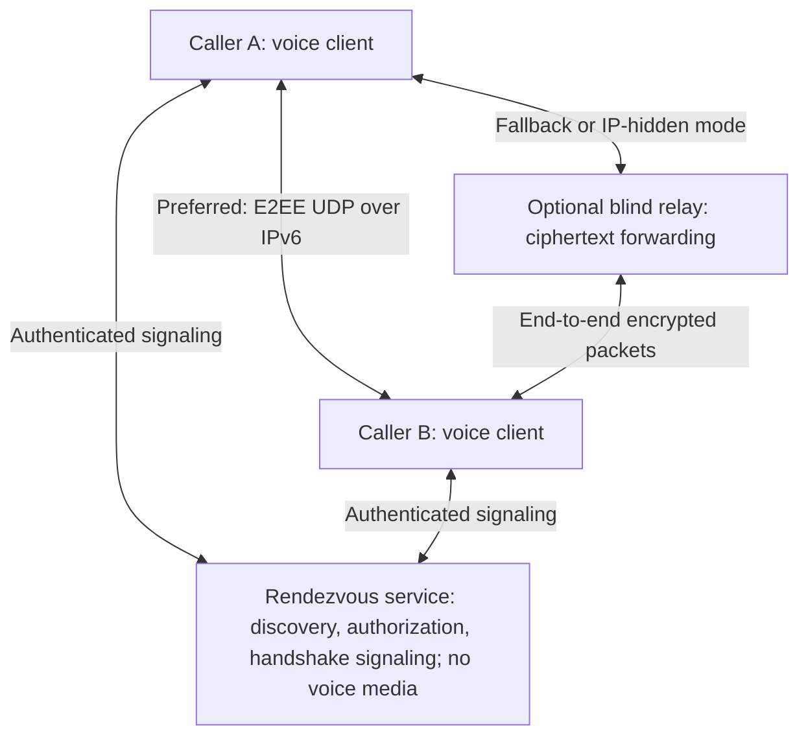
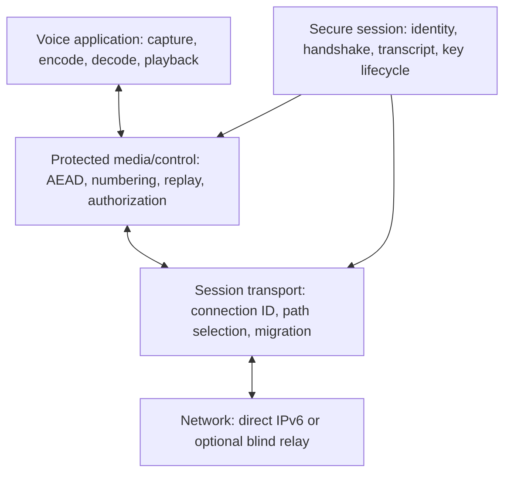
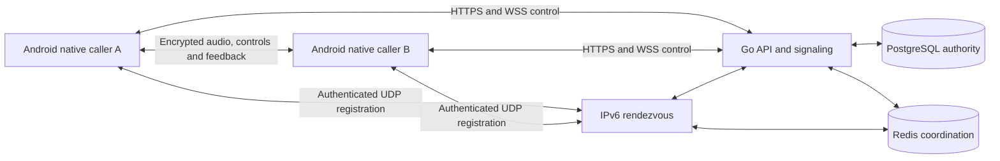

# System architecture

This is the entry point for the Go backend, PostgreSQL and Expo mobile architecture. The separate `frontend-web/` app is deferred. [Flows](flows.md), [protocol](protocol.md), [security](security.md), [deployment](deployment.md), and [decisions](decisions.md) own the detailed specification. [UI design](../../frontend/design.md) remains separate.

## Currently Implemented in Code

The Expo call coordinator exchanges Noise XX handshake messages via backend signaling. The Android voice module uses `Noise_XX_25519_ChaChaPoly_SHA256` to establish separate send and receive cipher states. It encrypts and authenticates audio and peer control datagrams with ChaCha20-Poly1305, then sends those datagrams directly to the other phone over IPv6/UDP. The backend provides authorization, signaling and rendezvous, and is outside the media path. This is partial registered Android calling source. A two-device call is not established by source inspection.

- **Registered accounts and sessions.** Go and Expo source cover Noise IK device enrollment, restricted setup and recovery-code acknowledgement, activation, SecureStore-backed credentials, bootstrap reconciliation, and generation checks around refresh and logout. Account events use a snapshot cursor and a separate one-use stream ticket.
- **Calling.** The native source contains peer-key checks, rendezvous registration, endpoint setup, encrypted datagrams and per-attempt shutdown fencing. Full Calling V2 readiness, replay, recovery, renewal and accounting still require implementation or verification as described in the owning specifications.
- **Integration-test and schema tooling (authorized fresh Docker runs, 2026-11-24; baseline GENERATED).** `cd backend && ./scripts/test-integration-docker.sh` used unique Compose project `ipv6ftp-it-bdfd81111e5c1cbe`, a fresh PostgreSQL container, and applied migrations 001–020 in that disposable environment. The three selected Critical/High tests passed (`selected=3 passed=3`): `TestPostgresRegisteredEnrollment` (including subtests), `TestPostgresAccountEventIsolationAndRollback`, and `TestPostgresEventStreamIsolationReplayAndExpiry`. Teardown removed the container/network; subsequent `docker ps -a` and network query by exact Compose project label found no resources. A separate authorized run under project `ipv6ftp-it-34e102e8acb1d48f` generated `backend/db/schema/baseline.sql` (41,822 bytes, SHA-256 `2c484bf042212151b7da1ab23a55791e993a255f9499ea71e9d30c6523a8703a`) after restore parity passed, with no leftover Docker resources. Scope is limited to these runs: Compose name-collision refusal and interruption cleanup have offline fake-Docker coverage only, not a live signal test. See [deployment](deployment.md) for the fixture boundary and the Android device-testing gate. This tooling does not change production topology.

The [implementation evidence](user-management-evidence.md) records test scope and verification gaps. The [September baseline](current-implementation.md) records the historical WebRTC implementation.

## Target New Flow (To Be Implemented)

Calling V2 adds the full consent, verification, readiness, replay, recovery, renewal, accounting and finalization flows to the direct media path. PostgreSQL owns durable identity, policy, calls and accounting. Go enforces authorization and coordinates operations. Redis is transient. Expo owns consent, local identity and encrypted media. Guest code/link calling belongs to the target. Relay and IP-hidden routing remain deferred.

## 3. Whole-system view

The direct edge is first-delivery scope. Relay edges describe deferred routing. A successful direct call removes the server from the media plane. A relayed call adds forwarding infrastructure while keeping decryption keys at the endpoints.

## 4. Components and responsibilities

| Component | Responsibility | Boundary |
| --- | --- | --- |
| Voice application | Consent, capture, Opus encoding, decoding, playback, call controls | Decoder receives validated voice frames only |
| Identity manager | Store local identity key; verify intended peer key | Server login alone does not authenticate a remote device key |
| Secure session manager | Run authenticated handshake; bind context; install directional keys | Reject identity, transcript, or negotiation failures |
| Media protection layer | AEAD, packet numbers, replay windows | Unauthenticated bytes never become trusted application input |
| Protocol dispatcher | Validate frame types, schemas, and call-state permissions | A valid peer can still send unauthorized or malformed messages |
| Transport manager | Direct path, relay selection, liveness, proposed migration | Address reachability is not identity proof |
| Rendezvous | Discovery, authorized joins, handshake forwarding, permitted metadata | No voice media or media decryption keys |
| Blind relay | Forward protected packets for authorized participants | Cannot decrypt; can observe metadata and disrupt forwarding |
| Host/network controls | Firewall, minimal listening ports, resource/rate limits | Complement application authentication |

These client components are a logical decomposition, not prescribed packages or services. Jitter buffering, congestion handling, detailed migration, and cleanup are proposed completions.

## 5. Logical layers

Session establishment provides keys before media starts; it is not repeated for every voice frame.

## 6. Control and media planes

**Control plane:** discovery, admission, consent, handshake signaling, and permitted connectivity metadata. V2 selects HTTPS API authorization, ticketed WSS setup, authenticated UDP rendezvous and protected peer controls. Semantic operations still require exact endpoint/message schemas. No voice decryption keys are provided to infrastructure.

**Media plane:** Opus frames encrypted by the sender, forwarded directly or through a blind relay, authenticated by the receiver, then decoded. In-band controls such as liveness and call termination are also session-protected.

A room code locates a session. A connection ID selects candidate local protocol state. An authenticated identity key establishes which peer is participating. Neither identifier alone authorizes processing.

## 7. Data ownership

| Data | Endpoint ownership | Infrastructure exposure |
| --- | --- | --- |
| Private identity key | Local durable secret; platform-backed storage | Never uploaded |
| Peer public verification material | V2 full-fingerprint independent link/QR comparison and remembered device-key checks | Directory distribution alone does not establish intended-peer trust |
| Ephemeral secrets and traffic keys | Transient session state | Never sent to rendezvous or relay |
| Room/session ID and membership | Endpoints and rendezvous | Visible as needed for coordination |
| Direct IPv6 endpoint | Disclosed to peer in normal direct mode | May appear in signaling; excluded from peer-facing IP-hidden setup |
| Plaintext/encoded voice | Participating endpoints | Never intentionally exposed to infrastructure |
| Encrypted packets and clear headers | Endpoints and selected path | Relay/network observers can see ciphertext and metadata |
| Counters and replay windows | Per session, direction, and proposed key epoch | Local trusted state; unauthenticated packets cannot advance it |
| Logs and metrics | Minimal operational records proposed | Retention and access policy remain open |

The notes do not select a database, identity provider, storage schema, or logging backend.

## 8. Routing policy

| Situation | Target behavior |
| --- | --- |
| Normal mode; authenticated session; usable IPv6 path | Direct encrypted media |
| Normal mode; direct path unavailable | Configured blind relay with the same peer-authentication requirements |
| IP-hidden mode selected before setup | Relay-only negotiation; no direct metadata disclosure or probes |
| Required relay unavailable | Fail clearly without weakening privacy policy |
| Established path fails | Proposed bounded recovery using a validated permitted path, or termination |
| Multi-hop requested | Unsupported until a specific routing protocol and threat model are selected |

IP-hidden means hiding the media endpoint from the other caller under a correctly enforced policy. It does not imply anonymity from infrastructure or network observers. See [security.md](security.md).

## 9. Primary media pipeline

`Microphone -> capture -> Opus -> numbered frame -> AEAD -> UDP/IPv6 -> bounds checks -> session lookup -> AEAD verification -> replay checks -> frame/state authorization -> Opus decode -> speaker`

A bounded jitter buffer between validation and decoding is proposed to handle timing and reordering. Both directions run independently with separate traffic keys and receive state.

Detailed behavior appears in [flows.md](flows.md), packet/state contracts in [protocol.md](protocol.md), operational guidance in [deployment.md](deployment.md), and remaining work in [decisions.md](decisions.md).

## Calling V2

### 1. Scope and architecture

#### First delivery

- Expo/React Native UI with a custom Android native voice module; Go control backend.
- PostgreSQL for authoritative records; Redis for temporary tickets, coordination, notifications, presence, and rate limits.
- Two-party, direct IPv6 UDP voice for registered users and authenticated guests.
- Native Android capture/playback with proposed bundled libopus; no WebRTC media dependency in this design.
- Direct invitations for registered users while apps are connected; code/link invitations for guests and registered users.
- Endpoint-only media keys and audio. Protected peer feedback, FEC, and liveness use the direct path.

#### Outside first delivery

IPv4 blind relay, IP-hidden routing, background/closed-app incoming ringing, arbitrary file transfer, video, groups, recording, iOS native implementation, and the deferred web application. IPv6/UDP failure ends the current direct-only flow clearly; do not silently downgrade. A future blind relay forwards ciphertext without media keys and needs its own route authorization and policy design.

The service is independent of the media forwarding path, not fully serverless: invitations, discovery, short authorization leases, revocation, and one-phone policy depend on infrastructure. A backend cannot instantly stop two uncooperative endpoints that already hold direct-call keys. An outsider may capture encrypted packets and observe IPs, sizes and timing; the goal is to prevent intelligible audio disclosure and acceptance of forged/replayed operations, assuming uncompromised endpoints and correct peer verification.

## Session V2

### 1. Scope and boundaries

Registered users and unregistered guests both use backend-authenticated device sessions. A guest lacks registered login credentials but is not an unauthenticated protected-API caller. Account type changes permissions and allowance, never cryptographic strength. Authentication establishes authorized account/device access, not verified real-world human identity or intended-peer trust.

Initial delivery targets the Expo Android app and Go/PostgreSQL/Redis backend. Calling initially supports direct IPv6 under calling V2. IPv4 allowance is defined but inactive until the route is implemented and authorized. FTP, multiple account profiles per device, iOS native implementation, and web remain deferred. Do not treat an unimplemented feature as an available guest service.

Email/password, OAuth/OIDC provider choices, verification and registered account recovery belong to a separate login module. That module supplies a backend-validated authentication result, not a client assertion or email string. Registered recovery-code direction from calling V2 remains separate from the explicit decision to omit guest recovery codes.

Go owns business rules, permissions and durable transitions. UI presents validated projections and submits typed intents. Native components must still protect keys, perform possession/peer proofs, validate packets, process audio, enforce deadlines and stop locally. A ban on client loops/conditions is not part of this architecture. Server actions are a finite versioned allowlist, never executable code or instructions overriding local consent/safety. Keys and plaintext media never move to the server to simplify the UI.

### 3. Ownership and conceptual records

| Owner | Records/responsibility |
| --- | --- |
| PostgreSQL | Principals, login credential references/hashes, enrolled devices, active bindings/generations, auth sessions, refresh lineage/status, allowance/usage/reservations, policy versions, reminder state, critical audit and outbox |
| Redis | Temporary purpose-bound operation tickets/results, bounded rate counters, presence, shared readiness/socket routing, notifications and non-authoritative caches |
| Native storage | Protected device secrets, versioned token bundle and separately scoped peer trust |
| UI memory/cache | Display projection, pending user input and connection state; no authorization authority |

Proposed logical records include a recognition association and period/service allowance bucket independent of guest principal; enrollment/operation records with bounded lifetime; session issuance/absolute expiry/revocation; and revisioned policy/reminder/outbox entries. This is a conceptual model, not executable schema or permission to alter historical migrations.

Recognition buckets carry restrictions across associated guest enrollments. They do not confer access to another principal. Minimize metadata returned during recognition; never disclose an old guest UUID, history, credentials or trust merely because a device signal matches. Registered allowance follows the authenticated account. Account conversion's entitlement mapping remains explicit prerequisite work.
